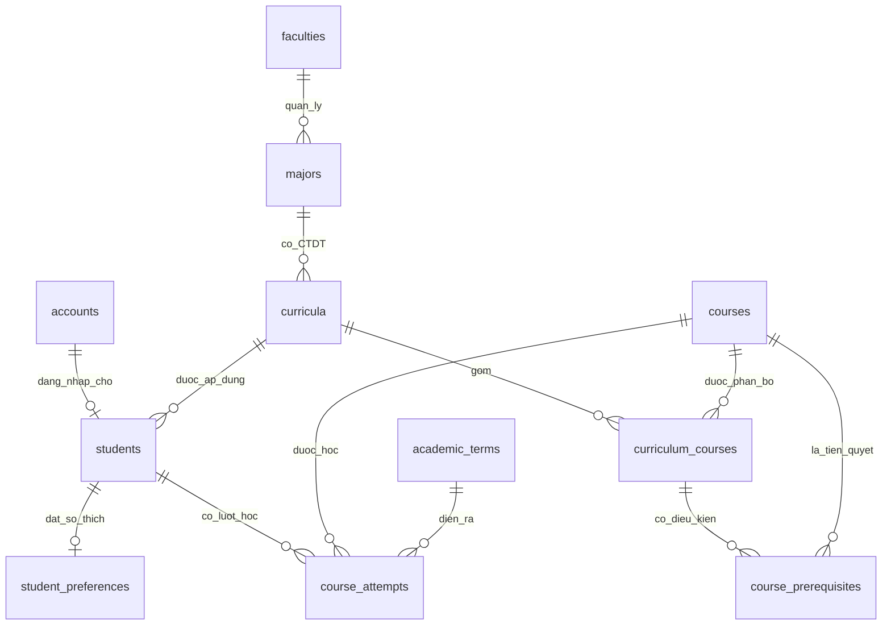
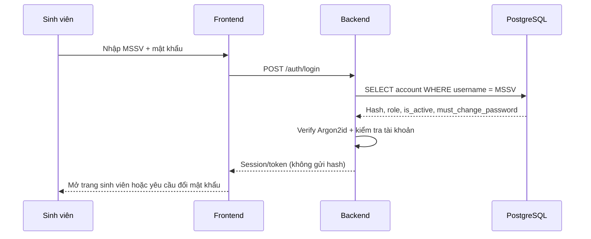

# TÀI LIỆU THIẾT KẾ CƠ SỞ DỮ LIỆU AI-07

**Đề tài:** Explainable Course Recommender — Hệ thống gợi ý học phần có giải thích  
**Ngữ cảnh:** Mô phỏng cổng thông tin đào tạo HUS (Trường Đại học Khoa học Tự nhiên, ĐHQGHN)  
**Hệ quản trị:** PostgreSQL trên Neon  
**Tên database:** `ai07`  
**Schema:** `public`  
**Bản tài liệu:** 1.1 — giải thích theo script SQL đã cung cấp, ưu tiên `01_ai07_tables_and_data_fixed.sql`  
**Phạm vi hiện tại:** 11 bảng dữ liệu + 2 view; người dùng chính là **sinh viên**.

> **Vị trí trong repo:** tài liệu này được đưa vào repo nguyên văn. Các artifact đi kèm nằm trong cùng thư mục `database/`:
> `sql/00_ai07_schema.sql` (DDL 11 bảng nền + 2 view), `sql/10_official_curricula_2023.sql`
> (nạp 4 CTĐT chính thức 2023), `SCHEMA.md` (ảnh chụp schema thật từ Neon),
> và bộ công cụ Python trong `hus_db/` + `tools/`.

> **Phân biệt dữ liệu:** Đây là **CSDL mẫu (prototype)** dùng để phát triển, kiểm thử và demo AI-07, **không phải dữ liệu sinh viên hoặc bảng điểm chính thức của HUS**. Tên/mã ngành và một số thông tin học phần được tham khảo từ nguồn công khai; hồ sơ sinh viên, điểm số, phân kỳ học, quy tắc tiên quyết và sở thích học tập là **giả lập**. Các chương trình `DEMO-2023` chưa đầy đủ học phần và không được xem là chương trình đào tạo chính thức của khóa 2023.

---

## 1. Hệ thống giải quyết bài toán gì?

Mục tiêu của AI-07 không phải thay thế toàn bộ cổng đào tạo của trường. Ta xây dựng **một lớp dữ liệu đào tạo thu nhỏ** nhằm hỗ trợ hai nhóm chức năng:

1. **Tra cứu thông tin sinh viên:** đăng nhập bằng mã sinh viên (MSSV), đổi mật khẩu, xem ngành/khóa, xem học phần và bảng điểm sẵn có.
2. **Gợi ý học phần có giải thích:** dựa vào chương trình đào tạo, các học phần đã học, điều kiện tiên quyết, mục tiêu và sở thích; xếp hạng các môn phù hợp; giải thích tại sao môn được/không được gợi ý và thử thay đổi trọng số (what-if).

Ở giai đoạn hiện tại, **admin và giảng viên chưa có màn hình hay quy trình nghiệp vụ**. Bảng tài khoản đã có trường `role` để thuận lợi mở rộng sau này.

### 1.1. Ví dụ xuyên suốt

Sinh viên giả lập có MSSV `99000005`:

- Đăng nhập với tên đăng nhập `99000005` và mật khẩu demo (mật khẩu được lưu trong CSDL **dưới dạng hash**).
- Thuộc ngành **Khoa học dữ liệu**, chương trình `DEMO-2023`.
- Đã có điểm của một số môn như `MAT2323` (Xác suất - Thống kê), `MAT3507` (Cơ sở dữ liệu), `MAT1202` (Lập trình hướng đối tượng).
- Đặt mục tiêu quan tâm đến `data-science`, `machine-learning`, `ai`.
- Hệ thống tìm các môn thuộc chương trình nhưng chưa đạt, kiểm tra tiên quyết, sau đó mới chấm điểm và giải thích gợi ý.

**Điểm cần nhớ:** Dữ liệu này cho thuật toán *đầu vào*; PostgreSQL **chưa tự chứa một recommender engine hoàn chỉnh**.

---

## 2. Kiến trúc tổng thể

```text
                         ỨNG DỤNG WEB (FRONTEND)
                Đăng nhập | Bảng điểm | Gợi ý | What-if
                                     |
                                     v
                           BACKEND (Node/Python)
             +-----------------------+-----------------------+
             |                       |                       |
        Authentication          Student Service        Recommender Service
         / Account               / Transcript            Rules -> Ranking
             |                       |                       |
             +-----------------------+-----------------------+
                                     |
                           PostgreSQL trên Neon
                            Database = ai07
                            Schema   = public
                                     |
         +---------------------------+---------------------------+
         |                           |                           |
    Catalog đào tạo            Người dùng/điểm            Cấu hình gợi ý
  faculty/major/course        account/student/term         student_preferences
  curriculum/prereq           course_attempts
```

**Database** lưu dữ liệu và ràng buộc. **Backend** thực hiện xác thực mật khẩu, kiểm tra ai được xem bản ghi nào, tính GPA theo quy chế, đánh giá tiên quyết, xếp hạng, tạo lời giải thích và xử lý what-if. **Frontend** hiển thị kết quả. Không đưa mật khẩu hoặc chuỗi kết nối Neon trực tiếp vào frontend.

### 2.1. Database, schema, table khác nhau thế nào?

```text
Neon project: SE_Project
└── Database: ai07            <-- chọn trong SQL Editor
    └── Schema: public        <-- chứa toàn bộ bảng
        ├── faculties
        ├── majors
        ├── curricula
        ├── courses
        ├── curriculum_courses
        ├── course_prerequisites
        ├── academic_terms
        ├── accounts
        ├── students
        ├── course_attempts
        ├── student_preferences
        ├── v_students_profile       (VIEW)
        └── v_student_transcript     (VIEW)
```

Ví dụ: `SELECT * FROM public.students;` khi đã kết nối vào database `ai07`. Không dùng `ai07.students` nếu `ai07` là **tên database**, không phải tên schema.

---

## 3. Tổng quan các bảng và lý do cần chúng

| STT | Bảng | Ý nghĩa ngắn gọn | Được dùng bởi |
|---:|---|---|---|
| 1 | `faculties` | Danh sách các khoa | Catalog, mở rộng nhiều khoa |
| 2 | `majors` | Ngành đào tạo thuộc khoa | Catalog, hồ sơ sinh viên |
| 3 | `curricula` | Phiên bản chương trình đào tạo của ngành/khóa | Catalog, quy tắc tốt nghiệp |
| 4 | `courses` | Thông tin chung của học phần | Catalog, ranking |
| 5 | `curriculum_courses` | Môn nào nằm trong CTĐT nào | Lọc ứng viên gợi ý |
| 6 | `course_prerequisites` | Điều kiện tiên quyết theo từng CTĐT | Rules, explanation |
| 7 | `academic_terms` | Năm học và học kỳ | Lịch sử học, điểm |
| 8 | `accounts` | Tài khoản đăng nhập, hash mật khẩu, vai trò | Authentication |
| 9 | `students` | Hồ sơ sinh viên và CTĐT đang theo học | Profile |
| 10 | `course_attempts` | Mỗi lần học một môn và kết quả của lần đó | Transcript, rules |
| 11 | `student_preferences` | Mục tiêu, chủ đề, số tín chỉ tối đa, trọng số | Ranking, what-if |

**Hai view (không phải bảng lưu dữ liệu độc lập):**

- `v_students_profile`: nối sinh viên với CTĐT, ngành, khoa để lấy hồ sơ một lần.
- `v_student_transcript`: nối từng lần học với môn, học kỳ và sinh viên để hiển thị bảng điểm.

---

## 4. Sơ đồ quan hệ (ERD)



### 4.1. Đọc ký hiệu

- **1–N:** một khoa có nhiều ngành; một sinh viên có nhiều lượt học.
- **1–0..1:** một tài khoản có thể có **tối đa một** hồ sơ sinh viên; sinh viên có thể có **tối đa một** bản sở thích trong thiết kế hiện tại.
- **N–N qua bảng trung gian:** một học phần có thể có mặt trong nhiều CTĐT, một CTĐT có nhiều học phần. Bảng `curriculum_courses` giải quyết quan hệ này.

### 4.2. PK, FK, UNIQUE và CHECK là gì?

- **PK (Primary Key):** định danh duy nhất một dòng, ví dụ `students.student_code`.
- **FK (Foreign Key):** đảm bảo dữ liệu liên kết tồn tại, ví dụ `students.curriculum_id` tham chiếu `curricula.curriculum_id`.
- **UNIQUE:** không cho trùng giá trị/tổ hợp giá trị, ví dụ `(cohort_year, semester)` không áp dụng ở đây; thay vào đó `academic_terms` sử dụng `(academic_year_start, semester)`.
- **CHECK:** ràng buộc giá trị hợp lệ, ví dụ `courses.credits BETWEEN 1 AND 30`.
- **ON DELETE CASCADE:** xóa dữ liệu liên quan cùng bản ghi cha tại một số quan hệ được khai báo; **không mặc định xuất hiện ở mọi FK**.

---

## 5. Giải thích chi tiết từng bảng

### 5.1. `faculties` — Khoa

**Vì sao cần:** không nên viết cứng bốn ngành thuộc một khoa vào code. Bảng khoa giúp mai sau thêm Khoa Vật lý, Hóa học... mà không cần thay thiết kế.

| Cột | Kiểu | Ý nghĩa |
|---|---|---|
| `faculty_code` | `TEXT` — **PK** | Mã khoa nội bộ, ví dụ `MIM` |
| `faculty_name` | `TEXT NOT NULL` | Tên khoa |
| `created_at` | `TIMESTAMPTZ` | Thời điểm tạo bản ghi, mặc định `now()` |

Ví dụ: `('MIM', 'Khoa Toán - Cơ - Tin học')`. `MIM` là mã được dùng trong bản demo; **không mặc định khẳng định đây là mã quản lý chính thức do HUS cấp**.

### 5.2. `majors` — Ngành đào tạo

| Cột | Kiểu | Ý nghĩa |
|---|---|---|
| `major_code` | `TEXT` — **PK** | Mã ngành đào tạo, **không phải ID số thứ tự** |
| `faculty_code` | `TEXT` — FK → `faculties` | Ngành thuộc khoa nào |
| `major_name` | `TEXT NOT NULL` | Tên ngành |
| `admission_code` | `TEXT` | Mã xét tuyển — khác mã ngành đào tạo |
| `is_active` | `BOOLEAN` | Ngành còn được sử dụng không |

Bản demo khởi tạo bốn ngành:

| `major_code` | `major_name` | `admission_code` |
|---|---|---|
| `7460101` | Toán học | `QHT01` |
| `7460117` | Toán tin | `QHT02` |
| `7460108` | Khoa học dữ liệu | `QHT93` |
| `7480113QTD` | Khoa học máy tính và thông tin | `QHT98` |

**Tại sao mã ngành là `TEXT`?** Một số mã có ký tự chữ (như `7480113QTD`), vì vậy không thể lưu an toàn bằng kiểu số nguyên.

**Ràng buộc:** không để hai ngành cùng tên trùng nhau trong cùng khoa: `UNIQUE(faculty_code, major_name)`.

### 5.3. `curricula` — Chương trình đào tạo (CTĐT)

**Phân biệt:** `majors` cho biết *ngành gì*, còn `curricula` cho biết *ngành đó, khóa đó, áp dụng bộ môn học/quy tắc nào*.

| Cột | Kiểu | Ý nghĩa |
|---|---|---|
| `curriculum_id` | `BIGINT IDENTITY` — **PK** | ID nội bộ của CTĐT, DB tự cấp |
| `major_code` | `TEXT` — FK → `majors` | Ngành sở hữu CTĐT |
| `curriculum_version` | `TEXT` | Phiên bản, ví dụ `DEMO-2023` |
| `cohort_year` | `INTEGER` | Năm tuyển sinh/khóa áp dụng |
| `credits_required` | `SMALLINT` | Tổng số tín chỉ mục tiêu được khai báo |
| `official_source_url` | `TEXT` | Link nguồn chương trình học |
| `note` | `TEXT` | Ghi chú về phạm vi và tính chính thức |

Ví dụ: ngành `7460108` có CTĐT `DEMO-2023` với `cohort_year = 2023`. Nếu khoa thay đổi CTĐT vào khóa 2027, thêm **dòng `curricula` mới**, không sửa đè quy định của khóa cũ.

**Ràng buộc:** `UNIQUE(major_code, curriculum_version, cohort_year)`.

**Cảnh báo:** `credits_required` trong seed là giá trị tham khảo, còn tập môn `curriculum_courses` hiện **chưa chứa đầy đủ các học phần**. Không lấy tổng tín chỉ hiện có trong seed để kết luận sinh viên đã hoàn thành bao nhiêu phần trăm chương trình thật.

### 5.4. `courses` — Danh mục học phần toàn hệ thống

| Cột | Kiểu | Ý nghĩa |
|---|---|---|
| `course_code` | `TEXT` — **PK** | Mã học phần, ví dụ `MAT3514` |
| `course_name` | `TEXT NOT NULL` | Tên học phần |
| `credits` | `SMALLINT` | Số tín chỉ (1–30) |
| `difficulty_level` | `SMALLINT` | Độ khó **giả lập** từ 1 đến 5 |
| `topics` | `TEXT[]` | Danh sách chủ đề như `ai`, `database`, `math` |
| `description` | `TEXT` | Mô tả học phần (có thể rỗng) |
| `is_active` | `BOOLEAN` | Học phần còn được sử dụng không |

Ví dụ:

```text
course_code      = MAT3514
course_name      = Cấu trúc dữ liệu và thuật toán
credits          = 4
difficulty_level = 3
topics           = {algorithms,programming}
```

`topics` và `difficulty_level` là **metadata do nhóm gắn để phục vụ AI-07**, không phải dữ liệu xác nhận từ HUS. Các tag nên chuẩn hóa từ một từ điển thống nhất, ví dụ tránh dùng lẫn `AI`, `ai`, `artificial_intelligence`.

**Tại sao không có `major_code` trong `courses`?** Cùng một môn có thể nằm trong nhiều ngành. Việc môn thuộc ngành nào nằm ở `curriculum_courses`.

### 5.5. `curriculum_courses` — Các môn trong từng CTĐT

Đây là **bảng liên kết N–N** giữa `curricula` và `courses`, đồng thời chứa thông tin áp dụng cho chương trình cụ thể.

| Cột | Kiểu | Ý nghĩa |
|---|---|---|
| `curriculum_id` | `BIGINT` — PK kép, FK → `curricula` | Chương trình đào tạo |
| `course_code` | `TEXT` — PK kép, FK → `courses` | Mã học phần |
| `course_type` | `TEXT` | `required`, `elective` hoặc `thesis` |
| `suggested_semester` | `SMALLINT` | Học kỳ **gợi ý giả lập** (1–8) |
| `course_group` | `TEXT` | Nhãn nhóm tự chọn/chuyên đề (đang để trống trong seed) |

**Ví dụ:** `MAT3514` có thể được liệt kê trong CTĐT Toán tin, Khoa học dữ liệu và Khoa học máy tính; vẫn chỉ tồn tại **một dòng** trong `courses` nhưng có **nhiều dòng** trong `curriculum_courses`.

- `required`: môn bắt buộc (theo dữ liệu demo).
- `elective`: môn tự chọn (theo dữ liệu demo).
- `thesis`: nhóm học phần dạng khóa luận (kiểu dữ liệu hỗ trợ nhưng seed chưa sử dụng).

**Khóa chính kép:** `(curriculum_id, course_code)` ngăn cùng môn lặp hai lần trong một CTĐT.

**Giới hạn hiện tại:** bảng chưa mô tả đầy đủ việc "chọn tối thiểu X tín chỉ trong nhóm A"; `course_group` mới chỉ là nhãn, muốn kiểm tra điều kiện tốt nghiệp thật phải mở rộng mô hình nhóm học phần và quy định số tín chỉ tối thiểu.

### 5.6. `course_prerequisites` — Điều kiện tiên quyết

| Cột | Kiểu | Ý nghĩa |
|---|---|---|
| `curriculum_id` | `BIGINT` | Điều kiện được áp dụng cho CTĐT nào |
| `course_code` | `TEXT` | Môn muốn đăng ký/học |
| `group_no` | `SMALLINT` | Số nhóm điều kiện (>= 1) |
| `prerequisite_course_code` | `TEXT` | Mã môn cần học đạt trước đó |

**Khóa chính:** `(curriculum_id, course_code, group_no, prerequisite_course_code)`.

**Điều kiện ngoại:** `(curriculum_id, course_code)` phải tồn tại trong `curriculum_courses`; mã môn tiên quyết phải tồn tại trong `courses`; không cho môn tự làm tiên quyết trực tiếp của chính nó.

#### AND/OR được biểu diễn thế nào?

Quy tắc của **script hiện tại**:

- **Các dòng cùng `group_no` là OR:** đạt **ít nhất một** môn trong nhóm.
- **Các nhóm `group_no` khác nhau là AND:** phải thỏa **tất cả các nhóm**.

Ví dụ môn X yêu cầu `(A OR B) AND C`:

| `course_code` | `group_no` | `prerequisite_course_code` |
|---|---:|---|
| X | 1 | A |
| X | 1 | B |
| X | 2 | C |

Nếu sinh viên đã đạt A và C thì được qua bước kiểm tra tiên quyết; chỉ đạt B mà chưa đạt C thì chưa đủ. Backend phải thực hiện phép đánh giá nhóm này.

**Lưu ý giới hạn thiết kế:** bảng không tự kiểm tra chu trình A → B → A; cũng chưa bắt buộc môn tiên quyết phải thuộc cùng CTĐT (FK chỉ kiểm tra nó có tồn tại trong `courses`). Các quy tắc demo không nên mặc nhiên xem là quy định học vụ chính thức.

### 5.7. `academic_terms` — Học kỳ

| Cột | Kiểu | Ý nghĩa |
|---|---|---|
| `term_id` | `BIGINT IDENTITY` — **PK** | ID kỳ học |
| `academic_year_start` | `INTEGER` | Năm bắt đầu năm học, ví dụ `2024` |
| `semester` | `SMALLINT` | Học kỳ `1`, `2` hoặc `3` |

Ví dụ `(academic_year_start=2024, semester=2)` biểu diễn học kỳ 2 của **năm học bắt đầu 2024**, không phải một ngày tháng cụ thể. Tổ hợp `(academic_year_start, semester)` là duy nhất.

Hiện chưa lưu ngày bắt đầu/kết thúc đăng ký, lịch học hay lịch thi; có thể bổ sung khi mở rộng hệ thống đăng ký tín chỉ.

### 5.8. `accounts` — Tài khoản và mật khẩu

| Cột | Kiểu | Ý nghĩa |
|---|---|---|
| `username` | `TEXT` — **PK** | Tên đăng nhập, **bằng MSSV** đối với sinh viên |
| `password_hash` | `TEXT` | Chuỗi hash mật khẩu Argon2id |
| `role` | `TEXT` | `student`, `teacher`, `admin` |
| `must_change_password` | `BOOLEAN` | Có bắt đổi mật khẩu khi đăng nhập không |
| `is_active` | `BOOLEAN` | Khóa/mở tài khoản |
| `password_changed_at` | `TIMESTAMPTZ` | Lần đổi mật khẩu gần nhất |
| `created_at` | `TIMESTAMPTZ` | Ngày tạo |

**Tài khoản do trường cấp:** hệ thống được phép tạo mật khẩu khởi tạo riêng cho sinh viên hoặc tạo luồng kích hoạt tài khoản. Backend hash mật khẩu trước khi lưu, đánh dấu `must_change_password=true`. Khi đổi mật khẩu, backend kiểm tra mật khẩu cũ, hash mật khẩu mới, cập nhật `password_changed_at` và chuyển `must_change_password=false`.

**Tuyệt đối không lưu mật khẩu gốc vào một cột SQL khác hoặc trả hash về trình duyệt.** Bản demo sử dụng cùng một mật khẩu để tiện thử nghiệm, **không được đưa cách này vào môi trường thật**. Hashing và kiểm tra mật khẩu diễn ra ở backend (PostgreSQL chỉ lưu hash).

`role` đã dự trù teacher/admin, nhưng **chưa có bảng hồ sơ giáo viên, phân công giảng dạy, phân quyền quản trị chi tiết hay giao diện quản trị**. Đồng thời, FK từ `students` sang `accounts` **chưa tự kiểm tra `role='student'`**; backend phải kiểm soát hoặc sau này bổ sung ràng buộc thích hợp.

### 5.9. `students` — Hồ sơ sinh viên

| Cột | Kiểu | Ý nghĩa |
|---|---|---|
| `student_code` | `TEXT` — **PK**, FK → `accounts.username` | MSSV, chính là username |
| `full_name` | `TEXT NOT NULL` | Họ tên sinh viên |
| `curriculum_id` | `BIGINT` — FK → `curricula` | Sinh viên học theo CTĐT nào |
| `admitted_year` | `INTEGER` | Năm nhập học |
| `student_status` | `TEXT` | `studying`, `paused`, `graduated`, `withdrawn` |
| `last_transcript_synced_at` | `TIMESTAMPTZ NULL`, không có default | Thời điểm đồng bộ bảng điểm thành công gần nhất; `NULL` nếu chưa đồng bộ |
| `created_at` | `TIMESTAMPTZ` | Ngày tạo hồ sơ |

Ví dụ: `students.student_code='99000005'` liên kết tài khoản cùng username `'99000005'`; trường `curriculum_id` dẫn tới CTĐT Khoa học dữ liệu `DEMO-2023`.

**Tại sao không lưu thêm `major_code` trong `students`?** Ngành đã xác định được qua `students.curriculum_id → curricula.major_code → majors`. Lưu lại `major_code` trong `students` sẽ dễ sinh lệch dữ liệu khi sinh viên chuyển CTĐT.

**Lưu ý khi nâng cấp:** mô hình một `curriculum_id` tại mỗi thời điểm chưa lưu **lịch sử chuyển ngành/chuyển chương trình**. Nếu cần, thêm bảng lịch sử phân bổ CTĐT cho sinh viên.

**Thời điểm đồng bộ:** `students.last_transcript_synced_at` lưu timestamp, không
lưu số ngày đã trôi qua. Backend tính tuổi dữ liệu khi cần; ngưỡng nhắc cập nhật
(ví dụ 7 ngày) thuộc cấu hình ứng dụng, chưa được triển khai trong runtime.
Chỉ cập nhật timestamp trong cùng transaction hoàn tất lưu bảng điểm, kể cả
khi bảng điểm không đổi. Kết nối, đọc hoặc lưu lỗi thì giữ nguyên timestamp.
Migration `hus_20261023_01` bổ sung cột; luồng portal lưu snapshot riêng, chưa cập nhật cột này.

### 5.10. `course_attempts` — Bảng điểm và từng lượt học

Đây là bảng quan trọng nhất của phần **lịch sử học tập giả lập**. Một sinh viên có thể học cùng một môn nhiều lần; mỗi lần được lưu một dòng.

| Cột | Kiểu | Ý nghĩa |
|---|---|---|
| `attempt_id` | `BIGINT IDENTITY` — **PK** | ID của một lượt học |
| `student_code` | `TEXT` — FK → `students` | Ai học |
| `course_code` | `TEXT` — FK → `courses` | Học môn gì |
| `term_id` | `BIGINT` — FK → `academic_terms` | Học kỳ nào |
| `attempt_no` | `SMALLINT` | Lần học thứ mấy (1, 2,...) |
| `grade_10` | `NUMERIC(4,2)` | Điểm trên thang 10 (nếu có) |
| `grade_4` | `NUMERIC(3,2)` | Điểm trên thang 4 (nếu có) |
| `letter_grade` | `TEXT` | Điểm chữ minh họa (`A`, `B+`, `F`...) |
| `result_status` | `TEXT` | `passed`, `failed`, `in_progress`, `withdrawn` |

Ràng buộc quan trọng:

- Không trùng `(student_code, course_code, attempt_no)`.
- Điểm 10 nằm từ `0` đến `10`; điểm 4 từ `0` đến `4`.
- Nếu `result_status` là `passed` hoặc `failed`, cả hai trường điểm số phải có giá trị.
- Môn chưa hoàn thành có thể có điểm `NULL` (ví dụ `in_progress`).

**Ví dụ học lại từ dữ liệu mẫu:** MSSV `99000006` học `MAT2502` lần 1 ở năm học 2023, kỳ 2: điểm `3.5`, trạng thái `failed`; học lại lần 2 ở năm học 2024, kỳ 1: điểm `6.5`, trạng thái `passed`.

Vì vậy:

- **Không** lấy mọi dòng `course_attempts` rồi cộng tất cả tín chỉ; sẽ cộng trùng môn học lại.
- Khi kiểm tra tiên quyết, thông thường có thể xét **đã tồn tại ít nhất một lượt `passed`** cho môn đó (nếu quy chế yêu cầu khác, sửa rules).
- Khi tính GPA/tín chỉ tốt nghiệp, cần **chọn lần học nào được tính theo quy chế**; bảng hiện lưu dữ liệu thô, không áp đặt quy chế chính thức.

**Điểm khác bảng điểm trong cổng đào tạo thật:** chưa lưu điểm thành phần (chuyên cần, giữa kỳ, cuối kỳ), giảng viên, lớp học phần, lịch thi, loại môn miễn/hoãn/hủy, công nhận tương đương. Có thể thêm ở giai đoạn sau.

### 5.11. `student_preferences` — Mục tiêu và trọng số AI-07

| Cột | Kiểu | Ý nghĩa |
|---|---|---|
| `student_code` | `TEXT` — **PK**, FK → `students` | Mỗi sinh viên tối đa một cấu hình hiện hành |
| `learning_goal` | `TEXT` | Mục tiêu diễn đạt bằng ngôn ngữ tự nhiên |
| `interest_topics` | `TEXT[]` | Tag chủ đề yêu thích |
| `max_credits_per_term` | `SMALLINT` | Ngưỡng tín chỉ do sinh viên ưu tiên, từ 1–40 |
| `weight_goal` | `NUMERIC(3,2)` | Trọng số khớp mục tiêu |
| `weight_progress` | `NUMERIC(3,2)` | Trọng số tiến độ CTĐT |
| `weight_difficulty` | `NUMERIC(3,2)` | Trọng số độ khó/phù hợp năng lực |
| `updated_at` | `TIMESTAMPTZ` | Thời điểm cập nhật |

**Ràng buộc:** mỗi trọng số thuộc `[0,1]` và tổng ba trọng số **bằng `1.00`**.

Ví dụ sinh viên `99000005`:

```text
learning_goal        = Khoa học dữ liệu và học máy
interest_topics      = {data-science,machine-learning,ai}
max_credits_per_term = 18
weight_goal          = 0.60
weight_progress      = 0.30
weight_difficulty    = 0.10
```

**What-if**: nếu sinh viên kéo thanh “Ưu tiên dễ học” lên, frontend có thể gửi một bộ trọng số **tạm thời** cho backend để tính lại xếp hạng; không nhất thiết ghi vào database. Chỉ cập nhật `student_preferences` khi họ bấm “Lưu tùy chọn”.

Không nên hiểu `weight_difficulty=0.10` là “độ khó = 10%”; nó là **mức ảnh hưởng của tiêu chí độ khó trong công thức ranking do nhóm thiết kế**.

---

## 6. Hai view hỗ trợ frontend và API

### 6.1. `v_students_profile`

Tổng hợp các trường như `student_code`, `full_name`, `admitted_year`, `student_status`, `major_code`, `major_name`, `faculty_name`, `curriculum_version`, `cohort_year`.

```sql
SELECT *
FROM public.v_students_profile
WHERE student_code = '99000005';
```

Thay vì viết lại JOIN từ `students`, `curricula`, `majors`, `faculties` mỗi lần truy vấn, backend có thể dùng view.

### 6.2. `v_student_transcript`

Tổng hợp từ `course_attempts`, `students`, `courses`, `academic_terms`. Mỗi dòng trong view ứng với **một lần học**, không nhất thiết là một môn duy nhất.

```sql
SELECT academic_year_start, semester, course_code, course_name,
       credits, attempt_no, grade_10, grade_4, letter_grade, result_status
FROM public.v_student_transcript
WHERE student_code = '99000005'
ORDER BY academic_year_start, semester, course_code, attempt_no;
```

**Quan trọng về bảo mật:** view không tự động “biết” sinh viên nào đang đăng nhập. Backend phải lọc theo **MSSV từ session/token đã xác thực**; không tin hoàn toàn tham số `student_code` do trình duyệt tự gửi. Nếu cho client kết nối trực tiếp, cần thiết kế phân quyền/RLS thích hợp.

---

## 7. Dữ liệu khởi tạo có gì?

| Loại | Số lượng trong script demo | Ghi chú |
|---|---:|---|
| Khoa | 1 | Khoa Toán - Cơ - Tin học (`MIM`, mã nội bộ demo) |
| Ngành | 4 | Toán học, Toán tin, Khoa học dữ liệu, Khoa học máy tính và thông tin |
| Phiên bản CTĐT | 4 | Mỗi ngành một dòng `DEMO-2023` |
| Học phần | 42 | Chỉ là **tập con minh họa**, chưa đủ CTĐT thực tế |
| Mối liên kết CTĐT–học phần | 74 | Có môn dùng chung nhiều ngành |
| Sinh viên | 8 | MSSV `99000001` đến `99000008` |
| Tài khoản | 8 | Chỉ role `student` có dữ liệu seed |
| Lượt học/điểm | 70 | Có ví dụ học lại |
| Học kỳ | 7 | Từ `(2023,1)` đến `(2026,1)` trong seed |
| Cấu hình sở thích | 8 | Mỗi sinh viên một cấu hình |

**Dữ liệu mẫu trong script không đại diện cho số lượng sinh viên, môn học hoặc dữ liệu thực tế của HUS.** Các dòng seed dùng `ON CONFLICT DO NOTHING`, vì vậy chạy lại trên database đã có dữ liệu **không cập nhật bản ghi cũ**.

---

## 8. Luồng nghiệp vụ: từ đăng nhập đến xem điểm

### 8.1. Đăng nhập



**Backend bắt buộc** xử lý: rate limit, kiểm tra hash, từ chối tài khoản khóa, quản lý session/token, quyền xem dữ liệu. Bảng `accounts` đơn thuần chưa tạo sẵn chức năng đăng nhập.

### 8.2. Xem bảng điểm

1. Sinh viên đăng nhập; backend xác định `student_code` từ danh tính đã xác thực.
2. Backend truy vấn `v_student_transcript` theo `student_code` đó.
3. Sắp xếp theo năm học, học kỳ, môn, lần học.
4. Frontend hiển thị điểm; nếu cần điểm tích lũy, backend tính theo chính sách đã định nghĩa.

```sql
SELECT * FROM public.v_student_transcript
WHERE student_code = $1
ORDER BY academic_year_start, semester, course_code, attempt_no;
```

`$1` là tham số SQL, không ghép trực tiếp chuỗi người dùng vào câu SQL.

### 8.3. Đổi mật khẩu

- Xác minh phiên đăng nhập và (khi thích hợp) mật khẩu hiện tại.
- Kiểm tra mật khẩu mới theo chính sách độ dài/độ mạnh.
- Hash mới bằng Argon2id ở backend.
- Cập nhật `accounts.password_hash`, `password_changed_at`, `must_change_password=false`.
- Hủy các phiên cũ khi chính sách bảo mật yêu cầu.

---

## 9. Luồng nghiệp vụ: gợi ý môn học có giải thích

```text
[MSSV đã xác thực]
       |
       v
[students] -> curriculum_id
       |
       v
[curriculum_courses] + [courses] -> Tập môn thuộc chương trình
       |
       v
[course_attempts] -> Loại môn đã đạt (và xử lý môn học lại)
       |
       v
[course_prerequisites] -> Kiểm tra đủ từng nhóm AND/OR
       |
       +---- Chưa đủ -> ghi nhận lý do bị chặn, môn còn thiếu
       |
       v
[student_preferences] -> chấm điểm ưu tiên, xếp hạng
       |
       v
[Danh sách khuyến nghị] + [Lý do] + [What-if]
```

### 9.1. Quy tắc tối thiểu nên hiện thực ở `rules.py` hoặc Rules Service

| Mã quy tắc gợi ý | Kiểm tra | Nguồn dữ liệu |
|---|---|---|
| R1 | Môn thuộc CTĐT hiện tại không? | `students`, `curriculum_courses` |
| R2 | Môn đã được sinh viên học đạt chưa? | `course_attempts` |
| R3 | Sinh viên đã đạt tất cả **nhóm** môn tiên quyết chưa? | `course_prerequisites`, `course_attempts` |
| R4 | Môn hiện còn được sử dụng không? | `courses.is_active` |
| R5 | Tổng số tín chỉ trong tổ hợp đề xuất có vượt ưu tiên không? | `courses.credits`, `student_preferences.max_credits_per_term` |
| R6 | Môn bắt buộc và học kỳ khuyến nghị có nên được ưu tiên? | `curriculum_courses` |

**Cần bổ sung khi có nghiệp vụ thật:** môn tương đương, môn song hành, học kỳ mở lớp, môn đã đăng ký nhưng chưa có điểm, quy định cải thiện điểm, tối thiểu tín chỉ tự chọn, điều kiện tốt nghiệp, tránh tiên quyết vòng.

### 9.2. Ví dụ xếp hạng — công thức minh họa, **chưa được cài trong SQL**

Sau khi lọc tập môn hợp lệ, có thể cho điểm mỗi môn như sau:

\[
S(c) = w_g \cdot \operatorname{GoalMatch}(c)
     + w_p \cdot \operatorname{Progress}(c)
     + w_d \cdot \operatorname{DifficultyFit}(c)
\]

Trong đó ba điểm thành phần được chuẩn hóa về khoảng `[0,1]` và `w_g+w_p+w_d=1`. Các hàm thành phần phải được nhóm thiết kế/kiểm thử, không phải giá trị tự sinh ra từ schema.

- `GoalMatch`: mức khớp giữa `courses.topics` và mục tiêu/chủ đề ưu tiên.
- `Progress`: mức đóng góp vào CTĐT, có thể ưu tiên môn bắt buộc và kỳ khuyến nghị.
- `DifficultyFit`: độ khó môn tương đối phù hợp với sở thích/khả năng sinh viên; **không nên chỉ tự động suy đoán năng lực từ GPA**.

**Giải thích gợi ý:** backend có thể trả: “Môn `MAT3378` phù hợp với chủ đề `data-science`; là môn thuộc CTĐT của bạn; bạn đã đạt `MAT3507` và `MAT1202`, nên đủ điều kiện tiên quyết theo rules demo.” Kiểm tra lại dữ liệu và các điều kiện khác (nếu triển khai) trước khi thực sự đề xuất.

**What-if:** thay `w_g,w_p,w_d` hoặc chủ đề quan tâm, giữ nguyên bảng điểm → tính lại điểm gợi ý, so sánh thay đổi thứ tự, kèm lý do. Mỗi lần thử không nhất thiết phải ghi DB.

---

## 10. Những câu SQL thường dùng

### 10.1. Liệt kê tất cả ngành và CTĐT

```sql
SELECT f.faculty_name, m.major_code, m.major_name, m.admission_code,
       cu.curriculum_id, cu.curriculum_version, cu.cohort_year
FROM public.faculties f
JOIN public.majors m ON m.faculty_code = f.faculty_code
JOIN public.curricula cu ON cu.major_code = m.major_code
ORDER BY m.major_name, cu.cohort_year;
```

### 10.2. Liệt kê các môn theo ngành Khoa học dữ liệu, khóa demo 2023

```sql
SELECT c.course_code, c.course_name, c.credits,
       cc.course_type, cc.suggested_semester, c.topics
FROM public.majors m
JOIN public.curricula cu ON cu.major_code = m.major_code
JOIN public.curriculum_courses cc ON cc.curriculum_id = cu.curriculum_id
JOIN public.courses c ON c.course_code = cc.course_code
WHERE m.major_code = '7460108'
  AND cu.curriculum_version = 'DEMO-2023'
  AND cu.cohort_year = 2023
ORDER BY cc.suggested_semester, c.course_code;
```

### 10.3. Xem các lượt học, kể cả học lại

```sql
SELECT student_code, course_code, attempt_no,
       academic_year_start, semester, grade_10, result_status
FROM public.v_student_transcript
WHERE student_code = '99000006'
  AND course_code = 'MAT2502'
ORDER BY attempt_no;
```

### 10.4. Tìm môn chưa có lượt học **đạt** — mới là tập ứng viên thô

```sql
SELECT c.course_code, c.course_name, c.credits, cc.course_type
FROM public.students s
JOIN public.curriculum_courses cc ON cc.curriculum_id = s.curriculum_id
JOIN public.courses c ON c.course_code = cc.course_code
WHERE s.student_code = '99000005'
  AND c.is_active = TRUE
  AND NOT EXISTS (
      SELECT 1
      FROM public.course_attempts a
      WHERE a.student_code = s.student_code
        AND a.course_code = c.course_code
        AND a.result_status = 'passed'
  )
ORDER BY cc.suggested_semester NULLS LAST, c.course_code;
```

**Chưa thể coi là danh sách đăng ký được ngay:** chưa kiểm tra tiên quyết, lớp có mở không, trùng giờ hay môn đang học.

### 10.5. Xem nhóm tiên quyết của một môn trong CTĐT sinh viên

```sql
SELECT p.course_code, p.group_no,
       p.prerequisite_course_code, pre.course_name AS prerequisite_name
FROM public.students s
JOIN public.course_prerequisites p
  ON p.curriculum_id = s.curriculum_id
JOIN public.courses pre
  ON pre.course_code = p.prerequisite_course_code
WHERE s.student_code = '99000005'
  AND p.course_code = 'MAT3533'
ORDER BY p.group_no, p.prerequisite_course_code;
```

Nếu nhiều dòng có cùng `group_no`, backend hiểu các điều kiện đó là **OR**. Không chỉ dùng một phép JOIN là đã đánh giá xong toàn bộ biểu thức AND/OR.

### 10.6. Kiểm tra nhanh số bản ghi

```sql
SELECT 'faculties' AS table_name, COUNT(*) AS total FROM public.faculties
UNION ALL SELECT 'majors', COUNT(*) FROM public.majors
UNION ALL SELECT 'curricula', COUNT(*) FROM public.curricula
UNION ALL SELECT 'courses', COUNT(*) FROM public.courses
UNION ALL SELECT 'curriculum_courses', COUNT(*) FROM public.curriculum_courses
UNION ALL SELECT 'students', COUNT(*) FROM public.students
UNION ALL SELECT 'course_attempts', COUNT(*) FROM public.course_attempts;
```

---

## 11. Tính nhất quán, chỉ mục (index) và an toàn dữ liệu

### 11.1. Các ràng buộc đã có

- PK/FK chống tham chiếu tới khoa, ngành, CTĐT, môn học, học kỳ không tồn tại.
- UNIQUE chống lặp CTĐT cùng phiên bản/khóa; chống lặp môn trong một CTĐT; chống trùng số lần học cùng môn.
- CHECK giới hạn tín chỉ, điểm 10/điểm 4, trạng thái, loại môn, học kỳ và tổng trọng số preferences.
- Một số FK có `ON DELETE CASCADE` như `curriculum_courses` khi xóa CTĐT, `course_attempts` khi xóa sinh viên. **Cần cân nhắc quy trình xóa và lịch sử học vụ** trước khi vận hành thực tế.

### 11.2. Các chỉ mục đã tạo ngoài PK/UNIQUE

| Index | Cột | Dùng để tối ưu |
|---|---|---|
| `ix_majors_faculty` | `majors(faculty_code)` | Tìm ngành theo khoa |
| `ix_curricula_major` | `curricula(major_code)` | Tìm CTĐT của ngành |
| `ix_curriculum_courses_course` | `curriculum_courses(course_code)` | Truy ngược CTĐT chứa môn |
| `ix_prerequisites_course` | `course_prerequisites(prerequisite_course_code)` | Tra môn phụ thuộc vào một môn |
| `ix_attempts_student_term` | `course_attempts(student_code, term_id)` | Xem điểm theo sinh viên/kỳ |
| `ix_attempts_course` | `course_attempts(course_code)` | Tra các lượt học một môn |

Index giúp truy vấn trên dữ liệu lớn nhưng tốn dung lượng/chi phí ghi; không cần tạo index cho mọi cột.

### 11.3. Việc CSDL **chưa tự làm**

- Chưa có cơ chế RLS hoặc các DB role riêng đảm bảo sinh viên không đọc điểm của người khác bằng SQL trực tiếp.
- Chưa có luật xác nhận `accounts.role='student'` khi tạo hồ sơ sinh viên.
- Chưa có ràng buộc trạng thái `passed` đồng nghĩa một mức điểm tối thiểu cụ thể; quy đổi điểm chưa theo quy chế chính thức.
- Chưa bảo đảm học phần thuộc CTĐT khi ghi `course_attempts` (đôi khi môn tự chọn ngoài CTĐT vẫn hợp lệ).
- Chưa kiểm tra chu trình môn tiên quyết hoặc tiên quyết tồn tại trong CTĐT đó.
- Chưa có trigger tự cập nhật `student_preferences.updated_at` mỗi lần `UPDATE`; backend phải cập nhật rõ ràng hoặc bổ sung trigger.
- Chưa có log chỉnh sửa điểm hoặc nhật ký thay đổi quyền/tài khoản.

Đây là **giới hạn thiết kế đã biết**, không nên mô tả là các chức năng đã hoàn thiện.

### 11.4. Các nguyên tắc triển khai backend

- Sử dụng parameterized queries/ORM chống SQL injection.
- Giữ `DATABASE_URL` ở server và hệ thống quản lý secret, không commit lên GitHub.
- Tài khoản DB dùng cho ứng dụng nên có quyền tối thiểu; quyền cập nhật điểm giới hạn cho dịch vụ quản lý điểm trong giai đoạn nâng cấp.
- Không trả `password_hash` qua API; dùng HTTPS, xác thực session và rate limiting.
- Khi cần xóa dữ liệu cá nhân theo yêu cầu, xác định dữ liệu liên quan, dữ liệu cần giữ theo quy định và tạo quy trình xóa/ẩn danh có kiểm soát; **không mặc định xóa toàn bộ dữ liệu học vụ thật**.

---

## 12. Cách mở rộng trong tương lai

### 12.1. Thêm một khoa và ngành mới

Không cần thay các bảng hiện tại:

1. `INSERT faculties` thêm khoa.
2. `INSERT majors` thêm ngành và liên kết `faculty_code`.
3. `INSERT curricula` thêm CTĐT theo khóa.
4. `INSERT courses` các mã học phần còn thiếu (chỉ thêm môn mới, không nhân bản môn dùng chung).
5. `INSERT curriculum_courses` liên kết học phần vào CTĐT.
6. `INSERT course_prerequisites` thêm điều kiện theo chương trình.

Từ đó mới tạo tài khoản và hồ sơ sinh viên theo CTĐT tương ứng.

### 12.2. Thêm vai trò giảng viên và admin

Bảng `accounts` đã có `role`, nhưng cần thêm các thành phần tùy yêu cầu:

- `teachers`: hồ sơ giảng viên; liên kết tài khoản.
- `course_sections`: lớp học phần mở theo học kỳ, giảng viên và sĩ số.
- `enrollments`: sinh viên đăng ký lớp học phần.
- `grade_components`: điểm thành phần theo quy tắc tính điểm.
- `audit_logs`: ghi nhận ai sửa điểm/hồ sơ và thời điểm.
- Cơ chế phân quyền tại backend (và có thể ở DB) cho từng chức năng.

Không nhất thiết tạo các bảng này ở giai đoạn 1 nếu chỉ cần sinh viên xem điểm và nhận gợi ý.

### 12.3. Nâng cấp recommender

- Chuẩn hóa tag chủ đề thành bảng `topics` và quan hệ `course_topics` nếu danh mục lớn.
- Thêm `student_goals` khi một sinh viên có nhiều mục tiêu riêng.
- Thêm `recommendation_runs` và `recommendation_items` **nếu thật sự cần** lưu lịch sử quyết định/gợi ý để đánh giá và giải thích; giai đoạn đầu có thể tính trực tiếp, không lưu.
- Thiết kế bộ test cho rules, kiểm tra ranking trên nhiều hồ sơ giả lập, đánh giá thiên lệch theo ngành/khóa.
- Thêm quy định CTĐT chính thức theo phiên bản và các chính sách tín chỉ tự chọn, học lại, GPA.

---

## 13. Hướng dẫn triển khai và xử lý lỗi trên Neon

**Trường hợp mới hoàn toàn:**

1. Trong Neon SQL Editor chọn database đang tồn tại (ví dụ `neondb`) và chạy riêng:

   ```sql
   CREATE DATABASE ai07;
   ```

2. Chuyển ô chọn database của SQL Editor sang **`ai07`**.
3. Chạy toàn bộ script **`01_ai07_tables_and_data_fixed.sql`** (bản câu `INSERT students` đã được viết lại dễ đọc hơn). Script này tạo bảng trong `public`, **không tạo/xóa database**.
4. Sau khi chạy thành công, truy vấn:

   ```sql
   SELECT * FROM public.v_students_profile
   WHERE student_code='99000005';
   SELECT * FROM public.v_student_transcript
   WHERE student_code='99000005';
   ```

5. Backend dùng connection string đến database `/ai07`, không phải `/neondb`.

**Nếu hiện `Failed transaction: ROLLBACK required`:**

- Xem **tab `ERROR` của câu lệnh hỏng đầu tiên**, không chỉ thông báo rollback.
- Thực hiện `ROLLBACK;` (hoặc nút ROLLBACK trong Neon) trước khi thử lại.
- Nếu script nằm trong `BEGIN; ... COMMIT;` và chưa commit khi lỗi, toàn bộ thay đổi trong transaction đó bị hủy. Khi đó sửa lỗi rồi chạy lại từ đầu.
- Nếu đã có bảng từ trước, `CREATE TABLE IF NOT EXISTS` không đồng nghĩa schema của bảng cũ giống schema của script mới; cần kiểm tra trước khi seed.

**Không chạy các lệnh `DROP DATABASE neondb` hay `DROP DATABASE neon_db_*` chỉ để sửa lỗi tạo bảng.** Việc xóa database khác là độc lập và có thể làm mất dữ liệu ngoài AI-07.

---

## 14. Checklist kiểm thử CSDL trước khi viết API

- [ ] Kết nối SQL Editor với database đúng tên `ai07`.
- [ ] Có đủ 11 bảng trong schema `public`.
- [ ] Có hai view `v_students_profile`, `v_student_transcript`.
- [ ] Bốn ngành xuất hiện đúng với mã ngành dùng trong seed.
- [ ] Truy vấn hồ sơ MSSV `99000005` trả về ngành Khoa học dữ liệu.
- [ ] Truy vấn bảng điểm `99000006` cho `MAT2502` có hai lượt học, lần hai `passed`.
- [ ] Kiểm tra danh sách môn của CTĐT dùng chung mã môn không trùng trong bảng `courses`.
- [ ] Thử insert `grade_10=11` bị từ chối (chạy trong transaction thử nghiệm và rollback).
- [ ] Thử thêm một ngành thuộc khoa mới mà không phải sửa cấu trúc bảng.
- [ ] Backend chỉ trả bảng điểm của sinh viên từ danh tính đã đăng nhập.
- [ ] Rules xử lý OR **trong nhóm** và AND **giữa các nhóm**.
- [ ] Thay đổi trọng số what-if làm thứ tự ranking thay đổi mà không sửa điểm học tập.

---

## 15. Nguồn đối chiếu học phần và lưu ý học thuật

Trang chương trình đào tạo công khai của HUS (dùng để đối chiếu mã ngành/mã học phần, cần chọn **đúng khóa và phiên bản** nếu đưa vào hệ thống thật):

- [Toán học — HUS](https://tuyensinh.hus.vnu.edu.vn/dai-hoc/nganh-hoc/toan-toan-ung-dung-va-tin-hoc/toan-hoc)
- [Toán tin — HUS](https://tuyensinh.hus.vnu.edu.vn/dai-hoc/nganh-hoc/toan-toan-ung-dung-va-tin-hoc/toan-tin)
- [Khoa học dữ liệu — HUS](https://tuyensinh.hus.vnu.edu.vn/dai-hoc/nganh-hoc/toan-toan-ung-dung-va-tin-hoc/khoa-hoc-du-lieu)
- [Khoa học máy tính và thông tin — HUS](https://tuyensinh.hus.vnu.edu.vn/dai-hoc/nganh-hoc/toan-toan-ung-dung-va-tin-hoc/Khoa-h%E1%BB%8Dc-M%C3%A1y-t%C3%ADnh-v%C3%A0-Th%C3%B4ng-tin)

**Các quy tắc học vụ của trường, thang điểm và việc công nhận môn tiên quyết phải được đối chiếu với tài liệu chính thức trước khi áp dụng thực tế.** Trong AI-07, cách đánh dấu rõ dữ liệu nào là thật/giả lập cũng là một phần của tính minh bạch và khả năng giải thích.

---

## 16. Tóm tắt một trang

- **Khoa → Ngành → CTĐT:** `faculties → majors → curricula`.
- **CTĐT gồm các môn:** `curricula → curriculum_courses → courses`.
- **Môn có điều kiện:** `course_prerequisites` (OR trong nhóm, AND giữa nhóm).
- **Sinh viên đăng nhập:** `accounts.username = students.student_code`.
- **Sinh viên theo CTĐT nào:** `students.curriculum_id`.
- **Sinh viên đã học và được điểm gì:** `course_attempts` liên kết `courses` và `academic_terms`.
- **Sinh viên muốn học theo định hướng gì:** `student_preferences`.
- **UI đọc nhanh hồ sơ/bảng điểm:** hai view `v_students_profile` và `v_student_transcript`.
- **Phần AI chưa có sẵn trong DB:** đánh giá rules, xếp hạng, giải thích, what-if, tính GPA chuẩn trường và xác thực session — xây dựng bằng backend.

**Kết luận:** Đây là cấu trúc vừa đủ cho AI-07 giai đoạn sinh viên, có thể mở rộng thêm khoa/ngành và sau này bổ sung admin/teacher, nhưng **chưa phải một cổng đào tạo đầy đủ như hệ thống chính thức của HUS**.
