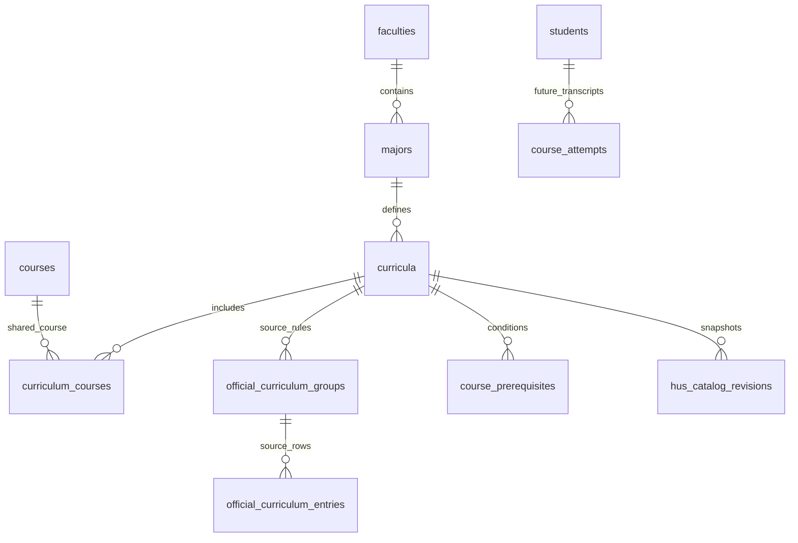

# HUS runtime cutover — 2026-10-17

FastAPI now reads the four active HUS catalogs from `ai07` on Docker
(`127.0.0.1:5433`). The legacy `course_recommender` database and volume remain intact.
Login, transcript persistence, portal synchronization and new recommendation/chat modules
are outside this change. Manual transcripts remain in browser session memory.

## Start or rebuild

Set local Docker credentials in ignored `database/.env.docker` using
`database/.env.example`. Never overwrite an existing credential file.

```powershell
docker compose --env-file database/.env.docker -f database/docker-compose.yml up -d db
.venv/Scripts/python.exe -m database.tools.migrate upgrade
.venv/Scripts/python.exe -m database.tools.publish_catalogs --dry-run
.venv/Scripts/python.exe -m database.tools.publish_catalogs
.venv/Scripts/python.exe -m uvicorn app.main:app --host 127.0.0.1 --port 8000
```

The migration/publisher uses `HUS_DATABASE_URL` (including the local file fallback).
The **application requires `DATABASE_URL`** pointing to that same `ai07` database,
`STORAGE_BACKEND=postgres`, `DATABASE_MODEL=hus`. For offline ranking set
`RECOMMENDATION_LLM_ENABLED=false`. Credentials belong in root `.env`, never frontend code.
Visit <http://127.0.0.1:8000/> and `/ready`.

Do not run root `alembic upgrade head` against HUS: that history belongs to legacy.
Legacy migrations and the raw SQL apply tool reject the migrated HUS runtime.
Compose starts PostgreSQL; it no longer runs the old destructive demo-import SQL.
Never use `docker compose down -v` to restart.

## Source and schema

`data/hus_source.json` is the catalog-only export of the eight existing HUS source
tables. It contains no student records. Stable program IDs are keyed by major,
cohort and curriculum version, with existing API aliases retained.
`hus_db/catalog_builder.py` prepares explicit group/track/graduation rules and
validated metadata 1.0 catalogs before publication; requests never parse source notes.
Source PDF names, pages, rows, prerequisite expressions and duplicate occurrences
remain in the export and snapshot. There are 174 shared courses, 290 curriculum
memberships and 297 source occurrences; catalogs contain 65/67/90/68 courses.

The original 13 tables remain. `curricula` gains `program_id` and `runtime_rules`;
`curriculum_courses` gains applicable credits, total/GPA inclusion, prerequisite
state and structured runtime metadata. `hus_catalog_revisions` stores hashed
snapshots and active pointers; `hus_alembic_version` records independent migrations.
Rules stored as JSONB are validated by the same domain validator used at read time.



Publication validates all four catalogs before any write, remaps numeric IDs through
natural keys, and activates all four in one transaction under an advisory lock.
Repeated imports reuse content hashes. Invalid bundles preserve active versions.
Removing existing source relationships requires explicit review and is rejected.
Historical snapshots are retained; the publisher never overwrites their payloads.
Readiness checks migration head `hus_20261017_02`, exactly four active catalogs,
identity, hashes and domain rules. There is no automatic legacy/JSON fallback.

The catalogs remain **draft_unverified**. Missing/complex/conflicting prerequisite
conditions block the affected courses. Default source difficulty `2` is preserved
as raw provenance only; runtime advisory metadata stays unknown. No PDF review or
academic-policy certification is implied by a successful import.

## Rollback

Application rollback: stop the HUS app, set `DATABASE_MODEL=legacy` and restore
the old `DATABASE_URL` from the ignored backup
`backups/hus_cutover_20261017/environment.legacy`. Start `se_recommender_db` if needed
and restart Uvicorn; verify `/ready`. Keep all passwords private.
Restore `DATABASE_MODEL=hus` and the `ai07` URL to return to HUS.
There is no need to downgrade or delete either database.

Per-program catalog rollback (previously published versions only):

```powershell
python -m database.tools.publish_catalogs --activate PROGRAM_ID REVISION_HASH
```

This only changes the active snapshot pointer; current source projections remain
available for inspection. Publishing a complete bundle activates all four together.

## Verified local acceptance

- Both pre-migration databases backed up with `pg_dump -Fc`, restored into temporary
  databases, and compared by every table's count/content digest: 13 HUS / 16 legacy tables.
- Existing HUS baseline adopted after structural comparison; fresh database migration
  and publication verified separately in a disposable database.
- All original HUS source rows/relationships and legacy table hashes preserved.
- Repeated publication stays at four revisions; invalid source rejected; historical
  activation and corrupt-content rejection tested in a disposable database.
- Accounts, students and course attempts remain empty. `/profiles` returns `[]`;
  individual profile endpoints return 404. No unauthenticated student-table exposure.
- Four real HTTP API flows verified: courses, summary/GPA, eligibility,
  recommendations and What-if. Unknown prerequisites never entered eligible results.
- Headless installed Chrome: all four majors, manual grades/GPA/credits, eligibility,
  recommendations, empty profiles and major-switch transcript/chat reset passed.
- HUS restart preserved catalogs. Legacy application rollback started successfully
  on port 18001 with its original four catalogs and twelve demo profiles.
- Regression: **173 passed, 10 skipped**. Skips require separately reviewed source
  catalogs/PDF acceptance data; these are not replaced by the HUS SQL export.
  One existing Starlette/httpx deprecation warning. Ruff, JS syntax and diff checks passed.

Local evidence and backups (ignored by Git): `backups/hus_cutover_20261017/`, including
`backup_evidence.json`, `runtime_evidence.json`, `browser_evidence.json`, `browser.png`,
the two custom-format dumps and the original local environment.
