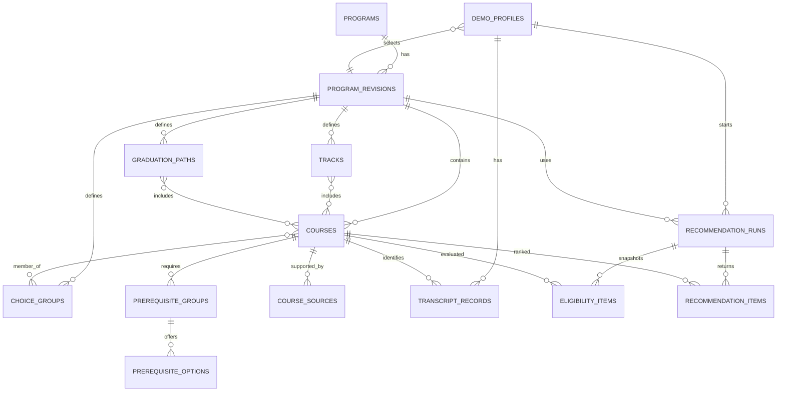
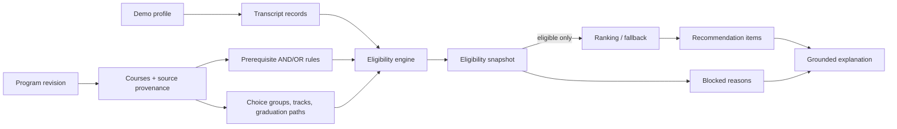

# Thiết kế database cho pipeline hiện hành

Quyết định cập nhật ngày 2026-10-14: PostgreSQL là storage runtime mặc định theo yêu cầu người dùng. **Phần 8 mô tả schema đã triển khai và kiểm chứng.** Các phần 3–6 giữ mô hình mở rộng tham khảo, bao gồm audit recommendation chưa triển khai trong đợt nền tảng này.

## 1. Kết luận

Đã kiểm tra trực tiếp schema PostgreSQL cũ `cced58321476` trong database `course_recommender`. Container `se_recommender_db` và volume `se_recommender_pgdata` phù hợp để dùng lại; các bảng cũ cần thay.

Các vấn đề chính:

1. Quan hệ course/prerequisite/transcript dùng course_code ở nhiều nơi nên không bảo đảm foreign key và dễ trộn cùng một mã môn giữa các ngành.
2. course_prerequisites chỉ có clause_index, chưa biểu diễn chặt cấu trúc AND giữa các nhóm và OR trong một nhóm.
3. choice_group_ids và các rule quan trọng nằm trong JSON, nên database không kiểm tra được membership và quota.
4. Không có catalog revision bất biến để tái lập eligibility/recommendation sau khi dữ liệu nguồn thay đổi.
5. enrollments thiếu liên kết tới course thuộc đúng catalog và thiếu ràng buộc trạng thái/điểm đạt.
6. recommendation_runs không lưu preference đã chuẩn hóa, tập eligibility, lý do bị chặn, phiên bản ranking và trạng thái fallback.
7. recommendation_items không có foreign key tới course và explanation chưa gắn chặt với facts đã tính.
8. students/student_preferences tạo cảm giác có dữ liệu sinh viên lâu dài, trong khi demo chỉ có 12 profile tổng hợp và chat là session-scoped.

Schema cũ có 4 ngành, 20 nhóm, 290 môn và 410 bản ghi prerequisite; students/enrollments/preferences/recommendation đều rỗng. Đã sao lưu custom-format vào `backups/se_project_before_pg_v2_20261014.dump`, kiểm tra bằng `pg_restore --list`, rồi thay đúng các bảng legacy. Database/container/volume được giữ nguyên. Migration hiện hành là `20261014_01`; JSON nguồn được seed vào PostgreSQL trong transaction.

## 2. Nguyên tắc

- Mỗi catalog là một program_revision; mọi course, rule và profile gắn với revision cụ thể.
- course_code chỉ duy nhất trong một catalog revision.
- Eligibility là kết quả tất định; LLM không được ghi hoặc sửa eligibility.
- Prerequisite ngoài catalog/chưa xác minh được lưu để giải thích nhưng không có required_course_id để mở khóa.
- Source provenance lưu riêng: source page, source row, raw expression, status và conflict.
- Đổi ngành tạo context mới, không tái sử dụng transcript cũ.
- Chat history và What-if không ghi vào hồ sơ sinh viên.
- Không lưu API key, dữ liệu thật, lịch mở môn hay thời khóa biểu.

## 3. Sơ đồ tổng thể

### 3.1. Sơ đồ quan hệ dữ liệu

### 3.2. Sơ đồ pipeline sử dụng database

Trong sơ đồ này, `program_revisions` là điểm cô lập chính. Profile, transcript,
course và mọi rule phải đi qua cùng revision. `eligibility_items` được tạo trước
`recommendation_items`; vì vậy một môn bị blocked không có đường đi sang ranking.

## 4. Các bảng chính

### 3.1 Catalog

#### programs

Danh mục bốn ngành ổn định.

- program_id PK
- name
- created_at

#### program_revisions

Một bản bất biến của catalog.

- revision_id PK
- program_id FK
- version
- catalog_status: draft_unverified hoặc verified
- digitization_status
- source_file
- source_sha256
- total_credits
- source_issues_json
- created_at

Unique: (program_id, version).

#### courses

- course_id PK
- revision_id FK
- code
- name, name_en
- credits
- block, category
- source_status: verified, draft_unverified hoặc source_conflict
- metadata_json: topics, orientation, workload, difficulty nếu nguồn có

Unique: (revision_id, code). Không unique code trên toàn hệ thống.

#### course_sources

Lưu từng lần xuất hiện của môn trong PDF.

- course_source_id PK
- course_id FK
- source_row
- source_page
- source_section
- raw_name
- raw_prerequisites
- source_status
- notes

### 3.2 Rule curriculum

#### choice_groups

- choice_group_id PK
- revision_id FK
- group_code, name
- selection_mode: exactly_one_course, minimum_credits, ...
- required_credits
- listed_credits

#### choice_group_courses

Bảng nối choice_groups và courses. Unique (choice_group_id, course_id).

#### tracks và track_courses

Biểu diễn hướng học và quan hệ hướng-môn.

#### graduation_paths và graduation_path_courses

Biểu diễn nhánh tốt nghiệp và các môn/phần yêu cầu.

Nếu rule nguồn chưa thể chuẩn hóa hoàn toàn, giữ rule_json kèm validator trước khi publish. Không hard-code tên track/path trong code.

### 3.3 Prerequisite AND/OR

#### prerequisite_groups

Mỗi row là một nhóm OR của một môn. Các group khác nhau của cùng môn được hiểu là AND.

- prerequisite_group_id PK
- course_id FK
- group_no
- status: verified, unverified hoặc source_conflict
- is_unlockable

#### prerequisite_options

Mỗi row là một lựa chọn OR trong group.

- option_id PK
- prerequisite_group_id FK
- required_course_id FK nullable
- external_code nullable
- min_grade
- verification_status: verified, unverified hoặc conflict

Constraint: đúng một trong required_course_id và external_code có giá trị.

Một option external/unverified không thể tự làm group unlockable. Các raw expression và biến thể nguồn lưu ở prerequisite_source_statements; eligibility engine chỉ dùng canonical groups/options đã được validator chấp nhận.

### 3.4 Demo profile và transcript

#### demo_profiles

Không gọi là students vì đây không phải tài khoản thật.

- profile_id PK
- revision_id FK
- current_term
- target_track nullable
- career_goal
- profile_version
- seed

#### transcript_records

- transcript_record_id PK
- profile_id FK
- course_id FK
- term nullable
- grade nullable, miền 0 đến 10
- status: passed, failed, exempt hoặc in_progress
- source: fixture hoặc user_session

Unique: (profile_id, course_id, term).

Ràng buộc nghiệp vụ: passed phải có grade >= 5.0 hoặc trạng thái exempt; in_progress không tính là passed. Profile và course phải cùng revision.

### 3.5 Recommendation và audit

#### recommendation_runs

Snapshot bất biến của một lần recommendation.

- run_id PK
- profile_id FK nullable
- revision_id FK
- request_id
- passed_codes_snapshot_json
- user_request_text nullable
- preference_json
- ranking_backend: fallback, llm_validated, ...
- ranking_version
- created_at

Không lưu API key hoặc toàn bộ chat history.

#### eligibility_items

Snapshot kết quả trước ranking và là bằng chứng cho zero violation.

- run_id FK
- course_id FK
- state: eligible, blocked, completed hoặc not_applicable
- reason_code
- reason_json: group/options thiếu, quota, source status
- evaluated_at

Primary key: (run_id, course_id).

Chỉ item state=eligible mới được xuất hiện trong recommendation_items. Service layer phải kiểm tra điều này; nếu database dùng production có thể thêm trigger.

#### recommendation_items

- run_id FK
- course_id FK
- rank
- score nullable
- eligible_because_json
- fit_reasons_json
- warnings_json
- explanation_status: grounded, fallback hoặc failed

Primary key: (run_id, course_id). Unique (run_id, rank).

#### what_if_runs

Chỉ thêm nếu cần audit What-if. Có parent_run_id, preference_json và rank_delta_json; không sửa profile, transcript hoặc catalog.

## 5. HUS RAG phải tách riêng

Nếu triển khai HUS RAG, dùng nhóm bảng riêng:

- hus_crawl_runs
- hus_documents: URL, title, update information, allowlist status, content hash
- hus_document_chunks: document, chunk text và search metadata

Không đặt HUS documents vào courses, course_sources hoặc catalog revision.

## 6. Không tạo trong phiên bản hiện hành

- course_offerings, class_sections, timetables: chưa xác nhận mở lớp và chưa làm lịch học.
- accounts, student_logins, sis_sync: không có đăng nhập/tích hợp thật.
- chat_messages: chat session-scoped.
- llm_api_keys: secret chỉ ở environment/server.

## 7. Lộ trình áp dụng

1. Hiện hành: PostgreSQL phục vụ catalog/profile runtime, JSON là nguồn seed có version.
2. Chỉ publish revision sau khi validator kiểm tra catalog, prerequisite DAG, source rows, group quota, track/path và 12 profile.
3. Schema audit recommendation/HUS ở các mục trước là việc mở rộng riêng, chưa tạo bảng hoặc persist session data.
4. Database không thay đổi thứ tự pipeline hoặc cho LLM quyền quyết định eligibility.

## 8. Schema và hành vi đã triển khai

Implementation: `app/db/schema.py`; migration snapshot bất biến: `alembic/schema_v1.py`; migration `20261014_01`.

| Bảng | Khóa/quan hệ chính | Dữ liệu |
|---|---|---|
| programs | program_id PK | Bốn ngành |
| catalog_revisions | revision_id PK, program_id FK; một revision active/ngành | SHA-256 của bundle nguồn; payload CTĐT, created_at |
| courses | PK (revision_id, code) | Mã, tên, TC, block, thứ tự nguồn và metadata JSONB |
| course_sources | FK (revision_id, course_code) | Từng lần xuất hiện, trang và source row gốc |
| choice_groups | PK (revision_id, group_id) | Selection mode, quota và metadata nguồn |
| choice_group_courses | FK composite tới group và course cùng revision | Membership và thứ tự nhóm của môn |
| prerequisite_groups | FK composite tới course; group_no | Các nhóm AND, trạng thái conflict/transcribed |
| prerequisite_options | FK tới group và required course cùng revision | OR options; XOR required_code/external_code |
| tracks, track_choice_groups | FK composite cùng revision | Hướng học và nhóm môn của hướng |
| graduation_paths, graduation_path_courses, graduation_path_tracks | FK composite cùng revision | Phương án tốt nghiệp, môn và hướng được phép |
| demo_profiles | PK (revision_id, profile_id) | Chỉ 12 fixture tổng hợp, payload không chứa records |
| transcript_records | FK tới profile/course cùng revision | Điểm 0..10, passed khớp grade, term 1..12, thứ tự record |

External prerequisite phải có `verification_status = unverified`, không có required course FK. Source conflict được giữ; eligibility tiếp tục chặn theo logic hiện hành. Không sửa số liệu nguồn để hợp thức hóa schema.

Seed kiểm tra dữ liệu trước khi ghi, dùng advisory transaction lock và publish bốn ngành trong cùng một transaction. Revision hash bao gồm curriculum/courses/source rows/profiles. Seed giống nhau giữ nguyên số bản ghi; nguồn khác tạo revision mới và giữ lịch sử. Revision được coi là bất biến qua workflow seed/read-only adapter; chưa có role/trigger khóa mọi thao tác SQL thủ công. Các bảng normalized và JSONB payload chỉ được cập nhật qua seed; không sửa riêng một bản biểu diễn.

Runtime dựng Course từ khóa và trường relational, lấy prerequisite và membership qua bảng liên kết, giữ metadata/provenance trong payload. Những phần CTĐT chưa tách thành cột đầy đủ vẫn được đọc từ payload đã validate. Đây là thiết kế kết hợp relational và JSONB, chưa phải chuẩn hóa toàn bộ mọi trường.

Adapter dùng connection pool và transaction snapshot khi đọc catalog/profile. `STORAGE_BACKEND=postgres` là mặc định, lỗi PostgreSQL trả 503; dữ liệu server lỗi trả 500. Chọn `json` rõ ràng để chạy offline. Không fallback storage tự động.

## 9. Kiểm chứng và giới hạn

- API đọc đủ 4 ngành, 290 môn, 12 profile từ PostgreSQL thật.
- Test round-trip so sánh toàn bộ Pydantic catalog/profile giữa JSON và PostgreSQL; eligibility không đổi khi đổi storage.
- Test FK chặn transcript sai ngành; CHECK chặn grade/passed sai và external prerequisite được nâng trạng thái sai.
- Test seed lặp, tạo revision mới, rollback import lỗi và Alembic upgrade/downgrade/upgrade.
- Integration tests chỉ tạo/drop schema ngẫu nhiên `se_test_*` khi đặt `TEST_DATABASE_URL`.
- Chưa lưu recommendation audit, chat, transcript nhập tay, HUS RAG, account hoặc dữ liệu sinh viên thật.
- Backup trước khi thay schema: SHA-256 `72A7B7E2F0BAA1EFE451AF0B0B1F2345DA89100B29D1A67E54402CDC21735A39`.

## 10. Tích hợp metadata 1.0 — 2026-10-15

Không thay schema/migration hiện hành: JSONB payload catalog revision giữ `_metadata_contract` gồm envelope header và vocabulary. Đây là phần storage, được tách khỏi Program khi đọc. Mã môn/tiên quyết/membership vẫn dựng từ bảng relational rồi đi qua normalizer/validator chung; payload không có quyền ghi đè các quan hệ này. Source catalog_revision và SHA-256 bundle database là hai giá trị khác nhau.

Hash bundle bao gồm envelope/evidence, vocabulary, curriculum, source rows và nguồn profiles thô. Seed kiểm tra toàn bộ nguồn trước transaction, giữ bốn ngành/12 profiles, dùng advisory lock và publish atomically như trước. Lỗi dữ liệu không dẫn tới fallback JSON. Legacy payload không có contract mới vẫn đọc được nhưng không được nâng trạng thái xác minh.

Test phần A chạy trên container PostgreSQL tạm riêng ở port 55432 và schema ngẫu nhiên `se_test_*`, không seed/migrate database sản phẩm. Round-trip so sánh toàn bộ catalog/profile, kiểm tra eligibility không đổi, idempotence/history/rollback/constraints và migration upgrade/downgrade/upgrade. Fixtures là dữ liệu tổng hợp nhỏ độc lập; nguồn sản phẩm đầy đủ chưa có trong repository.
