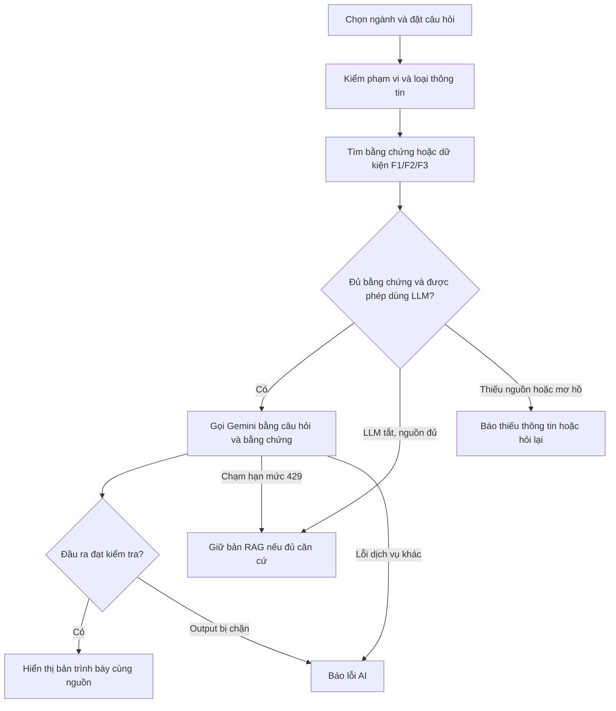

# Báo cáo phân hệ chatbot HUS dùng RAG và LLM

Ngày tổng hợp: **14/11/2026** · Nhánh làm việc: `hus-llm-rag` · Phạm vi: đồ án sinh viên.

Tài liệu này mô tả phân hệ hỏi đáp độc lập. Nhóm bổ sung tên học phần, giảng viên,
thành viên và phân công thực tế vào bản báo cáo nộp; các thông tin đó chưa được
cung cấp ở đây. Các kết quả dưới đây có bằng chứng lưu riêng, chưa thay xác nhận
nội dung của nhóm.

## 1. Mục tiêu và phạm vi

Chatbot giúp tra cứu bốn ngành của Khoa Toán: **Toán học, Toán tin, Khoa học máy
tính và thông tin, Khoa học dữ liệu**. Người dùng chọn ngành, nhập câu hỏi hoặc
chọn câu trong menu. Backend tìm bằng chứng RAG, có thể gọi Gemini để tạo bản
trình bày từ bằng chứng và hiển thị nguồn để đối chiếu.

| Nhóm | Nội dung hỗ trợ | Nguyên tắc |
| --- | --- | --- |
| **F1** |Giới thiệu, định hướng, nghề nghiệp, học tiếp theo tài liệu ngành đã lưu |Đúng phạm vi ngành/hệ/phiên bản nguồn; không tự xác nhận hiệu lực hiện tại |
| **F2** |Tên/mã môn, tín chỉ, tiên quyết và dữ kiện chương trình |Backend giữ dữ kiện gốc; model chỉ chọn cách trình bày |
| **F3** |Tổng quan, nội dung/chủ đề, mục tiêu học tập tham khảo |Giữ nhãn **kiến thức AI**, quyền dùng nội dung tham khảo và cảnh báo chưa là đề cương chính thức |

Đồ án tập trung vào chức năng cơ bản đến trung bình, chạy local trên Windows.
Phân hệ này không cần tài khoản, bảng điểm, database sản phẩm hoặc tư vấn chọn
môn. Triển khai public, phục vụ tải lớn và kiểm nhiều hệ điều hành nằm ngoài
phạm vi hiện tại.

## 2. Dữ liệu và cách tổ chức

Runtime chọn release **`hus-data-20261111-v4`** bằng selector trong source. F1
dùng các đoạn trích đã lưu từ web/PDF/DOCX. F2 dùng dữ kiện có cấu trúc và dòng
nguồn của chương trình. F3 có **174 mã môn/290 hồ sơ theo ngành và chương trình**,
gồm nội dung và mục tiêu; không có bài tập hoặc tiêu chí đánh giá.

Một mã môn có thể xuất hiện ở nhiều ngành. Vì vậy, hệ thống luôn giữ ngành,
phiên bản, mã môn và loại thông tin khi tra cứu. Edition F1 không đồng nhất với
mã quyết định chương trình F2/F3. Nguồn F1 KHDL đang có hệ/edition `unknown` được
giữ nguyên; không gán thành hệ chuẩn chỉ vì người dùng chọn ngành KHDL.

Nguồn có quote, locator, trạng thái review và thông tin file/hash khi có. Dữ
kiện chép từ nguồn hoặc hồ sơ AI không tự trở thành xác nhận học vụ của trường.

## 3. Công nghệ và luồng xử lý

Backend dùng **Python3.11, FastAPI, HTTPX**, giao diện HTML/CSS/JavaScript. Tìm
kiếm mặc định là **lexical/BM25**, chưa cần vector index. LLM cấu hình là
`gemini-3.5-flash-lite`, gọi trực tiếp Google bằng API tương thích OpenAI,
không qua 9Router.



F1/F3 chuẩn bị bằng chứng trước khi dựng bản trích nguồn hoàn chỉnh. Model trả
JSON, backend kiểm và phục hồi citation/bố cục. Validator hiện thiên về bảo
toàn từ ngữ nguồn; chưa chứng minh khả năng diễn đạt linh hoạt hoặc suy luận
ngoài bằng chứng.

F2 dùng prompt riêng với bốn trường output: `kind="facts"`, `style`, `fact_keys`,
`citation_ids`. Model không được tự trả giá trị tín chỉ/tiên quyết thay thế.
Backend giữ facts, quote, cảnh báo và câu trả lời canonical; vì thế thông tin
F2 vẫn nguyên trạng cả khi model lỗi.

| API chính | Vai trò |
| --- | --- |
| `GET /hus/config` |Danh sách ngành/phiên bản, release và khả năng bật LLM |
| `GET /hus/questions` |Menu câu hỏi theo ngành/phiên bản |
| `POST /hus/chat` |Hỏi đáp và metadata used/fallback khi người dùng yêu cầu LLM |
| `GET /hus/sources/{source_id}` |Mở file nguồn local đã kiểm tra |

Profile `tools.run_hus_llm` tự gửi câu hỏi/bằng chứng phù hợp tới Google, không
cần tick diễn đạt; **Cho phép kiến thức AI tham khảo** vẫn riêng cho F3. Đổi ngành
xóa phản hồi cũ và tắt F3, giữ chế độ Gemini tự động. Chat không tự kế thừa môn ở câu trước.

## 4. Ví dụ từ các kết quả đã lưu

Các đoạn dưới là tóm tắt minh họa; đáp án, cảnh báo và citation đầy đủ nằm trong
receipt/bảng30 câu, không phải kết quả gọi mới ở lượt viết báo cáo.

| Nhóm | Câu hỏi và phạm vi | Nội dung trả lời đã ghi nhận |
| --- | --- | --- |
| **F1** |“Cho em hỏi cơ hội nghề nghiệp ngành KHMTTT như thế nào?”; nguồn2023 |Kỹ thuật, tư vấn/quản lý/phân tích/thiết kế/lập trình, nghiên cứu và giảng dạy; giữ nguồn DOCX và cảnh báo phạm vi |
| **F2** |“MAT2300 có bao nhiêu tín chỉ?”; Toán học/QD3565-2023 |**4 tín chỉ**, kèm nguồn PDFtrang9; call xác nhận prompt mới dùng được Gemini, facts vẫn do backend giữ |
| **F2 chưa rõ** |“Tiên quyết MAT2300 là gì?”; cùng phạm vi |Ô nguồn trống nên **chưa rõ**, không biến thành “không có tiên quyết” hoặc đủ điều kiện đăng ký |
| **F3** |“Hồ sơ môn MAT1202 có mục tiêu học tập nào?”; Toán tin/QD3567-2023 |Các mục tiêu về lớp/đối tượng, giao diện, đa hình, kế thừa/hợp thành; nhãn **kiến thức AI**, chưa là chuẩn đầu ra chính thức |
| **Làm rõ** |“Môn đó có bao nhiêu tín chỉ?” |Yêu cầu xác định môn, không suy từ lịch sử chat |

[Đáp án30 câu và nguồn](RAG_STUDENT_CONTENT_30_LIVE_2026_11_14.md) ·
[Call F2 xác nhận riêng](RAG_F2_PROMPT_CONFIRMATION_2026_11_14.md).

## 5. Kết quả kiểm thử và giới hạn cách đọc số liệu

Bộ chức năng gồm **30 câu**:24 câu nội dung, mỗi ngành2F1/2F2/2F3;6 câu control
về chào hỏi, mơ hồ, mã môn không có, chưa cho phép F3 và ngoài phạm vi. Nguồn và
kỳ vọng được lưu trước khi thu phản hồi.

| Nhóm trong lượt đo30 câu | Call Google | Đầu ra model được dùng | Fallback |
| --- | --- | --- | --- |
| F1 |8 |8 |0 |
| F2 |8 |7 |1 |
| F3 |8 |8 |0 |
| Control |0 |0 |Không tính vào24 câu nội dung |

Cả24 call trả HTTP200 nhưng chỉ23 đầu ra được dùng. Câu tín chỉ MAT2300 bị
`invalid_output` và fallback giữ4 tín chỉ. **Đây là số liệu vận hành, không phải
điểm chính xác/đủ ý của chatbot.** Nhóm chưa ký xác nhận nội dung30 câu.

Sau đó, một call diagnostic riêng ghi lỗi `output_schema/kind`. Prompt F2 được
tách riêng và kiểm offline. **Một call xác nhận mới** trả HTTP200/`used=true`,
775 input/53 output token, khoảng1,62giây, giữ4 tín chỉ/citation. Kết quả này
không thay dòng fallback trong run cũ và không chứng minh mọi lần gọi F2 đều
ổn định. Không biết giá trị output bị từ chối của các call cũ.

| Kiểm local đã lưu | Bằng chứng |
| --- | --- |
| UI trên Chromium |29 test đạt về opt-in, AI/fallback, lỗi API, nguồn, đổi ngành/response muộn, mobile/bàn phím; provider giả lập |
| Citation và wrapper |14 test nguồn,27 test package/wrapper đạt; không thay đánh giá nội dung |
| Source chuyển thư mục + venv tối thiểu mới |Windows/Python3.11.9,25 package, `pip check` đạt; `--check`20 ca API/2.124 câu menu/4 hash file nguồn đạt |
| Server loopback thật |5 chat F1/F2/F3/quyền/đổi ngành đúng trên source đã chuyển; không gọi Google |
| Prompt F2 mới |13 test mới đạt; nhóm liên quan42 và nhóm LLM rộng680 đạt ở các lượt đã ghi, có giao nhau |

Các nhóm test không được cộng thành tổng độc lập; chưa khẳng định full-repo
đạt. Có warning Starlette/httpx cũ. Kiểm source chuyển thư mục vẫn trên cùng
máy Windows; chưa kiểm máy khác, clone GitHub hoặc cài Windows sạch. Dependency
được cài từ wheelhouse local, chưa kiểm download PyPI mới ở lượt đó.

[Bằng chứng UI/cài/chạy](RAG_UI_QUICKSTART_2026_11_14.md) ·
[Bằng chứng sửa prompt](RAG_F2_DEDICATED_PROMPT_2026_11_14.md).

## 6. Review nội dung của nhóm

Đã có **30 nhận xét sơ bộ của Codex(AI)** ở bản trả riêng. Hiện **0 xác nhận
người thật/30 pending**, chưa có tên/ngày review do nhóm điền. Nhận xét AI
không thay việc thành viên đọc câu hỏi, đáp án và nguồn.

| Việc cần nhóm bổ sung | File/thao tác |
| --- | --- |
| Đúng ý, đủ ý, dữ kiện, citation |Điền các cột review của [CSV trả riêng](../data/hus/review/student_content_ai_draft_20261114_r1/review_group_return.csv) |
| Người đọc và ngày |Điền tên/ngày thực tế, không dùng tên AI thay thành viên |
| Lỗi hoặc không đồng ý với AI |Ghi lý do và mã câu; giữ nguyên đáp án/run gốc |
| Kết quả thành viên khác cài thử |Ghi môi trường/lệnh/kết quả ở checklist trong [kịch bản demo](HUS_RAG_MANUAL_DEMO.md) |

Các vấn đề sơ bộ cần đọc trước:005/011/017/023 có đúng chủ đề nhưng trả dư unit;
hai ví dụ005/017 cần làm rõ giả định hoặc wording; một số quote F1 bị ngắt dòng
và có lỗi chữ từ nguồn. Đây là nhận xét sơ bộ, chưa phải nghiệm thu học thuật.
[Bản nhận xét30 câu](RAG_STUDENT30_AI_REVIEW_2026_11_14.md).

## 7. Cài đặt, demo và giới hạn còn lại

Người nhận đủ source dùng **Windows64-bit/Python3.11**, tạo venv và cài
`requirements-rag.txt` với `requirements-lock.txt`. Lệnh RAG không cần key:

```powershell
.\.venv\Scripts\python.exe -X utf8 -m tools.run_hus_rag --check
.\.venv\Scripts\python.exe -X utf8 -m tools.run_hus_rag
```

Mở `http://127.0.0.1:8011/`. Muốn Gemini thật, dùng profile backend trong
[quickstart](HUS_RAG_QUICKSTART.md), đặt key của mình trong terminal backend và
Gemini tự động được dùng. Launcher RAG luôn ép LLM tắt. Key không nằm trong
frontend/file mẫu, startup không gọi provider để kiểm key.

Theo chính sách mới, profile tự động chuyển RAG offline sau HTTP429, ngừng gọi
đến khi restart. Lỗi quyền/mạng/timeout/503 hoặc đầu ra không đạt kiểm được báo
lỗi, không trả offline thay thế. Không có bằng chứng thì hỏi lại hoặc báo thiếu
thông tin. Các số liệu live trước đây phản ánh chính sách fallback cũ, giữ nguyên.

Giới hạn chính: review nhóm còn thiếu; F3 chưa nghiệm thu đầy đủ và đôi khi dư
chủ đề; một số nguồn chưa rõ hệ/edition/hiệu lực; validator bảo toàn từ nguồn
còn hạn chế diễn đạt; Gemini phụ thuộc key/quota/mạng. Chưa triển khai public
hoặc kiểm tải, chưa kiểm mọi cách hỏi. Source còn local chưa tự xuất hiện trên
GitHub khi chưa đưa qua quy trình nhóm.

Phân hệ đã có luồng chạy thử, nguồn và bằng chứng kiểm đủ để nhóm tiếp tục hoàn
thiện đồ án. Phần nộp cuối cần bổ sung review thực tế và ghi trung thực lỗi còn
lại, thay vì coi một call thành công hoặc số test đạt là nghiệm thu toàn bộ.

[Kịch bản demo5–7phút](HUS_RAG_MANUAL_DEMO.md) · [Tiến độ/các bước tiếp theo](RAG_PROGRESS_AND_NEXT_PLAN.md).
