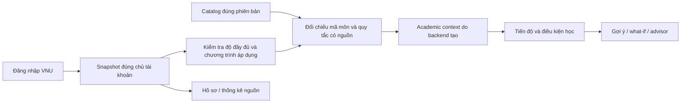

# Kế hoạch dùng bảng điểm VNU làm nguồn duy nhất và bỏ nhập điểm thủ công

### Bổ sung mới nhất: ngành/khóa theo hồ sơ VNU

Người dùng đã xác nhận qua ảnh UI có tên/ngành/khóa và yêu cầu bỏ dropdown bốn
ngành. Đã thay bằng thông tin chỉ đọc từ profile VNU tại sidebar và ngành ở
thanh trên; không gọi `/programs` hoặc chọn ngành đầu tiên. Nguồn thiếu thì ghi
chưa có thông tin, chưa đăng nhập thì ghi trạng thái đăng nhập; logout/expiry/xóa
không giữ thông tin cũ. Việt/Anh chỉ đổi nhãn, không dịch tên ngành nguồn.

Không tự biến tên ngành nguồn thành catalog/policy binding. Khi chưa có binding
server, UI không gọi academic-context với một program_id mặc định nữa; hai mục
học vụ hiển thị chờ hoàn tất chuyển đổi/xác minh và trạng thái đầy đủ của snapshot.
Đoạn mô tả dropdown tham khảo/call context bên dưới là checkpoint trước thay đổi
này. Bốn Chrome regression (VNU-only/workspace/charts/profile), Ruff/JS syntax/
diff checks đạt; không đổi backend/DB hoặc restart/commit/push.

## Cập nhật triển khai — 23/10/2026: đã gỡ UI nhập tay

Người dùng yêu cầu thực hiện thống nhất bỏ màn nhập điểm. Đã gỡ tab Nhập điểm,
upload preview, nhập học kỳ/môn/điểm, Dashboard KPI/kế hoạch nhập tay và advisor
cũ khỏi giao diện hoạt động. `#transcript` chuyển sang `#profile`. Entry point
mới `workspace.js` không tải `app.js`/`dashboard.js` của luồng thủ công.
Hồ sơ/đăng nhập/đồng bộ/xóa và biểu đồ mô tả VNU vẫn hoạt động.

Điều kiện học/Gợi ý kỳ tới hiển thị readiness từ `/me/academic-context`, chưa
phát hành kết quả cá nhân khi thiếu completeness/binding/policy. Chưa có UI
kết quả học vụ VNU hoàn chỉnh; gợi ý/what-if/advisor cá nhân đang chờ chuyển đổi.
Không suy hoàn thành môn từ tập điểm nhập tay trống. Dropdown CTĐT chỉ là
chương trình tham khảo, không tự khớp ngành/khóa vừa đọc từ nguồn.

Đây là **gỡ luồng thủ công khỏi frontend**, chưa hoàn tất toàn bộ kế hoạch.
API public nhận records/passed sets và mã domain/fixture legacy vẫn được giữ;
việc đóng API cũ và hoàn thiện kết quả VNU còn chờ các bước dưới. Các yêu cầu
cũ về giữ UI nhập tay đến khi replacement sẵn sàng được thay bằng quyết định
gỡ UI hiện tại; điều kiện an toàn cho đầu ra học vụ không thay đổi.

Chrome `check_vnu_only.py`, `check_workspace.py`, `check_charts.py`,
`check_portal.py` đạt với dữ liệu tổng hợp, có kiểm tra logout/response chậm,
VI/EN/themes/mobile. Ruff/JS syntax/diff checks đạt. Không đổi backend/DB,
restart, gọi VNU thật, commit/push. Các đoạn “chưa triển khai” dưới đây mô tả
thời điểm lập kế hoạch ban đầu; xem status học vụ cho nền tảng backend đã có.

Cập nhật: 23/10/2026. **Kế hoạch đã lập, chưa triển khai chuyển đổi.**
Người dùng đồng ý hướng bỏ hoàn toàn luồng nhập điểm; yêu cầu hiện tại chỉ
là lập kế hoạch. Các thay đổi portal/UI đã có trong workspace được giữ nguyên.

## 1. Kết quả cần đạt

Sinh viên đăng nhập VNU, xem bảng điểm đã lưu, xác nhận chương trình phù hợp
và sử dụng cùng một nguồn kết quả học tập cho Dashboard, tiến độ, điều kiện
học, gợi ý môn, what-if và advisor. Không nhập/sửa điểm hoặc chọn “đã đạt”
thủ công. Không dùng profile demo hay tệp upload để tạo context học vụ.

Điểm nguồn, mã môn, học kỳ và các lần học vẫn được giữ nguyên. Backend tạo
context tính toán có nguồn gốc rõ ràng; trình duyệt không quyết định môn nào
đã đạt. Thiếu thông tin thì hiển thị cần kiểm tra, không đoán dữ liệu.

Luồng cuối cùng:

Hồ sơ và thống kê nguồn vẫn xem được khi context chưa đủ điều kiện dùng
cho gợi ý. Không lấy trung bình trên biểu đồ làm GPA chính thức.

## 2. Hiện trạng đã rà từ code

| Thành phần | Đã có | Khoảng trống cần xử lý |
| --- | --- | --- |
| Portal | Login, phiên, snapshot/attempt theo owner; UI đã có bằng chứng người dùng xem được nguồn | Chưa nghiệm thu đầy đủ identity alias, pagination/filter/loading và cập nhật điểm thay đổi |
| Snapshot | Giữ các lần học, điểm nguồn và hàng chưa hiểu | Parser luôn gán `completeness=unknown`; dữ liệu thay đổi chưa được phép thay snapshot cũ |
| Dashboard | Biểu đồ mô tả từ snapshot đã lưu | Chưa nối kết quả nguồn vào progress/eligibility/recommendation |
| `app/transcript.py` | Model phục vụ luồng thủ công | Cấm mã trùng, term 1..12; thiếu grade mặc định passed=true; có grade tự suy đạt theo ngưỡng 5.0; GPA4 dùng bảng quy đổi dự án |
| API học vụ | Summary, eligibility, recommendations, what-if, advisor đã có | Nhận records hoặc passed_course_codes từ client; chưa lấy context từ phiên VNU |
| Catalog | Bốn chương trình HUS phiên bản 2022 | Vẫn `draft_unverified`; chưa chứng minh tự khớp ngành/khóa của từng tài khoản portal |
| Frontend | Đã bỏ profile demo và nút tạo điểm mẫu | Còn Nhập điểm, nhập học kỳ, upload preview, state transcript và panel kế hoạch nhập tay |

Đây là khoảng trống đã đọc từ code, không phải kết luận về quy chế học vụ
VNU. Các ngưỡng/ánh xạ hiện có trong dự án chưa được coi là policy portal.

## 3. Nguyên tắc chuyển đổi

- **Một nguồn kết quả:** snapshot VNU thuộc tài khoản đăng nhập. Browser chỉ
  gửi mục tiêu, hạn mức, trọng số và lựa chọn chương trình/track/path hợp lệ.
- **Hai lớp dữ liệu:** snapshot nguyên bản và context suy ra có phiên bản.
  Không sửa snapshot để ép khớp catalog, không mất môn ngoài catalog/học lại.
- **Không đoán CTĐT:** không suy ngành/khóa từ MSSV, năm đầu bảng điểm hoặc
  dropdown đang chọn. Chưa xác nhận chương trình áp dụng thì chưa phát hành
  kết quả cá nhân hóa. Được xem catalog để tham khảo, phải ghi rõ trạng thái.
- **Không tự đặt policy:** không tự bỏ hậu tố E, ghép theo tên, chọn điểm cao
  nhất/lần cuối, quy đổi điểm chữ hay coi điểm trống/miễn là đã đạt.
- **Không mở khóa nhầm:** kết quả chưa rõ không được thỏa tiên quyết. Đồng
  thời không tự đề xuất học lại môn có khả năng đã hoàn thành nhưng chưa
  giải quyết được mapping/policy. Nếu chưa chứng minh được tập ứng viên an
  toàn thì khóa gợi ý, thay vì trả một danh sách có vẻ đầy đủ.
- **Không dùng frontend làm bằng chứng:** owner lấy từ phiên; snapshot/context
  do backend đọc. Owner ID, passed set hay context giả gửi lên không có hiệu lực.
- **Không thêm nhập tay trá hình:** review chỉ giải thích dữ liệu chưa rõ và
  xác nhận lựa chọn CTĐT có căn cứ; không có ô sửa điểm/checkbox đánh dấu đạt.

## 4. Contract context đề xuất

`AcademicContext` là model nghiệp vụ mới, không nhận trực tiếp toàn bộ hàng
portal vào `StudentTranscript` cũ.

| Nhóm | Trường/trách nhiệm |
| --- | --- |
| Định danh | Owner nội bộ, snapshot ID/digest, fetched_at, completeness |
| Chương trình | Program ID, catalog revision, cách xác nhận tính áp dụng, track/path hợp lệ |
| Phiên bản | Mapping version, policy version, context revision/digest |
| Lần học | Tham chiếu row key nguồn, mã/điểm/học kỳ nguyên bản và kết quả đối chiếu |
| Kết quả theo môn | `completed`, `not_completed`, `unresolved`, `out_of_catalog`; kèm reason và provenance |
| Facts an toàn | Completed set dùng kiểm tra tiên quyết; credits/progress đủ bằng chứng; bộ chặn môn chưa rõ |
| Thiếu sót | Unmatched/ambiguous rows, policy chưa có, nguồn chưa đủ, cảnh báo catalog |
| Sẵn sàng | `needs_program_binding`, `needs_source_review`, `needs_policy_review`, `ready`; readiness theo từng chức năng |

Readiness tách giữa xem nguồn, tính tiến độ và gợi ý. Có thể xem nguồn nhưng
chưa có GPA/progress cá nhân hóa. Không gắn `ready` toàn bộ chỉ vì parser đọc
được một bảng hoặc vài tín chỉ khớp tổng kết.

Context có thể tính lại từ snapshot bất biến để không lưu hai bộ điểm.
Khóa cache phải gồm owner + snapshot digest + catalog revision + mapping/policy
version + track/path. Snapshot/catalog/policy thay đổi làm kết quả cũ hết hiệu lực.

Đề xuất chỉ lưu lựa chọn chương trình đã xác nhận bằng bảng
`portal_program_bindings`: owner, program/catalog revision, nguồn/cách xác
nhận, thời điểm và phiên bản review. Xác nhận của sinh viên là lựa chọn áp
dụng, không biến catalog draft thành đã được nhà trường duyệt. Nếu cần bảng
mới, dùng migration HUS nối sau `hus_20261023_03`, backup trước khi áp local;
không sửa migration cũ, không đụng catalog hoặc bảng legacy để dọn giao diện.

## 5. Thứ tự triển khai và bàn giao

| Bước | Công việc | Điều kiện hoàn thành |
| --- | --- | --- |
| 1. Chốt bằng chứng và policy | Xác minh phiên/identity bằng luồng thật có phép; lấy nguồn áp dụng CTĐT và quy tắc đạt/học lại/miễn/điểm chờ; xác định tín hiệu bảng đã tải đủ | Có bảng quyết định có nguồn hoặc đánh dấu chưa biết; không dùng dữ liệu thật trong fixture |
| 2. Làm ổn định snapshot | Hoàn thiện loading/filter/pagination và parser; phân biệt tài khoản chưa có điểm với đọc bảng lỗi; nghiệm thu cập nhật nguồn thay đổi và giữ bản cũ khi lỗi | Không tự gán complete; unknown/partial không ghi đè bản tốt; cập nhật thành công đổi snapshot nguyên tử |
| 3. Xây lớp chuẩn hóa | Program binding, mapping chính xác và có phiên bản; AttemptRecord/AcademicContext; xử lý môn ngoài catalog, hậu tố, trùng lần học, trạng thái chưa rõ | Không mất hàng; có reason/provenance; credits không đếm trùng theo policy; chưa rõ không thành đạt |
| 4. Chuyển backend học vụ | Backend resolve context từ phiên; nối progress, eligibility, ranking, what-if và advisor | Các chức năng dùng cùng context revision; không tin passed set/records từ browser; guardrails trước ranking/LLM |
| 5. Chuyển giao diện | Dashboard/profile dùng một snapshot; điều kiện/gợi ý có readiness, nguồn và thời điểm; đổi/hết phiên/xóa dữ liệu xóa kết quả cũ | UI VI/EN, sáng/tối/mobile; source không bị sửa; phản hồi cũ không xuất hiện sau đổi context |
| 6. Xóa luồng thủ công | Xóa mục Nhập điểm, form môn/điểm/học kỳ, preview upload, panel/manual state và public API phụ thuộc đầu vào thủ công | Không còn lối nhập/sửa điểm, không còn đường lách qua API cũ; không xóa core rules/test fixtures cần thiết |
| 7. Nghiệm thu và chuyển hẳn | Regression offline/PostgreSQL/browser, live đối chiếu có phép, kiểm tra lỗi portal và rollback | Gợi ý không chứa môn đã hoàn thành, môn bị chặn, sai ngành hoặc chưa đủ bằng chứng; đủ checklist mục 8 |

Các bước có thể phát triển độc lập trong nội bộ nhưng **không xóa phần nhập
tay đang dùng trước khi bước 1–5 đạt điều kiện thay thế**. Không phát hành
một UI gợi ý chạy bằng completed set rỗng vì luồng mới chưa nối xong.
Trong giai đoạn chuyển tiếp, build chưa đủ sẵn sàng phải chỉ rõ tính năng
chưa dùng được; không tự chạy hai nguồn rồi chọn kết quả thuận tiện hơn.

Mỗi bước xong báo một lần: đã bàn giao gì, kiểm tra nào đạt, còn gate nào.
Ưu tiên các gate chứ không cam kết ngày hoàn thành trước khi có nguồn policy.

## 6. API và bảo mật khi chuyển nguồn

Routes đề xuất; chưa triển khai:

| Route | Đầu vào được phép / hành vi |
| --- | --- |
| `GET /me/academic-context` | Resolve owner và snapshot hiện hành từ phiên; trả readiness/provenance/context revision |
| `POST /me/academic-program` | Chọn/xác nhận CTĐT có căn cứ; kiểm tra catalog revision và khả năng áp dụng; không nhận điểm |
| `GET /me/eligibility` | Backend tự tạo completed set theo policy; kèm lý do bị chặn và cảnh báo |
| `POST /me/recommendations` | Mục tiêu, hạn mức và preference; context revision kỳ vọng để phát hiện thay đổi |
| `POST /me/recommendations/what-if` | Chỉ đổi preference/weights của baseline cùng revision; không tự mở eligibility |
| `POST /me/advisor/chat` | Câu hỏi/history trong phiên; backend lấy facts từ cùng context, không nhận completed set |

Track/path là lựa chọn kế hoạch, không phải dữ liệu điểm; phải kiểm tra thuộc
đúng catalog. Giá trị context revision do client gửi chỉ là precondition,
không phải bằng chứng quyền truy cập hoặc nguồn kết quả.

Khi context đổi giữa request, trả mã rõ như `context_changed` và yêu cầu tải
lại; không trộn summary của snapshot A với gợi ý của B. Context chưa sẵn sàng
trả `academic_context_not_ready` kèm reason an toàn; thiếu phiên vẫn 401.
401 chỉ là chưa xác thực, không tự suy là nhập sai mật khẩu portal.

Sau chuyển đổi, gỡ các **public routes nhận học vụ thủ công** khỏi sản phẩm:
`/transcript/summary`, `/eligibility`, `/recommendations`,
`/recommendations/what-if`, `/advisor/chat` và `/profiles` cùng routes con.
Không để API cũ vẫn nhận passed set tùy ý khi UI đã bỏ nhập tay. Lập inventory
caller trước khi xóa và cập nhật tests/docs/OpenAPI cùng đợt. Giữ các hàm
domain thuần để test, nếu còn dùng nội bộ thì đổi contract phù hợp; fixture
tổng hợp không phải tính năng demo và không bị xóa theo UI.

`/programs` và `/courses` có thể giữ để xem catalog; xem không đồng nghĩa tài
khoản đã được gắn CTĐT. Giữ ownership, no-store, CSRF/origin, giới hạn job,
timeout/cancel và không lưu mật khẩu/cookie VNU. Không đưa danh tính, toàn bộ
bảng điểm hoặc credentials vào LLM/RAG; chỉ đưa facts môn ứng viên tối thiểu
đã qua gate. Không lưu chat lâu dài trong đợt chuyển đổi này.

## 7. Các quyết định cần nguồn trước khi code logic học vụ

| Nội dung | Cách xử lý trong kế hoạch |
| --- | --- |
| Ngành/khóa và CTĐT 2022 có áp dụng không | Xác minh từ nguồn phù hợp hoặc review lựa chọn có căn cứ; không suy MSSV |
| Điểm nào được coi hoàn thành, điểm chữ D/F/miễn/chờ | Tra quy tắc áp dụng đúng đối tượng; chưa có thì unresolved, không bê ngưỡng 5.0 của model cũ |
| Học lại: hoàn thành môn, tính GPA và tính tín chỉ | Ba quyết định riêng có nguồn; không mặc định cùng chính sách chọn lần học |
| Mã có hậu tố E, môn tương đương/thay thế | Exact match trước; ánh xạ khác chỉ theo bảng có nguồn, có reviewer và phiên bản |
| Điểm hệ 10/chữ/4 không khớp | Giữ nguồn, báo mâu thuẫn; không tự sửa hoặc chọn thang thuận tiện |
| Môn ngoài catalog/môn điều kiện | Vẫn hiển thị ở hồ sơ; chỉ tính vào học vụ khi có căn cứ, không cộng tín chỉ theo tên |
| Bảng đang lọc/phân trang/chưa tải hết | Chưa đủ bằng chứng thì không tạo context cá nhân hóa hoàn chỉnh |
| Catalog draft và tiên quyết chưa xác minh | Giữ cảnh báo; không cho môn có prerequisite chưa xác minh lọt vào gợi ý |

Người dùng đã đồng ý hướng sản phẩm; không cần hỏi lại chuyện giữ hay bỏ
nhập tay. Chỉ hỏi khi thực sự thiếu bằng chứng áp dụng CTĐT/quy tắc, sau khi
đã kiểm tra tài liệu có sẵn. Lượt lập kế hoạch này không xác nhận thêm bất kỳ
quy chế học vụ nào và không cần credentials.

## 8. Nghiệm thu trước khi xóa hoàn toàn

- A không đọc/sync/xóa/gợi ý theo dữ liệu B; giả owner/snapshot/context ID và
  gửi passed set không đổi được kết quả.
- Ngành/khóa chưa gắn hoặc sai catalog: không sinh gợi ý cá nhân hóa từ các
  lựa chọn dropdown chưa được xác nhận. Đổi program binding hủy kết quả cũ.
- Thiếu điểm, điểm 0, dấu phẩy, điểm chữ, miễn, học lại, môn lạ/hậu tố và
  hàng chưa hiểu đều có ca test. Không mất lần học, không đếm trùng credits,
  không mặc định passed hoặc quy GPA khi chưa có policy.
- Môn hoàn thành/blocked/foreign-major/unverified prerequisite không vào
  candidate set/ranking/LLM. Trường hợp còn mơ hồ phải chặn an toàn và giải thích.
- Summary/progress/eligibility/gợi ý/what-if/advisor dùng cùng revision. Chat
  và gợi ý cũ không sống sót sau logout/expiry/delete/snapshot hoặc policy đổi.
- Lỗi cập nhật/hủy/job muộn giữ snapshot trước; xóa dữ liệu ngăn phản hồi
  muộn ghi lại. Portal lỗi không chuyển sang dữ liệu demo hoặc điểm giả.
- Người đang có phiên còn hiệu lực được xem snapshot cũ kèm thời điểm; hết
  phiên cần xác thực lại. Nếu VNU đang lỗi thì không bỏ qua xác thực để đọc
  dữ liệu cá nhân đã lưu. Snapshot cũ chỉ dùng gợi ý nếu vẫn qua readiness.
- Không còn menu/form/JavaScript state/upload/public API nhập điểm thủ công.
  Dashboard nguồn, profile, theme/VI-EN/mobile và bộ gợi ý vẫn hoạt động.
- Offline dùng fixture tổng hợp; PostgreSQL dùng DB tạm; browser dùng mock
  personal endpoints. Live acceptance cần phép, đối chiếu nguồn, không chụp
  hoặc đưa thông tin/điểm thật vào Git/log/test artifacts.

Rollback: giữ backup/schema/source snapshot và bản code trước chuyển đổi.
Nếu phát hiện sai policy, khóa kết quả học vụ và giữ xem nguồn; không sửa
nguồn thật để khớp test. Không tự bật lại nhập tay làm nguồn chính sau cutover.
Không xóa bảng legacy hoặc Docker volumes để hoàn thành việc gỡ UI.

## 9. Phạm vi lượt lập kế hoạch này

Đã rà code/API liên quan và lập kế hoạch. Chưa nối điểm VNU vào học vụ, chưa
xóa Nhập điểm, chưa thay migration/schema/data/.env, chưa gọi portal hoặc
chạy lại app/tests. Không commit/push. Khi người dùng yêu cầu triển khai,
bắt đầu từ bước 1; không coi tài liệu này là bằng chứng tính năng đã có.

Tham chiếu:
[portal đợt đầu](KE_HOACH_TICH_HOP_PORTAL_BANG_DIEM_2026_10_23.md),
[trạng thái portal](PORTAL_INTEGRATION_STATUS_2026_10_23.md),
[Dashboard/profile](WORKSPACE_DASHBOARD_PROFILE_2026_10_23.md),
[module 02](../modules/02-transcript-profile.md),
[module 03](../modules/03-eligibility-engine.md),
[module 09](../modules/09-portal-transcript-import.md).
