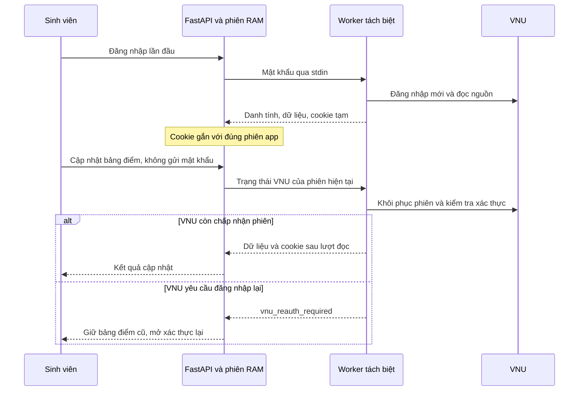

# Kế hoạch giữ phiên VNU để cập nhật bảng điểm không nhập lại mật khẩu

Ngày lập: 25/10/2026. Trạng thái: **đã triển khai local; người dùng xác nhận cập nhật không hỏi lại mật khẩu**.

## Checkpoint triển khai — 25/10/2026

Người dùng đã yêu cầu thực hiện kế hoạch và báo tiến độ thường xuyên. Đã có:
contract cookie 64 KiB/64 cookie; worker `login`/`resume`; cookie trong RAM theo
phiên app với TTL/version; dọn định kỳ 30 giây; thu hồi khi logout/delete/expiry/
shutdown; đồng bộ không credentials; route xác thực lại chỉ nhận password và
form riêng chỉ xuất hiện khi VNU cần xác thực lại. Không ghi cookie ra file/DB.

Chrome fixture đã chứng minh: một lần POST mật khẩu → đóng browser → hai lượt
đọc bằng browser mới, cookie xoay vòng; sai danh tính, hết phiên và CAPTCHA được
phân biệt. UI fixture đạt cập nhật không hỏi mật khẩu, xác thực lại, lỗi kỹ thuật,
logout trong khi chờ, VIE/EN/theme/mobile và nhắc 7 ngày. Ảnh kiểm thử là dữ liệu
giả, đặt trong thư mục ignored. Kiểm thử offline hiện có báo cáo ở memory.

Đã restart Uvicorn local và kiểm tra health/ready PostgreSQL. Sau lời mời
Ctrl+F5, login mới và cập nhật, người dùng xác nhận: “Cập nhật được, không hỏi
lại mật khẩu”. Hoàn thành phạm vi triển khai local và nghiệm thu luồng chính.
Đây là xác nhận thực tế của người dùng, không thay thế kiểm chứng nhiều tài khoản,
độ đầy đủ bảng điểm hoặc toàn bộ tình huống hết phiên trên nguồn thật.
434 test offline đạt, 40 deselected, Ruff và Chrome đạt; không chạy lại test
cho cập nhật tài liệu nghiệm thu này. Không commit/push, migration hoặc crawl nền.

Người dùng yêu cầu lập kế hoạch sau khi nút “Cập nhật bảng điểm” vẫn mở lại
form mật khẩu dù đang đăng nhập. Mục tiêu là cập nhật ngay trong cùng phiên;
chỉ yêu cầu xác thực lại khi phiên VNU không còn dùng được.

## 1. Phạm vi và nền trước khi thực hiện

Kế hoạch dựa trên workspace local ở nhánh `fix/portal-session-diagnostics-20261025`,
HEAD `586d659`, cùng các thay đổi chưa commit về kiểm tra phiên, chẩn đoán 502,
nút cập nhật và nhắc sau 7 ngày. Giữ nguyên những thay đổi đang có khi triển khai.

| Thành phần | Hành vi trước bản sửa đã đọc từ code |
| --- | --- |
| `runtime.Session` | Giữ owner, subject, generation và expiry trong RAM; TTL 30 phút, chưa giữ phiên VNU |
| `worker.collect` | Mỗi lần mở Chrome/context mới, đăng nhập bằng mật khẩu, lấy dữ liệu rồi đóng browser |
| `DaotaoClient.login` | Chỉ chấp nhận đăng nhập mới, từ chối cookie có sẵn; kiểm tra giao dịch POST và chuyển sang trạng thái đã đăng nhập |
| `POST /me/portal-sync` | Yêu cầu username/password, tạo job rồi xác thực VNU lại |
| Nút cập nhật | Điền tài khoản đang đăng nhập và mở form mật khẩu |
| Dữ liệu đã lưu | Snapshot theo owner trong PostgreSQL; thay đổi chưa xác minh đầy đủ vẫn bị chặn |
| Nhắc cập nhật | Trong app sau 7 ngày từ lần đồng bộ được chấp nhận; lỗi không làm mới mốc |

Phạm vi mới: tái sử dụng phiên VNU trong thời gian phiên Sổ học tập còn hiệu lực.
Đây là thay đổi vòng đời cookie, không phải yêu cầu lưu mật khẩu. Không kéo dài
phiên thành một tuần, không thêm lịch crawl, email/push, Redis, migration hoặc
chức năng gợi ý học vụ. Tự động cập nhật hằng tuần vẫn hoãn đến gần hoàn thiện.

## 2. Trải nghiệm cần đạt

1. Sinh viên đăng nhập VNU một lần như hiện tại. Backend xác minh danh tính,
   lưu bảng điểm theo contract và giữ trạng thái phiên VNU tạm trong RAM.
2. Bấm **Cập nhật bảng điểm**: gửi yêu cầu cập nhật ngay, hiện tiến trình và khóa
   thao tác trùng. Không hiện form tài khoản/mật khẩu nếu phiên VNU dùng được.
3. Phiên VNU hết hạn nhưng phiên app còn hiệu lực: vẫn xem được dữ liệu đã lưu,
   hiện “Phiên VNU đã hết hạn. Xác thực lại để cập nhật bảng điểm”. Chỉ lúc này
   mở phần xác thực lại, với tài khoản cố định theo phiên app.
4. Xác thực lại thành công: thay phiên VNU tạm rồi tiếp tục lượt cập nhật.
5. Phiên app hết hạn: xóa dữ liệu cá nhân khỏi giao diện và yêu cầu đăng nhập
   đầy đủ. Xác thực VNU lại không được hồi sinh một phiên app đã hết hạn.
6. Đăng xuất/xóa dữ liệu: thu hồi trạng thái VNU và job tương ứng. Snapshot
   PostgreSQL chỉ bị xóa khi người dùng chọn thao tác xóa dữ liệu.

Cookie phiên app và cookie VNU là hai quyền riêng. TTL app không đảm bảo VNU
giữ phiên đủ 30 phút; việc VNU chấp nhận phiên phải được kiểm tra ở mỗi lượt đọc.

## 3. Phương án kỹ thuật ưu tiên và điều kiện xác nhận

Giữ mô hình worker riêng theo lượt đọc. Sau đăng nhập mới thành công, worker
trả cookie cần thiết về tiến trình FastAPI qua pipe riêng; backend giữ chúng
trong RAM của đúng phiên app. Khi cập nhật, worker mới nhận cookie qua stdin,
tạo context mới và khôi phục phiên VNU. Browser vẫn đóng khi job kết thúc.
Không giữ một browser thường trực cho mỗi sinh viên.

Playwright hỗ trợ lấy cookie và nạp chúng vào context mới bằng
[`cookies()` / `add_cookies()`](https://playwright.dev/python/docs/api/class-browsercontext#browser-context-add-cookies).
Tài liệu [tái sử dụng trạng thái xác thực](https://playwright.dev/python/docs/auth#reusing-signed-in-state)
cũng chỉ rõ ứng dụng có thể phụ thuộc vào nhiều loại trạng thái khác nhau.
Vì vậy **chưa coi cookie là đủ cho VNU thật** nếu chưa có bằng chứng kiểm chứng.

Điều kiện triển khai:

- Fixture trình duyệt phải chứng minh: đăng nhập mới → xuất cookie → đóng browser
  → context mới nhập cookie → đọc nguồn mà không POST mật khẩu lần nữa.
- Sau kiểm thử tổng hợp, kiểm chứng tại UI với tài khoản được người dùng cho phép;
  người dùng nhập mật khẩu trực tiếp vào app. Chỉ thu số lượt/thành công/mã bước,
  không lưu cookie, DOM, ảnh bảng điểm hoặc thông tin cá nhân làm bằng chứng.
- Nếu cookie không đủ, ghi nhận chính xác trạng thái còn thiếu. Không tự mở rộng
  sang lưu toàn bộ `storage_state`, localStorage, sessionStorage hoặc IndexedDB.
  Chỉ thiết kế thêm dữ liệu tối thiểu khi có bằng chứng nguồn và review riêng.
- Khi chưa đủ bằng chứng, trả yêu cầu xác thực lại rõ ràng; không tự lưu mật khẩu
  hoặc nới kiểm tra danh tính để làm luồng cập nhật có vẻ thành công.

## 4. Trạng thái trong RAM và vòng đời

Mỗi `runtime.Session` có trạng thái VNU riêng: cookie đã giới hạn, danh tính từ
lần xác thực mới, thời điểm hết hạn và số phiên bản trạng thái. Trường bí mật
không xuất hiện trong `repr`, log, JSON API, job status, exception hoặc snapshot.
Không dùng subject làm khóa của một cookie jar dùng chung.

| Sự kiện | Xử lý dự kiến |
| --- | --- |
| Đăng nhập mới | Lấy cookie từ context đã xác thực; chỉ gắn vào phiên app sau kiểm tra danh tính và quyền sở hữu |
| Đồng bộ thành công | Kiểm tra phiên/generation/phiên bản còn hiệu lực rồi thay cookie đã xoay; giữ nguyên quy tắc lưu snapshot |
| Bảng điểm bị từ chối vì chưa đầy đủ | Giữ snapshot và mốc nhắc; có thể nhận cookie đã xoay sau khi danh tính được xác minh, vì trạng thái xác thực tách biệt với nghiệm thu dữ liệu |
| VNU quay về login | Bỏ trạng thái VNU đã hết hiệu lực; giữ phiên app và snapshot, yêu cầu xác thực lại |
| Timeout/lỗi kỹ thuật | Không tự kết luận mật khẩu sai hoặc VNU hết phiên; giữ snapshot, không tự gửi lại credentials |
| Hủy khi đang đọc | Kết thúc worker, bỏ kết quả/cookie đến muộn; lượt sau có thể cần xác thực lại nếu nguồn đã xoay phiên |
| Đăng xuất | Thu hồi phiên app hiện tại, xóa trạng thái VNU và hủy job đang đọc thuộc phiên đó |
| Xóa dữ liệu | Thu hồi mọi phiên/trạng thái VNU và job của owner; giữ hàng rào generation trước dữ liệu đến muộn |
| App hết TTL | Xóa trạng thái VNU, hủy lượt đọc thuộc phiên, yêu cầu đăng nhập mới |
| Restart/shutdown | Dọn job/process và bỏ toàn bộ trạng thái RAM; snapshot PostgreSQL vẫn còn |

TTL của trạng thái VNU không vượt quá TTL app hiện tại 30 phút và thời hạn cookie
đã biết. Cookie dạng session không có hạn sử dụng rõ vẫn bị giới hạn bởi TTL app.
Cần tác vụ dọn RAM theo thời gian, không chỉ dọn khi người dùng gửi request tiếp.
Tác vụ này chỉ dọn trạng thái, không crawl hoặc giữ sống phiên VNU.

Giữ tối đa hai worker đọc đồng thời và một job đang hoạt động cho mỗi owner
theo giới hạn hiện tại. Hai phiên app của cùng tài khoản có trạng thái VNU riêng;
kết quả từ phiên cũ không được thay cookie của phiên mới. Dùng số phiên bản và
kiểm tra trạng thái còn active trước mọi lần nhận kết quả.

Giai đoạn này chỉ hỗ trợ tiến trình server đơn như runtime RAM hiện tại.
Triển khai nhiều worker/máy chủ cần thiết kế kho phiên và định tuyến riêng;
không quảng bá bản này đã hỗ trợ scale ngang hoặc giữ phiên qua restart.

## 5. Contract worker và xác minh danh tính

Tách hai chế độ nội bộ rõ ràng:

| Chế độ | Đầu vào chỉ do backend tạo | Điều kiện |
| --- | --- | --- |
| `login` | Username/password của thao tác đăng nhập/xác thực lại | Context sạch; giữ đầy đủ kiểm tra POST hiện tại |
| `resume` | Cookie tạm và subject đã xác minh từ đúng phiên server | Không nhận mật khẩu, không chạy lại form login |

Không nới `DaotaoClient.login` để nhận sẵn cookie. Thêm đường khôi phục phiên
riêng, mở URL nguồn cố định, phát hiện login/challenge rồi xác minh trạng thái.

Danh tính của đường `resume` phải dựa trên nguồn gốc cookie từ lần login đã
xác minh, gắn với session/owner/generation trong RAM và kết quả kiểm tra nguồn.
Chỉ thấy bảng điểm hoặc menu không đủ để tạo quyền sở hữu mới. Nếu nguồn hiện
mã sinh viên, luôn đối chiếu và từ chối khi mâu thuẫn. Nếu nhãn không có, chỉ dùng
chuỗi bằng chứng phiên đã được server giữ; không chấp nhận username browser
gửi lên hoặc tự truyền `authenticated_subject` từ một giá trị chưa xác minh.

Backend phải kiểm tra `subject` của kết quả bằng subject phiên trước khi lưu.
Sai danh tính phải hủy kết quả và thu hồi phiên liên quan; không chuyển sang hồ
sơ người khác, không ghép tài khoản theo tên và không suy alias từ mã sinh viên.

Các hàng rào truyền trạng thái cần bổ sung:

- Cookie chỉ có phạm vi host VNU đã review, không nhận cookie domain rộng như
  `.vnu.edu.vn` có thể áp sang host khác. Cookie ngoài phạm vi bị loại/từ chối.
  Giữ chặn request tới host ngoài allowlist.
- Schema allowlist cho từng trường cookie; giới hạn dự kiến tối đa 64 cookie,
  tổng trạng thái 64 KiB. Vượt giới hạn phải trả lỗi an toàn, không cắt âm thầm.
- Thay giới hạn stdin 8 KiB hiện tại bằng giới hạn envelope phù hợp, đọc có chặn
  kích thước. Không đặt cookie/credentials trong command line hoặc environment.
- Cookie chỉ đi qua pipe cha-con và RAM ứng dụng; không ghi file state, browser
  profile dùng lâu dài, database, trace/video/screenshot hoặc log raw stdout.
- Collector phải lọc cookie khỏi mọi response công khai và mọi lỗi. Giữ bộ lọc
  stage/code/kind hiện tại; bổ sung mode chỉ bằng giá trị allowlist nếu cần.
- Kiểm thử phải dùng cookie giả; Python test offline không bắt buộc cài Playwright.

## 6. API và giao diện dự kiến

| Route | Thay đổi dự kiến |
| --- | --- |
| `POST /auth/portal` | Giữ đăng nhập mới và cấp phiên web; nhận cookie VNU nội bộ từ worker, không trả chúng cho frontend |
| `GET /auth/session` | Giữ phản hồi boolean/no-store hiện tại; không dùng endpoint này để xuất dữ liệu VNU bí mật |
| `POST /me/portal-sync` | Gửi không có body credentials; lấy owner và trạng thái VNU từ phiên server, trả 202/job ID |
| `POST /me/portal-reauth` | Route dự kiến mới, chỉ nhận password; username cố định từ phiên app. Xác thực lại và tiếp tục cập nhật qua job |
| GET/DELETE job | Giữ contract trạng thái/hủy và ownership; không trả cookie hoặc dữ liệu xác thực |
| Logout/delete | Bổ sung thu hồi cookie và chặn phục hồi từ job đến muộn |

Route đồng bộ mới từ chối body chứa owner, subject, cookie hoặc mật khẩu;
không để cơ chế fallback nhận credentials ngầm ở cùng route.
Route xác thực lại giữ origin/CSRF, body limit và lỗi không echo password như
đăng nhập hiện tại. Session/generation phải được kiểm tra trước và sau I/O.

| Trường hợp | Phản hồi và hành vi UI |
| --- | --- |
| Phiên app thiếu/hết hạn | 401 `session_expired`; xóa dữ liệu cá nhân khỏi DOM/state và đăng nhập lại |
| Phiên VNU thiếu/hết hạn | 409 `vnu_reauth_required`; giữ hồ sơ đang xem, mở xác thực lại |
| Hết phiên giữa lượt đọc | Job failed với cùng mã `vnu_reauth_required`; xử lý như trên |
| CAPTCHA/OTP | `interaction_required`; không giả định form mật khẩu giải quyết được challenge |
| Lỗi kỹ thuật nguồn | 502 `portal_unavailable`; giữ dữ liệu, hiển thị lỗi kỹ thuật, không tự mở form mật khẩu |
| Timeout | 504 `timeout`; giữ dữ liệu và phân biệt với hết phiên |
| Không mở được browser | 503 `browser_unavailable`; không gọi đó là lỗi tài khoản |
| Bảng điểm thay đổi chưa được chấp nhận | Giữ `incomplete_snapshot`, snapshot và mốc nhắc như hiện tại |

Nếu phát hiện hết phiên trước khi tạo job, API trả mã trực tiếp; nếu xảy ra sau
khi job bắt đầu, mã nằm trong job status. UI phải xử lý nhất quán cả hai đường.
401 do thiếu phiên không được đổi thành 200 ở API dữ liệu riêng tư.

Nút cập nhật ở đầu workspace gửi sync ngay sau khi xác nhận có phiên app.
Khi chưa đăng nhập, vẫn đưa tới đăng nhập. Khi cần xác thực VNU lại, hiện tên
tài khoản dạng chỉ đọc và một ô mật khẩu, nút “Xác thực lại và cập nhật”; không
hiện lại toàn bộ form đăng nhập thông thường bên cạnh hồ sơ.

Giữ loading, hủy, khóa nút, chống thao tác trùng, VIE/EN, sáng/tối, mobile và
chống phản hồi cũ. Lời nhắc 7 ngày chỉ đổi mốc sau khi bảng điểm được chấp nhận;
xác thực lại thành công nhưng lưu dữ liệu bị từ chối không làm mới mốc nhắc.

## 7. Các bước thực hiện và bàn giao

| Bước | Tỷ trọng triển khai | Bàn giao và điều kiện qua bước |
| --- | --- | --- |
| 1. Contract và chứng minh khôi phục | 15% | Schema hai mode, kiểm thử context mới nhập cookie, tiêu chí xác minh nguồn và giới hạn dữ liệu |
| 2. Vòng đời phiên RAM | 25% | Cookie tách từng session, TTL/dọn định kỳ, version, logout/expiry/delete/shutdown và giới hạn tài nguyên |
| 3. Worker/client và API | 25% | Luồng resume riêng, cập nhật không credentials, xác thực lại có chủ đích, lỗi phân biệt đúng và không lộ cookie |
| 4. Giao diện | 15% | Bấm cập nhật chạy ngay, chỉ hiện mật khẩu khi thật sự cần, giữ trải nghiệm/nhắc 7 ngày |
| 5. Hồi quy và nghiệm thu | 20% | Kiểm thử tổng hợp, PostgreSQL phù hợp, Chrome và nghiệm thu VNU có phép trước khi tuyên bố hoạt động thật |

Mỗi bước báo tiến độ theo bàn giao đã kiểm chứng. Tỷ trọng trên là kế hoạch
triển khai, không phải phần trăm toàn bộ sản phẩm. Lúc lập kế hoạch, phần code
mới là 0%; checkpoint ở đầu tài liệu ghi trạng thái triển khai mới nhất.

Các file dự kiến chạm khi thực hiện: `runtime.py`, `worker.py`, `client.py`,
`app/api/portal.py`, `portal.js`, HTML/CSS phần xác thực lại, cùng test tương ứng.
Không cần đổi schema hoặc ghi cookie vào `portal_users.profile`.
Mốc đồng bộ đang lưu và snapshot giữ nguyên contract.

## 8. Kiểm thử bắt buộc

| Nhóm | Các trường hợp cần chứng minh |
| --- | --- |
| Đường thành công | Login một lần, cập nhật nhiều lần qua context mới, không có POST password bổ sung; cookie xoay được cập nhật đúng phiên |
| Quyền sở hữu | Hai tài khoản có cookie khác nhau; browser không chọn owner/cookie; sai danh tính bị chặn trước lưu; hai phiên cùng owner không ghi đè trạng thái của nhau |
| Vòng đời | App hết TTL, cookie VNU hết hạn, cookie thiếu, VNU chuyển về login, logout, delete và restart đều có hành vi đúng |
| Cạnh tranh | Hai lượt cập nhật, logout/delete khi đang đọc, logout lúc saving, xác thực lại trong lúc có job, kết quả cũ sau rotation; không hồi sinh trạng thái đã thu hồi |
| Hủy/timeout | Process tree được dọn; không giả báo rollback khi transaction đã bắt đầu; không tự gửi lại mật khẩu |
| Dữ liệu | Cùng digest làm mới mốc thành công; nguồn thay đổi unknown vẫn bị chặn; lỗi không sửa snapshot hoặc mốc nhắc |
| Bảo mật dữ liệu | Cookie/credentials giả không xuất hiện trong log, repr, API, job status, lỗi validation hoặc file; kiểm tra cookie ngoại domain/quá kích thước/malformed |
| UI | Không mở form khi phiên VNU còn dùng được; hết VNU giữ hồ sơ và mở đúng form; hết app xóa hồ sơ; retry lỗi kỹ thuật, stale responses, ngôn ngữ/theme/mobile |
| Nguồn thật | Người dùng login tại UI rồi cập nhật mà không nhập lại; nếu cần reauth, chứng minh do hết phiên thay vì lỗi kỹ thuật bị gán nhầm |

Chạy test offline bằng `.venv`, Ruff, JS syntax và diff checks. Thay đổi transaction
lưu dữ liệu nếu có phải chạy PostgreSQL trên database tạm, không dùng hồ sơ thật
làm fixture. Test Chrome chặn toàn bộ request ngoài các fixture tổng hợp.

502 đã quan sát trước đây chưa được tái hiện đủ để kết luận nguyên nhân. Kế hoạch
này không coi giữ cookie là bản sửa chắc chắn cho mọi lỗi 502; giữ chẩn đoán
an toàn để xử lý các lỗi nguồn/worker độc lập nếu còn xuất hiện.

## 9. Điều kiện hoàn thành và đưa vào sử dụng

Hoàn thành khi kiểm thử và nghiệm thu chứng minh: cập nhật trong cùng phiên
không nhập lại mật khẩu nếu VNU còn chấp nhận phiên; hết phiên hiện đúng yêu cầu
xác thực lại; các tài khoản cách ly; logout/expiry/delete/restart không để trạng
thái VNU dùng lại; không lưu mật khẩu và không nới kiểm tra bảng điểm đầy đủ.

Không đánh dấu hoàn thành chỉ vì test tổng hợp pass. Nếu VNU yêu cầu trạng thái
ngoài cookie hoặc không cho khôi phục context theo cách này, báo giới hạn đã
chứng minh và thiết kế tiếp trước khi tuyên bố đạt trải nghiệm mong muốn.

Chỉ thay đổi runtime khi người dùng yêu cầu triển khai. Khi được yêu cầu công bố,
dùng feature branch → PR → Create a merge commit theo quy tắc repository;
không tự commit/push/merge hoặc restart trong lượt lập kế hoạch.

Phiên được cấp bởi bản code cũ chưa có cookie VNU để tái sử dụng. Sau khi triển
khai, các phiên này cần xác thực lại một lần; không thể phục hồi trạng thái mà
worker cũ đã bỏ. Thông báo rõ khi restart làm mất phiên RAM. Khi rollback bản sửa,
thu hồi trạng thái mới; giao diện trở về cơ chế nhập lại mật khẩu hiện tại,
snapshot và mốc nhắc PostgreSQL vẫn giữ nguyên.

Tham chiếu: [Module 09](../modules/09-portal-transcript-import.md),
[kế hoạch tích hợp gốc](KE_HOACH_TICH_HOP_PORTAL_BANG_DIEM_2026_10_23.md),
[trạng thái tích hợp](PORTAL_INTEGRATION_STATUS_2026_10_23.md),
[hướng dẫn connector](../app/integrations/daotao/README.md).
