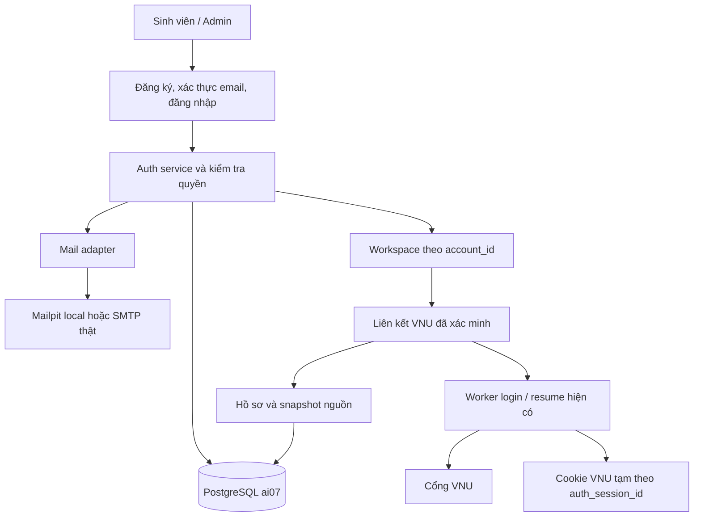
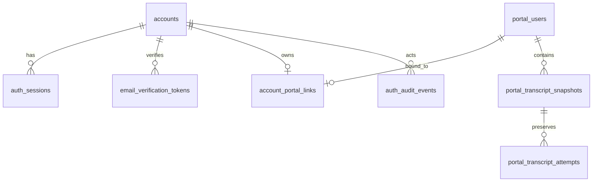

# Kế hoạch tài khoản Sổ học tập, xác thực email và phân quyền

**Yêu cầu mới thay thế luồng sinh viên:** đăng nhập VNU trực tiếp, admin đăng
nhập local riêng. Xem [thiết kế và vận hành mới](VNU_SIGNIN_2026_10_25.md).
Phần email/student dưới đây ghi lại thiết kế trước khi chuyển đổi.

Ngày lập: 25/10/2026. Trạng thái cập nhật: **đã triển khai và kiểm tra local**.
Tài liệu này giữ thiết kế/kế hoạch gốc; xem [hướng dẫn vận hành bản đã triển khai](HUONG_DAN_TAI_KHOAN_HE_THONG.md)
để biết cấu hình, migration, seed và các điều kiện production còn lại.

Người dùng đã chốt cần tài khoản riêng của hệ thống, gồm đăng ký, xác thực email,
đăng nhập, đăng xuất và hai vai trò admin/người dùng thường. Cần tạo sẵn một
admin và một người dùng thường trong PostgreSQL khi thực hiện. VNU trở thành
kết nối lấy bảng điểm sau khi sinh viên đã đăng nhập Sổ học tập.

Lượt lập tài liệu ban đầu chỉ lập kế hoạch. Theo yêu cầu thực hiện tiếp theo,
bản local đã có migration, hai seed, email Mailpit và runtime mới. Chưa commit/push.
Các thiết kế dưới đây là cơ sở triển khai; SMTP bên ngoài và triển khai công khai
vẫn cần nghiệm thu riêng theo hướng dẫn vận hành.

## 1. Hiện trạng và điểm phải chuyển đổi

Nền là workspace local `fix/portal-session-diagnostics-20261025`, HEAD `586d659`,
cùng các sửa chưa commit đã được nghiệm thu về cập nhật bảng điểm/giữ phiên VNU.
Không bỏ hoặc ghi đè những thay đổi này khi bắt đầu module tài khoản.

| Thành phần đã đọc | Hiện trạng | Yêu cầu mới |
| --- | --- | --- |
| Xác thực | `/auth/portal` xác thực VNU rồi tạo phiên app | Email/mật khẩu Sổ học tập mới tạo phiên hệ thống |
| Phiên app | Token cookie, trạng thái trong RAM, 30 phút | Phiên hệ thống kiểm tra/revoke qua PostgreSQL |
| Cookie VNU | RAM riêng theo phiên; cập nhật không hỏi mật khẩu khi VNU còn chấp nhận | Giữ cơ chế này, gắn với phiên hệ thống đã xác thực |
| Chủ hồ sơ | `portal_users` theo provider/subject VNU | `accounts.id` là danh tính hệ thống, đi qua liên kết đã xác minh để tới hồ sơ nguồn |
| `accounts` HUS | Có username PK, password_hash, role, must_change_password, is_active; chưa có email/xác thực email | Mở rộng bảng hiện có, giữ tương thích username/FK cũ |
| `students` | Đòi MSSV, tên, CTĐT, năm vào học | Không bắt buộc tạo sinh viên học vụ khi đăng ký tài khoản hệ thống |
| Email | Chưa có mail adapter/cấu hình email trong `Settings` | Thêm transport, template, token và luồng resend |
| Quyền | Chưa có admin/user dependency cho tài khoản riêng | Kiểm tra vai trò và ownership tại backend |

HUS accounts có thể đã thay đổi từ các checkpoint cũ; không mặc định database
thật vẫn rỗng. Trước migration chỉ kiểm tra cấu trúc và số lượng tổng hợp cần
thiết, không xuất danh sách email, hash hoặc bảng điểm thật.

## 2. Kết quả sản phẩm của bản đầu

1. Người mới đăng ký bằng email, tên hiển thị và mật khẩu Sổ học tập.
2. Hệ thống gửi email xác thực. Chưa xác thực thì chưa được vào workspace cá nhân.
3. Sau xác thực, đăng nhập hệ thống bằng email/mật khẩu, không cần VNU để vào app.
4. Người chưa liên kết VNU vẫn vào được workspace, thấy trạng thái “Chưa kết nối VNU”.
5. Sinh viên chủ động kết nối VNU; backend xác thực đúng nguồn rồi gắn hồ sơ với
   tài khoản Sổ học tập đang đăng nhập.
6. Đăng nhập hệ thống những lần sau xem được bảng điểm đã lưu. Khi cần cập nhật,
   tái sử dụng phiên VNU trong RAM; chỉ hỏi mật khẩu VNU khi kết nối đó hết hiệu lực.
7. Admin có trang quản lý tài khoản tối thiểu; người dùng thường không vào được
   API/trang quản trị dù sửa URL hoặc request.
8. Có hai tài khoản mẫu thực sự trong database local, dùng được sau restart.

Phần này không mở khóa gợi ý học vụ đang bị chặn bởi completeness/binding/policy.
Nhắc cập nhật sau 7 ngày vẫn giữ; tự crawl hằng tuần tiếp tục hoãn.
Đổi email, OAuth/SSO cho tài khoản hệ thống, MFA và quên mật khẩu tự phục hồi là
các mốc tiếp theo. Cần bổ sung phục hồi tài khoản trước khi mở dịch vụ rộng rãi;
không coi chỉ hoàn thành bản local là đủ vận hành cho toàn bộ sinh viên.

## 3. Kiến trúc đề xuất

Giữ FastAPI và giao diện HTML/CSS/JS. Xác thực hệ thống là module riêng;
connector VNU không tự cấp danh tính hệ thống nữa.



Quyết định nền:

- Tái sử dụng `accounts`; thêm UUID ổn định để code mới không coi email/MSSV là
  khóa ownership. Giữ `accounts.username` làm PK cho FK lịch sử, không sửa migration cũ.
- Dùng phiên opaque phía server, lưu token digest trong PostgreSQL. Không cần JWT
  cho bản web cùng origin này; vai trò/trạng thái tài khoản đọc từ server.
- Tách `AuthSession` có account_id khỏi `PortalConnection` có portal owner/subject.
  Không tiếp tục dùng một biến `owner` để chỉ cả hai loại ID.
- Hệ thống đăng nhập độc lập với khả năng truy cập VNU. VNU lỗi/hết phiên không
  làm mất quyền xem hồ sơ đã lưu của tài khoản hệ thống còn hợp lệ.
- Phiên hệ thống có thể còn sau restart nhờ DB; cookie VNU RAM thì mất và cần
  kết nối lại. Không ghi cookie VNU vào bảng phiên hoặc JSON profile.
- Bản đầu vẫn chạy một tiến trình app cho trạng thái VNU trong RAM. DB session
  không tự làm cookie VNU sẵn sàng trên nhiều worker; scale ngang cần thiết kế riêng.

## 4. Vai trò và quyền

Dùng role backend `student` cho người dùng thường để phù hợp CHECK hiện tại;
giao diện gọi là “Người dùng”. Role `admin` là quản trị viên. `teacher` đang có
trong schema là giá trị lịch sử, chưa mở luồng cấp quyền giảng viên ở module này.

| Hành động | Khách | Chưa xác thực email | Người dùng | Admin |
| --- | --- | --- | --- | --- |
| Đăng ký / mở trang xác thực | Có | Có | Không cần | Không cần |
| Gửi lại email | Theo giới hạn | Theo giới hạn | Không cần | Không cần |
| Đăng nhập | Có | Chưa cấp phiên đầy đủ | Có | Có |
| Workspace cá nhân | Không | Không | Của mình | Của mình |
| Kết nối/cập nhật/xóa bảng điểm VNU | Không | Không | Của mình | Của mình |
| Danh sách tài khoản, phân trang | Không | Không | Không | Có |
| Khóa/mở tài khoản, thay vai trò | Không | Không | Không | Có, có hàng rào |
| Xem mật khẩu/hash/token/cookie VNU | Không | Không | Không | Không |
| Xem bảng điểm người khác nhờ quyền admin | Không | Không | Không | Không mặc định |

Đăng ký công khai luôn tạo role `student`; schema từ chối client gửi `role`,
`is_active`, `email_verified_at`, `account_id` hoặc cờ seed.
Backend kiểm tra quyền cho mọi request, không dựa vào nút bị ẩn trên giao diện.
Thay role/khóa tài khoản phải tăng auth_version và thu hồi phiên tương ứng.
Không cho tự khóa/hạ quyền hoặc vô hiệu hóa admin hoạt động cuối cùng.
Kiểm tra admin cuối cùng cần transaction và khóa chung để hai admin không đồng
thời hạ quyền nhau vượt qua kiểm tra số lượng.

Trang admin bản đầu chỉ quản lý email, tên hiển thị, role, trạng thái, thời điểm
tạo/xác thực. Không có công cụ đặt mật khẩu người khác hoặc đánh dấu email đã
xác thực tùy ý. Mọi thay đổi quyền/trạng thái có audit event tối thiểu.

## 5. Thiết kế database

### 5.1. Mở rộng `accounts`

| Trường | Thiết kế dự kiến |
| --- | --- |
| `username` | Giữ PK/FK lịch sử. Tài khoản local mới dùng mã kỹ thuật `local:<uuid>`, không phải MSSV |
| `id` | UUID NOT NULL UNIQUE; định danh hệ thống dùng cho mọi bảng mới |
| `email` | Địa chỉ đã validate, giữ dạng phục vụ hiển thị/gửi email; nullable cho dòng legacy |
| `email_normalized` | Khóa so sánh UNIQUE khi khác null; policy nhất quán giữa register/login/resend |
| `email_verified_at` | Null cho đăng ký mới; chỉ điền sau xác thực đúng hoặc bootstrap local có ghi nhận |
| `display_name` | Tên tự khai của tài khoản hệ thống, không thay họ tên nguồn VNU |
| `password_hash` | Tái sử dụng cột có sẵn, hash Argon2id cho mật khẩu Sổ học tập |
| `role` / `is_active` | Tái sử dụng; quyền sử dụng còn phụ thuộc email_verified_at |
| `must_change_password` | Tái sử dụng cho tài khoản bootstrap có mật khẩu tạm |
| `auth_version` | Số nguyên tăng khi đổi mật khẩu/quyền/trạng thái để thu hồi phiên cũ |
| `updated_at` | Thời điểm cập nhật tài khoản |
| `seeded_for_dev` | Nhận diện hai tài khoản mẫu; mặc định false, không nhận từ public API |

Backfill UUID không đổi username, password_hash hoặc vai trò của dòng hiện hữu.
Dòng legacy không có email đã xác thực không tự trở thành tài khoản local dùng
được. Không đoán email từ MSSV, không tự đổi hash cũ thành một mật khẩu mẫu.
Không tạo dòng `students` với CTĐT/năm/điểm giả để vượt ràng buộc schema.

### 5.2. Các bảng mới

| Bảng | Trường và ràng buộc chính |
| --- | --- |
| `auth_sessions` | UUID id, account_id FK, token_digest UNIQUE, auth_version, created_at, last_seen_at, idle_expires_at, absolute_expires_at, revoked_at |
| `email_verification_tokens` | UUID id, account_id FK, token_digest UNIQUE, registration proof digest nếu có, purpose/version, expires_at, used_at, created_at |
| `account_portal_links` | account_id UNIQUE FK, portal_owner_id UNIQUE FK tới portal_users, linked_at, generation/version; mỗi phía tối đa một liên kết |
| `auth_rate_limits` | Khóa hành vi + định danh đã HMAC/hash, cửa sổ thời gian, số lượt; tránh chỉ giới hạn trong một process |
| `auth_audit_events` | Actor ID nullable, target ID, action, result code, created_at; không lưu body, mật khẩu, token, cookie, bảng điểm |

Token xác thực/phiên là giá trị ngẫu nhiên 256 bit; database giữ digest, không
giữ raw token. Trạng thái gửi mail không chứa nội dung link/token rõ. Bản đầu
không thêm durable email outbox chứa token; gửi qua tác vụ RAM có giới hạn và
timeout sau khi transaction tạo token đã commit. Nếu process chết trước khi gửi,
tài khoản vẫn chờ xác thực và có luồng gửi lại; không báo đã kích hoạt.



Index cho email normalized, token digest, expiry/revoked sessions và các FK.
Thao tác xác thực token, đổi role, claim liên kết, xóa dữ liệu phải có transaction.
Hai request đồng thời cùng email/provider identity không tạo tài khoản/liên kết trùng.
FK link tới portal owner dùng ON DELETE CASCADE để xóa bảng điểm không để link
treo; FK link tới account không âm thầm chuyển chủ. Session/token có thể cascade
khi có quy trình xóa account riêng. Audit phải giữ được sự kiện khi actor không
còn tồn tại, không giữ credential hoặc hồ sơ học tập như nội dung audit.

### 5.3. Migration và công cụ liên quan

Đề xuất migration mới nối `hus_20261023_03`, ví dụ `hus_20261025_04_system_auth`;
xác minh head thực tế trước khi chọn revision. Không sửa baseline SQL hoặc migration cũ.

Phải cập nhật đồng bộ:

- `app/infrastructure/hus_repository.py` đang kiểm tra chính xác migration HEAD.
- `database.tools.publish_catalogs` hiện chỉ chấp nhận hai head cũ.
- Fresh migration/adoption tests, schema checks và tài liệu vận hành.
- Test fresh migration vẫn không có tài khoản nếu chưa gọi lệnh seed riêng.

Backup local trước khi áp dụng. Chỉ migration/test DB tạm ở giai đoạn kiểm thử;
không reset volume, không publish catalog hoặc thay dữ liệu nguồn như tác dụng phụ.

## 6. Đăng ký và xác thực email

### 6.1. Luồng chính

1. Form nhận email, tên hiển thị, mật khẩu và xác nhận mật khẩu.
2. Backend validate/normalize theo cùng policy; hash mật khẩu, tạo tài khoản
   chưa xác thực với role student và tạo token trong transaction.
3. Sau commit, gửi email qua mail adapter. Phản hồi đăng ký/gửi lại không tiết
   lộ email đã tồn tại; không cấp phiên hệ thống đầy đủ ở bước này.
4. Email dẫn đến trang xác nhận riêng. GET chỉ mở trang, không tiêu thụ token
   hoặc kích hoạt tài khoản vì phần mềm quét link email có thể mở GET trước.
5. Người dùng xác nhận qua POST. Backend khóa token/account, kiểm tra hạn và
   trạng thái, ghi email_verified_at, tiêu thụ các token liên quan trong một transaction.
6. Hiện xác thực thành công và chuyển tới đăng nhập, không tự tạo phiên chỉ vì
   trình duyệt đã mở link. Replay token không cấp quyền lần nữa.

### 6.2. Các trường hợp cần xử lý ngay

| Tình huống | Quyết định dự kiến |
| --- | --- |
| Token hết hạn/không đúng/đã dùng | Hiện lỗi xác thực an toàn, cho gửi lại theo giới hạn; không cấp phiên |
| Đăng ký trùng email đã xác thực | Phản hồi công khai chung; không đổi mật khẩu, role hoặc trạng thái của tài khoản đó |
| Trùng email đang chờ | Không ghi đè password của lần đăng ký đang có; hướng dẫn luồng tiếp tục/gửi lại an toàn |
| SMTP tạm lỗi | Giữ pending; mã lỗi vận hành an toàn, không kích hoạt giả; người dùng có thể gửi lại |
| Gửi lại liên tục | Cooldown và quota theo email/IP; không cho request ẩn danh làm vô hiệu liên tục token hợp lệ của người đăng ký |
| Xác thực từ thiết bị khác | Có luồng xác nhận quyền email và đặt mật khẩu mới trước khi kích hoạt nếu thiếu bằng chứng phiên đăng ký |

Chống việc người khác đăng ký trước bằng email của nạn nhân: ràng buộc luồng
chuẩn với nonce đăng ký ngẫu nhiên trong cookie tạm và digest phía server.
Khi không có proof của lần đăng ký ban đầu, email holder phải đặt mật khẩu mới
trong bước hoàn tất; không kích hoạt một hash do người lạ đặt trước chỉ nhờ bấm link.
Quy trình tiếp tục/resend phải phân biệt được trường hợp này và được kiểm thử.

Mặc định đề xuất: token 30 phút, cooldown gửi lại 60 giây, tối đa 5 lượt/email/ngày,
giới hạn thêm theo IP. Cho phép số token còn hạn nhỏ có kiểm soát khi cần resend
khác thiết bị; sau khi xác thực thành công hủy toàn bộ token đang chờ của account.
Xóa pending không có dữ liệu liên quan sau thời hạn vận hành, đề xuất 7 ngày.

Link dùng `PUBLIC_BASE_URL` cấu hình server, không lấy Host/URL do request tự chọn.
Ưu tiên token trong URL fragment, frontend đọc vào RAM rồi xóa khỏi thanh địa chỉ,
POST bằng body; trang xác thực không tải tài nguyên bên thứ ba. Đặt no-store và
Referrer-Policy phù hợp; không log token hoặc toàn bộ link xác thực.

Chính sách email: thư viện validate đã được kiểm chứng, giữ địa chỉ hiển thị và
khóa so sánh riêng. Đề xuất tài khoản local so sánh không phân biệt hoa/thường
được ghi rõ; không tự bỏ dấu chấm hoặc phần `+tag`, không dùng email để tự ghép
hai tài khoản. Tham khảo [OWASP Email Verification](https://cheatsheetseries.owasp.org/cheatsheets/Email_Validation_and_Verification_Cheat_Sheet.html).

## 7. Mật khẩu, đăng nhập và vòng đời phiên hệ thống

Mật khẩu Sổ học tập và mật khẩu VNU là hai dữ liệu khác nhau. Chỉ mật khẩu Sổ
học tập có hash trong `accounts`; mật khẩu VNU vẫn chỉ dùng cho thao tác kết nối.

Đề xuất Argon2id qua thư viện có bảo trì, pin dependency cùng lock hiện tại.
Mốc tham khảo tối thiểu là 19 MiB, 2 vòng, parallelism 1; benchmark CPU/RAM của
server trước khi chốt cấu hình. Không dùng SHA-256 thay hash mật khẩu.
Nguồn: [OWASP Password Storage](https://cheatsheetseries.owasp.org/cheatsheets/Password_Storage_Cheat_Sheet.html).

Theo điều chỉnh người dùng ngày 25/10/2026: mật khẩu 6–128 ký tự, cho dấu cách/Unicode, không tự cắt
hoặc thay đổi password; chặn giá trị phổ biến bằng blocklist local, không gửi
password sang API ngoài. Có giới hạn body và số tác vụ hash đồng thời.
Nguồn: [OWASP Authentication](https://cheatsheetseries.owasp.org/cheatsheets/Authentication_Cheat_Sheet.html).

Luồng login: tìm account theo email normalized → verify hash, kể cả dummy hash
cho trường hợp không tồn tại → kiểm tra is_active/email_verified_at → cấp token
ngẫu nhiên mới. Không nhận token session do client tự chọn. Lỗi sai email/password
dùng thông báo chung; chỉ hiện email_not_verified khi đã chứng minh đúng password.

| Chính sách phiên đề xuất | Giá trị bản đầu |
| --- | --- |
| Cookie local | `study_app_session`, HttpOnly, SameSite=Lax, Path=/, không Domain |
| Production HTTPS | Secure bắt buộc; có thể dùng tên cookie `__Host-...` theo cấu hình |
| Thời hạn | 12 giờ tuyệt đối, hết sau 2 giờ không hoạt động; chưa thêm Remember me |
| Ownership/quyền | Token digest → DB session → account active/verified/auth_version; không tin role từ browser |
| Thu hồi | Logout, đổi password, khóa tài khoản/thay quyền hoặc hết hạn |
| Trình duyệt | Không localStorage token/password/profile; chỉ preference giao diện như hiện tại |

Các API thay đổi dữ liệu yêu cầu origin allowlist, JSON và kiểm tra CSRF gắn với
phiên; không coi SameSite là toàn bộ CSRF defense. Không CORS tùy ý. Sử dụng
thành phần CSRF được review, không tự phát minh mật mã. Các route mới `/admin/`
cũng phải nằm trong middleware no-store và kiểm tra origin, không chỉ `/auth/`, `/me/`.
Nguồn: [OWASP Session Management](https://cheatsheetseries.owasp.org/cheatsheets/Session_Management_Cheat_Sheet.html).

Đổi mật khẩu của mình cần password hiện tại, trừ luồng đặt lại khi hoàn tất email
đã nêu. Sau thay đổi: tăng auth_version, thu hồi phiên khác, xoay token hiện tại
và xóa trạng thái VNU của các phiên bị thu hồi. Chặn thử sai theo account/IP,
đề xuất 10 lần/15 phút và backoff; tránh khóa tài khoản vĩnh viễn do người lạ thử sai.

## 8. Liên kết VNU và bảo toàn bảng điểm cũ

### 8.1. Quy tắc sở hữu

Mặc định bản đầu: một tài khoản hệ thống liên kết tối đa một tài khoản VNU,
một danh tính VNU thuộc tối đa một tài khoản hệ thống. Đây là quyết định thiết kế
đề xuất để tránh chia sẻ nhầm bảng điểm; nếu cần nhiều liên kết thì phải mở rộng riêng.

Email hệ thống không buộc giống email/MSSV VNU và không phải bằng chứng sở hữu VNU.
Chỉ worker login mới đã xác minh được dùng để tạo/nhận liên kết.
Nếu VNU đã được liên kết với account khác, không tự chuyển chủ và không tiết lộ
email/account của người đang giữ; trả lỗi liên kết cần được xử lý.

### 8.2. Nhận hồ sơ VNU đã lưu trước khi có tài khoản hệ thống

1. Giữ nguyên `portal_users`, snapshot/attempt, digest, fetched_at và mốc nhắc.
   Migration chỉ thêm quan hệ mới, không gán tự động các hồ sơ cũ cho seed user/admin.
2. Sinh viên xác thực email và đăng nhập app.
3. Bấm Kết nối VNU, nhập credentials trực tiếp. Worker chứng minh đúng danh tính.
4. Transaction lấy/tạo portal owner hiện có, khóa hàng liên quan, kiểm tra unique
   link và gắn vào account hiện tại. Khi có tranh chấp, unique constraint là hàng rào cuối.
5. Giữ contract changed-unknown: có thể kết nối để xem bản cũ, nhưng dữ liệu mới
   chưa được chấp nhận không ghi đè snapshot hoặc làm mới mốc nhắc.

Trước cutover cần backup, kiểm tra aggregate số owner/snapshot/link, test claim
trên dữ liệu giả và kiểm tra không tạo link trùng. Không xuất hồ sơ thật để test.
Phiên VNU/app cũ phải bị thu hồi ở lần chuyển đổi; cookie `study_portal_session`
không được chấp nhận thay phiên hệ thống mới.

### 8.3. Tách hành vi kết nối, xóa dữ liệu và đăng xuất

| Hành động | Phiên hệ thống | Liên kết sở hữu | Phiên VNU RAM / dữ liệu |
| --- | --- | --- | --- |
| VNU hết phiên hoặc disconnect | Giữ | Giữ | Bỏ cookie, snapshot vẫn xem được |
| Cập nhật bảng điểm | Kiểm tra còn hợp lệ | Đúng account/link/version | Resume hoặc yêu cầu reauth; giữ mọi cổng dữ liệu |
| Logout hệ thống | Thu hồi phiên hiện tại | Giữ | Hủy job/phiên VNU thuộc phiên đó, giữ DB snapshot |
| Khóa account | Thu hồi tất cả phiên account | Giữ | Hủy kết nối/job, không tự xóa bảng điểm |
| Xóa bảng điểm VNU | Giữ đăng nhập app | Gỡ liên kết với owner đã bị xóa | Xóa đúng dữ liệu nguồn, thu hồi mọi kết nối/job tương ứng |

Bản đầu không có chức năng tự chuyển liên kết sang account khác. Xóa tài khoản
Sổ học tập là nghiệp vụ riêng với xác nhận/retention, không gộp vào nút xóa bảng điểm.

Mỗi job phải kiểm tra DB auth session, account active/verified/auth_version,
account_portal_link/generation và phiên bản cookie trước khi bắt đầu và trước
khi lưu/nhận trạng thái. Logout/delete/disable trong khi đọc không được hồi sinh
phiên hoặc bảng điểm từ response đến muộn. Khi transaction đã bắt đầu vẫn giữ
contract chờ kết quả commit thật như hiện tại.

## 9. API dự kiến và chuyển đổi API hiện có

| Method / route | Trách nhiệm |
| --- | --- |
| `POST /auth/register` | Validate, tạo pending student, tạo yêu cầu email; phản hồi chung |
| `POST /auth/email/verify` | Xác nhận token một lần; xử lý proof/đặt password mới khi cần |
| `POST /auth/email/resend` | Gửi lại có giới hạn, không reset password hoặc cấp quyền ngầm |
| `POST /auth/login` | Email/password hệ thống, cấp cookie phiên mới |
| `GET /auth/session` | Signed-out trả 200; signed-in trả principal tối thiểu, role và must_change_password, không trả bí mật |
| `GET /auth/me` | Thông tin account hiện tại, 401 nếu không có phiên |
| `POST /auth/logout` | Thu hồi app session và kết nối VNU tương ứng, clear cookie idempotent |
| `POST /me/password` | Đổi mật khẩu của chính mình và thu hồi/xoay phiên |
| `POST /me/portal-connection` | Cần account verified; login VNU mới và tạo/nhận link |
| `GET /me/portal-connection` | Trạng thái kết nối/liên kết, không cookie/token |
| `DELETE /me/portal-connection` | Disconnect phiên VNU, không xóa ownership/snapshot |
| `POST /me/portal-sync` | Cập nhật qua phiên VNU, không credentials |
| `POST /me/portal-reauth` | Password VNU, subject từ liên kết server, không nhận account ID |
| `GET/DELETE /me/portal-sync/{id}` | Giữ contract job/hủy, ownership theo auth session và link |
| `GET /me/profile` | Profile của account và dữ liệu VNU đã liên kết; chưa link vẫn trả 200 với trạng thái rỗng có cấu trúc |
| `DELETE /me/portal-data` | Xóa dữ liệu VNU của account, không xóa/đăng xuất tài khoản hệ thống |
| `GET /admin/users` | List/filter/phân trang account; không mật khẩu/secret/profile học tập |
| `PATCH /admin/users/{id}` | Chỉ role/status được cho phép, kiểm tra admin cuối, audit và revoke phiên |

Tên endpoint là contract dự kiến để triển khai, chưa tồn tại toàn bộ.
`POST /auth/portal` cũ phải bị bỏ đường cấp app session, đề xuất 410 sau cutover;
frontend chuyển sang `/me/portal-connection`. Không giữ fallback “VNU login thì
được bỏ qua tài khoản hệ thống/email verification”.

Tách dependency `require_account`, `require_verified_account`, `require_admin`,
`require_portal_link`. `app/api/academic.py` hiện import session/COOKIE từ portal;
cần chuyển sang dependency chung và tra portal owner qua link, giữ owner nguồn
nội bộ của AcademicContext, không truyền UUID account thay UUID portal một cách mù quáng.

Kiểm kê route legacy: GET catalog không có dữ liệu cá nhân có thể tiếp tục public;
route profile/personal API phải có ownership hoặc tạm đóng nếu chưa có mapping.
Các POST học tập legacy còn giữ thì yêu cầu account verified theo policy mới;
không xóa domain tests hoặc khôi phục UI nhập tay trong task này.

## 10. Email local và gửi email thật

Tạo interface mail adapter với fake transport cho test, SMTP transport cho runtime.
Template HTML và text gồm mục đích xác thực, thời hạn, link, hướng dẫn bỏ qua nếu
không đăng ký. Không chứa password, bảng điểm hoặc mã VNU.

Local mặc định đề xuất dùng [Mailpit](https://mailpit.axllent.org/docs/) bắt email
SMTP và xem qua hộp thư thử chỉ mở loopback. Không forward ra ngoài. Giữ UI sản
phẩm sạch; địa chỉ hộp thư test và cách lấy link nằm trong tài liệu phát triển.

Email thật dùng SMTP do người dùng cấu hình; chưa chọn nhà cung cấp trả phí hoặc
gửi thư trong lượt lập kế hoạch. Các biến dự kiến:

```text
APP_ENV, PUBLIC_BASE_URL, AUTH_ALLOWED_ORIGINS
APP_SESSION_IDLE_SECONDS, APP_SESSION_ABSOLUTE_SECONDS
AUTH_TOKEN_PEPPER, CSRF_SIGNING_KEY
EMAIL_VERIFICATION_TTL_SECONDS, EMAIL_RESEND_COOLDOWN_SECONDS
EMAIL_BACKEND, SMTP_HOST, SMTP_PORT, SMTP_USERNAME, SMTP_PASSWORD
SMTP_SECURITY, MAIL_FROM, MAIL_TIMEOUT_SECONDS
```

SMTP security phải chọn TLS/STARTTLS phù hợp với provider, xác minh certificate;
không gửi credentials plaintext trên mạng ngoài. Secret chỉ trong env/config local
ignored hoặc secret manager của môi trường sau này; không đưa giá trị thật vào
`.env.example`, frontend, Git hoặc log.

SMTP chưa cấu hình/lỗi không được tự xác thực user. Register/resend có thông báo
chung và hướng xử lý; vận hành có mã lỗi mail an toàn. Khả năng SMTP có thể có
health riêng, không bắt `/ready` phải gửi thư thử hoặc làm hỏng khả năng đăng nhập
của account đã xác thực chỉ vì mail tạm lỗi.

## 11. Hai tài khoản mẫu lưu database

| Loại | Email local đề xuất | Role DB | Dữ liệu ban đầu |
| --- | --- | --- | --- |
| Admin | `admin@sohoctap.test` | `admin` | Active, bootstrap verified, seeded_for_dev=true, chưa liên kết VNU |
| Người dùng thường | `student@sohoctap.test` | `student` | Active, bootstrap verified, seeded_for_dev=true, chưa liên kết VNU |

Đây là địa chỉ thử dành riêng cho local, không gửi email ra ngoài. Chính sách
validate seed phải nhận diện chế độ test rõ ràng, không mở domain thử trong
đăng ký production. Tên/email có thể điều chỉnh khi thực hiện nếu người dùng muốn.

Thực hiện bằng CLI riêng, ví dụ `database.tools.seed_system_accounts`:

- Chỉ chạy có chủ đích sau migration, không tự seed khi khởi động app.
- Xác minh APP_ENV local/test và đích PostgreSQL local ai07; production không tự
  bật seed. Không đọc/ghi bảng điểm hoặc gắn VNU của người dùng thật vào hai account.
- Tạo mật khẩu ngẫu nhiên riêng tối thiểu 20 ký tự, hash như mọi tài khoản local.
  Bàn giao một lần qua file private ignored có quyền truy cập phù hợp hoặc đầu
  ra riêng theo yêu cầu; không đưa password vào code/SQL/Git/log CI.
- Đặt must_change_password=true. Lần login đầu chỉ vào bước đổi mật khẩu;
  sau đổi mới mở workspace/admin. Không hardcode tài khoản “admin/admin”.
- Bootstrap verified là ngoại lệ chỉ cho hai account local do công cụ quản trị
  tạo; public registration luôn đi qua email. Audit ghi nguồn bootstrap, không
  dùng hai dòng seed để tuyên bố đã nghiệm thu gửi email thật.
- Idempotent: chạy lại không nhân bản, reset password hoặc tự nâng quyền một
  account trùng email không có cờ seed; trường hợp không khớp thì dừng và báo rõ.
- Kiểm tra hai dòng đã commit, login đúng role sau restart và không có dòng
  students/course_attempts giả được tạo như tác dụng phụ.

Trước public deployment phải vô hiệu hai account dev hoặc chuyển bootstrap admin
sang địa chỉ thật đã được kiểm soát/xác thực và đổi secret; readiness production
phải phát hiện cấu hình seed đang mở. Không công bố file bàn giao mật khẩu.

## 12. Giao diện cần xây dựng

| Màn hình | Nội dung |
| --- | --- |
| Đăng nhập hệ thống | Email/password Sổ học tập, lỗi, liên kết đăng ký/gửi lại xác thực |
| Đăng ký | Tên hiển thị, email, password/xác nhận, trạng thái xử lý |
| Chờ xác thực | Hướng dẫn kiểm tra email, cooldown gửi lại, sửa email bằng cách bắt đầu lại có kiểm soát |
| Xác thực email | Xác nhận chủ động, token hết hạn/đã dùng, luồng hoàn tất khác thiết bị |
| Đổi mật khẩu ban đầu | Dành cho seed must_change_password, không mở toàn quyền trước bước này |
| Header/account | Danh tính hệ thống/role, đăng xuất hệ thống tách khỏi VNU |
| Hồ sơ VNU | Chưa liên kết/đã liên kết/mất kết nối; nút kết nối/cập nhật/xác thực lại và lần đồng bộ |
| Admin/users | Danh sách phân trang, filter, role/status, xác nhận thay đổi và kết quả |

Giữ branding Sổ học tập, VIE/EN, sáng/tối, keyboard, focus, labels, reduced motion
và không tràn ở 390px. Người dùng phân biệt rõ “Mật khẩu Sổ học tập” và “Mật khẩu VNU”.
Không dùng email/tên tự khai để thay thông tin VNU nguồn; hiển thị mỗi loại đúng nhãn.

State frontend tách `account` và `portal`: VNU disconnect không đưa account về
signed-out; xóa bảng điểm không xóa header account. Logout hệ thống thì xóa tất cả
DOM/state cá nhân, bao gồm admin list, biểu đồ, reminder và form đang xử lý.
Epoch/version guard phải bao phủ login, claim VNU, sync, reauth, delete và admin
response đến muộn sau khi quyền đã đổi. Không có request hồ sơ riêng tư trước khi
kiểm tra phiên như bản sửa 401 hiện tại.

## 13. Tổ chức code và các điểm tích hợp

Đề xuất `app/auth/` chứa password/token helpers, repository, service, mail adapter,
schemas và dependencies; `app/api/auth.py`, `app/api/admin.py` tách khỏi portal.
Không viết nghiệp vụ DB/email/hash trực tiếp thành một route lớn.

Các phần dự kiến sửa: config/env template; HUS migration/head compatibility;
main middleware/router/lifespan; portal API/runtime/store resolver; academic
dependency; static auth/admin/workspace/portal; tests và CI cài dependency lock.
Không đổi source catalog, parser điểm, PDF acceptance hoặc RAG như tác dụng phụ.

Các thay đổi local hiện có phải được giữ và review thành nền trước/đồng thời với
feature mới. Khi công bố theo yêu cầu, dùng nhánh/PR phù hợp và merge commit;
không tự commit/push các sửa cũ để làm sạch workspace hoặc bỏ lịch sử đồng đội.

## 14. Các giai đoạn thực hiện

| Giai đoạn | Tỷ trọng | Bàn giao | Điều kiện qua mốc |
| --- | --- | --- | --- |
| 1. Chốt contract/nền dữ liệu | 8% | Principal, role matrix, mapping/claim, email/session policy | Không còn đường VNU tự cấp quyền hệ thống hoặc claim theo dữ liệu browser |
| 2. Database/migration/repository | 15% | Accounts extension, session/token/link/rate/audit, cập nhật head compatibility | Fresh/upgrade, FK/unique/rollback và catalog không đổi |
| 3. Password/auth/session | 15% | Register pending, login, logout, đổi password, dependencies | Unverified/disabled/role injection/session revoked bị chặn |
| 4. Email verification | 15% | Adapter, template, token/proof/resend, local SMTP | Nhận email test, token một lần, cross-device an toàn, SMTP fail không kích hoạt |
| 5. Ownership và VNU cutover | 20% | Claim hồ sơ cũ, connection/resume/reauth, academic resolver | Hai account cách ly; dữ liệu cũ không mất; không bỏ qua auth mới |
| 6. UI và admin | 12% | Màn auth/verification, header tách VNU, admin/users | Backend lẫn UI đúng quyền; VI/EN/themes/mobile và stale responses |
| 7. Hai account mẫu | 5% | CLI seed, hai dòng local, bàn giao mật khẩu riêng | Idempotent, đổi password đầu tiên, login đúng quyền sau restart |
| 8. Hồi quy/nghiệm thu | 10% | Offline, PostgreSQL, email/browser integration và bàn giao | Checklist bản đầu đạt; ghi rõ gate SMTP thật/public deployment còn lại |

Báo tiến độ theo mốc hoàn thành/đã kiểm chứng, không dựa vào số file đã sửa.
Lập kế hoạch hoàn thành ở lượt này; triển khai module mới vẫn 0%.

## 15. Ma trận kiểm thử bắt buộc

| Nhóm | Trường hợp chính |
| --- | --- |
| Register | Email malformed/Unicode/normalization, password policy, role injection, duplicate/concurrent register, không ghi đè pending/verified password |
| Email | Expiry/replay/concurrent consume, resend/cooldown/quota, mail failure, process restart trước gửi, scanner GET không activate, cross-device và pre-registration |
| Password | Hash/verify/rehash, wrong password, dummy hash, đổi password/revoke; không echo input hoặc log secret |
| Session | Cookie attributes/CSRF/origin, session fixation, idle/absolute expiry, logout lặp lại, restart DB session, auth_version/disabled/role change |
| Admin | User gọi thẳng API bị 403; last-admin concurrency; audit và pagination; không trả hash/token/grades; không tự cấp verified qua PATCH |
| VNU ownership | Account A không đọc/sync/delete job/data B; claim tranh chấp; cùng VNU hai account; legacy unclaimed được nhận bằng bằng chứng nguồn mới |
| VNU lifetime | Cookie RAM đúng session, expiry/restart, reconnect không logout app, logout/disable/delete giữa collect/save, không nhận kết quả cũ |
| Data preservation | Snapshot/attempt/digest/fetched_at không sửa ngoài contract; changed-unknown vẫn chặn; reminder chỉ đổi sau sync được chấp nhận |
| Seed | Đúng 2 dòng, role/hash/verified marker, không fake student/VNU, idempotency/collision, không chạy production, không lộ password |
| UI | Login/register/verify/resend/must-change, account và VNU tách biệt, các empty/error/loading, logout xóa mọi DOM, ngôn ngữ/theme/mobile |
| Deployment | Fresh DB/upgrade/backup/rollback, schema-head compatibility, mail mode đúng, production không bật dev seed, HTTPS và origin/proxy được cấu hình |

Offline dùng fake mail/worker, block outbound HTTP. PostgreSQL dùng database/schema
tạm theo validator hiện tại; không thử destructive migration trên ai07 thật.
Chrome dùng dữ liệu giả và intercept API/portal; email integration dùng Mailpit.
E2E email thật chỉ thực hiện với địa chỉ nhận được phép và cấu hình SMTP có sẵn.
Không giữ link/token/cookies/điểm thật trong screenshot, trace, report hoặc Git.

## 16. Nghiệm thu và chuyển sang chạy thực tế

Bản local hoàn thành khi:

- Đăng ký mới phải xác thực email trước khi dùng workspace.
- Login/logout hệ thống hoạt động độc lập với VNU; restart không mất account/hash/link.
- Hai tài khoản mẫu tồn tại thật và đúng quyền, đổi được mật khẩu ban đầu.
- Account user không gọi được admin API và không thấy dữ liệu người khác.
- Link VNU có bằng chứng, hồ sơ cũ vẫn có thể nhận đúng chủ, cập nhật trong phiên
  không hỏi password VNU khi phiên còn hợp lệ.
- Các kiểm thử dữ liệu/phiên/email/role đã đạt, không nới completeness để vượt test.

Trước khi tuyên bố sẵn sàng cho sinh viên dùng trên server: cần SMTP thật và email
người nhận đã xác nhận nhận/verify được; domain/HTTPS và trusted proxy/origins;
quy trình phục hồi tài khoản; quản lý secret/backup; bootstrap admin an toàn;
và lựa chọn chạy single-worker hoặc giải pháp VNU state cho nhiều worker.
Chưa có các cấu hình này không được coi là mọi email production đã gửi thành công.

Các thông tin có thể chốt khi triển khai gần tới phần tương ứng: SMTP/mail-from,
địa chỉ nhận thử thật, domain triển khai, và tên/email seed nếu muốn khác đề xuất.
Không cần thu thập các secret đó trong chat hoặc chặn việc xây dựng/test local.

## 17. Rollout và rollback

1. Review/bảo toàn nền giữ phiên VNU đã nghiệm thu, làm trên feature branch.
2. Kiểm tra head và backup schema/data local; test migration trên bản dùng riêng.
3. Triển khai backend/schema và test với feature chưa mở public; không giữ hai
   đường đăng nhập cho phép vượt qua email verification cùng lúc.
4. Cutover UI/API cùng release: thu hồi cookie cũ, bật local account dependency,
   kiểm tra hai seed và claim VNU; không tự claim toàn bộ dữ liệu cũ.
5. Nghiệm thu local/mail test; SMTP thật và public deployment là gate riêng.
6. Khi được yêu cầu công bố, PR và Create a merge commit, giữ lịch sử gốc.

Rollback ưu tiên app/release tương thích schema bổ sung; không xóa bảng accounts,
link, snapshot hoặc email proof đã có dữ liệu. Nếu quay lại bản VNU-only, chỉ
chạy local/cô lập sau khi thu hồi phiên mới và phải nói rõ hệ thống đang đổi
mô hình xác thực; không âm thầm mở lại VNU-only cho public để vượt gate lỗi.
Restore backup là thao tác riêng có review, không tự downgrade destructive.

Tham chiếu: [Module 12](../modules/12-system-authentication.md),
[Module 09](../modules/09-portal-transcript-import.md),
[kế hoạch giữ phiên VNU](KE_HOACH_GIU_PHIEN_VNU_2026_10_25.md),
[HUS runtime](../database/HUS_RUNTIME.md).
