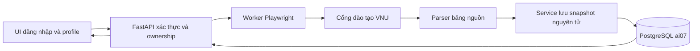

# Kế hoạch tích hợp VNU: tài khoản, profile và bảng điểm lưu database

Cập nhật chốt phiên: 23/10/2026. **Đã triển khai code local và migration;
người dùng xác nhận đăng nhập và xem bảng điểm thành công, nhưng họ tên/ngành/
khóa vẫn trống dù đã đăng nhập lại. Lỗi này CHƯA GIẢI QUYẾT; chưa nghiệm thu
toàn bộ profile hoặc hoàn tất tích hợp.** Xem
[trạng thái triển khai và bước chẩn đoán tiếp theo](PORTAL_INTEGRATION_STATUS_2026_10_23.md).

Không tiếp tục coi F5/cache/chưa đăng nhập lại là nguyên nhân. Cần bằng chứng
bố cục authenticated trên `default.asp` và kiểm tra luồng đọc/parse/save trước
khi sửa tiếp. Test giả lập đã qua chưa chứng minh ba trường hoạt động thật.
Chốt phiên chỉ cập nhật tài liệu; không commit/push.

Các phần bên dưới giữ thiết kế ban đầu. Identity/completeness hiện còn cổng
nghiệm thu; không hiểu các mục đề xuất là bằng chứng mọi hành vi đã hoàn tất.

## 1. Phạm vi đã chốt với người dùng

- Chạy trên máy cá nhân tại http://127.0.0.1:8000 trước; server nhiều người dùng là bước sau.
- Đợt đầu: đăng nhập VNU, lấy bảng điểm, lưu PostgreSQL theo tài khoản, có giao diện profile xem lại và chủ động cập nhật.
- **Dùng đăng nhập VNU, không tạo mật khẩu Sổ học tập riêng.** Chỉ cấp phiên web nội bộ sau khi xác thực portal thành công. Không lưu mật khẩu VNU, kể cả dạng hash để tái đăng nhập.
- Người dùng đã cho phép lưu profile/bảng điểm lâu dài. Quyết định này thay thế giới hạn chỉ dùng bảng điểm portal trong phiên. Không mở rộng sang lưu chat hay credentials.
- Chưa áp bảng điểm portal vào transcript nhập tay, GPA dự án, progress, eligibility hoặc gợi ý môn. Review/apply học vụ là mốc sau.
- Áp dụng [skill frontend-design](../.github/skills/frontend-design/SKILL.md) của người dùng; giữ Sổ học tập, theme sáng/tối và Việt/Anh.
- Không còn câu hỏi phạm vi đang chờ. Các lựa chọn triển khai thường lệ tự giải quyết trong phạm vi đã giao; cập nhật tiến độ thường xuyên và hỏi khi có quyết định thực sự cần người dùng.

## 2. Bằng chứng và giới hạn

Đã fetch `origin/feat/login` tại `b790d6af5e3a2fa183e28dd9b08286489572c71a`. Hai test giả lập chạy thành công. Phiên đăng nhập thật được người dùng cho phép đã mở trang xem điểm và đọc 45 hàng bảng, trong đó 36 hàng môn có nội dung điểm. Không đưa tài khoản, mật khẩu hoặc điểm từng môn vào Git/tài liệu.

Connector dùng Playwright/Chromium: form tại `https://daotao.vnu.edu.vn/dkmh/login.asp`, menu `#PortalModule_374`, bảng trong `#divList3`, tìm cả page/frame. Chưa xác minh HTTP API độc lập, CAPTCHA/OTP, danh tính đầy đủ, pagination hoặc độ đầy đủ toàn lịch sử. Phiên thử thành công không chứng minh mọi tài khoản đều hoạt động.

CLI hiện in mảng chuỗi, chưa có API/profile/database. Main đã có preview theo năm/học kỳ nhưng chưa lưu và chưa apply. Model transcript hiện tự gán đạt theo `grade >= 5.0`, cấm trùng mã môn, term 1..12 và tự quy đổi GPA; không dùng model này để lưu bảng điểm nguồn.

## 3. Luồng người dùng

1. Mở “Đăng nhập” hoặc “Hồ sơ của tôi”, nhập tài khoản VNU trực tiếp trên UI local.
2. Backend xác thực VNU; chưa xác thực thì không được xem profile đã lưu. Không tin username client gửi làm bằng chứng sở hữu dữ liệu.
3. Lần đầu lấy điểm: UI báo đang kết nối/đăng nhập/đọc; parser kiểm tra cấu trúc và lưu snapshot đúng chủ tài khoản trong transaction.
4. Profile hiển thị thông tin đã xác minh được, bảng điểm theo năm/học kỳ mới nhất trước, tổng kết nguồn, thời điểm cập nhật.
5. Đăng nhập lần sau xem snapshot đã lưu; “Cập nhật bảng điểm” chủ động lấy lại. Không tự crawl nền hoặc đăng nhập lại bằng mật khẩu lưu sẵn.
6. Lỗi/hủy đồng bộ giữ snapshot trước, hiển thị dữ liệu cũ và nguyên nhân an toàn. Dữ liệu partial/unknown không tự thay bản đầy đủ trước đó.
7. Đăng xuất thu hồi phiên, đóng browser, xóa profile khỏi DOM/state; DB vẫn giữ dữ liệu. “Xóa dữ liệu đã lưu” có xác nhận riêng và kiểm tra ownership.

Tên/ngành/khóa chưa lấy được hiển thị chưa có thông tin; không suy từ MSSV hoặc năm học đầu bảng điểm. Mốc xem nguồn không cần chờ policy học lại/điểm D; chỉ giữ đúng nguồn, không suy đạt/trượt.

## 4. Kiến trúc và vòng đời phiên



Chọn lọc package daotao, CLI và test từ commit đã thử vào nhánh tích hợp dựa trên main; không merge cả lịch sử login mặc định. Không viết lại connector của đồng đội khi chưa có lỗi cần sửa. Không commit/push nếu chưa được yêu cầu.

Playwright sync chạy trong worker riêng, không chặn async event loop. Tạo/đóng Playwright trong worker sở hữu, không chia sẻ context giữa tài khoản hoặc thread. Có giới hạn job đồng thời, timeout toàn job và cleanup khi lỗi/hủy/shutdown. Đề xuất ban đầu một job đang chạy/phiên, timeout 120 giây/job, idle TTL phiên cấu hình được; đo lại khi triển khai.

Chrome có giao diện trên máy local. Chrome trên server không tự hiển thị ở máy sinh viên; server cần nghiệm thu riêng cơ chế tương tác. CAPTCHA/OTP chưa hỗ trợ thì trả `interaction_required`, giữ dữ liệu cũ, không tự bỏ qua. Timeout menu không tự kết luận sai mật khẩu.

Portal cookies chỉ trong RAM đến khi đọc xong/lỗi/hủy. Cần xác thực mới khi không còn phiên portal để cập nhật. Phiên web chỉ tạo sau xác thực VNU thành công. Kiểm tra dấu hiệu authenticated và tài khoản tương ứng, đối chiếu danh tính portal khi có; nếu chưa xác minh ownership thì chưa ghi profile lâu dài. Không dùng mảng điểm không rỗng làm bằng chứng duy nhất.

## 5. Database và migration

Các bảng HUS hiện có chưa phù hợp để nhận trực tiếp nguồn portal: accounts bắt buộc password_hash; students bắt buộc tên/CTĐT/năm vào học; course_attempts yêu cầu mã môn thuộc courses và trạng thái đạt/trượt cụ thể. Nguồn có thể thiếu thông tin, có môn ngoài catalog và nhiều lần học. Không tạo dữ liệu giả để vượt ràng buộc, không ép profile vào catalog 2022/draft_unverified.

| Bảng dự kiến | Trường và ràng buộc |
| --- | --- |
| portal_users | ID UUID, provider, subject đã xác minh, thông tin profile nullable, thời điểm tạo/cập nhật; unique(provider, subject); không có mật khẩu |
| portal_transcript_snapshots | owner FK, schema/connector version, fetched_at, completeness, source_summary JSONB, content digest, trạng thái; không lưu DOM/cookies |
| portal_transcript_attempts | snapshot FK, source row key, mã/tên môn nguồn, tín chỉ, năm/học kỳ/mã học kỳ, chuỗi điểm 10/chữ/4 và số parse nullable, trạng thái nguồn nullable; unique(snapshot, source row key), không unique theo mã môn |
| portal_users.current_snapshot_id | Con trỏ snapshot hiện hành; FK/ràng buộc bảo đảm snapshot thuộc cùng owner, đổi trong transaction |
| web_sessions nếu cần DB session | Token digest, owner FK, expiry/thu hồi; không có mật khẩu hoặc cookie VNU |

Tên bảng/schema là thiết kế dự kiến. Đề xuất giữ bản hiện hành và một bản trước để rollback; cùng digest không nhân bản. Đồng bộ thất bại không đổi con trỏ. Xóa dữ liệu cascade đúng owner và hủy/vô hiệu hóa job đang chạy để phản hồi muộn không ghi lại.

Dùng migration HUS mới nối tiếp `hus_20261017_02`; không sửa migration cũ, không dùng root Alembic hoặc SQL import lịch sử. Test repository/migration trên DB dùng riêng. Backup trước áp migration local runtime; không reset DB/volumes/catalog. Không đưa dump chứa profile thật vào Git hoặc log dùng chung.

## 6. Parser và schema nguồn

Tách hàng học kỳ, môn, tổng kết và hàng chưa hiểu. Giữ thứ tự, ô trống và mọi lần học. Không tự bỏ hậu tố E, ghép gần giống, đổi mã, chọn điểm cao nhất/lần cuối, tính lại GPA hoặc quy đổi điểm. Chưa rõ giữ nguyên chuỗi/null kèm cảnh báo.

Snapshot gồm schema_version, connector_version, fetched_at, định danh đã kiểm chứng tối thiểu, ngành/khóa nullable, terms/attempts, source_summary và completeness. Locator dùng mã học kỳ/chỉ số bảng-hàng, không HTML thô hoặc URL chứa token.

Kiểm tra loading/filter/pagination: thấy một ô mã môn chưa đủ chứng minh hoàn tất. Tổng tín chỉ khớp chỉ là tín hiệu vì học lại/môn điều kiện có thể khác policy. Partial/unknown có thể xem tạm với cảnh báo, không tự thay snapshot tốt trước đó. Hàng chưa hiểu không âm thầm biến mất.

## 7. API và quyền truy cập

Route đề xuất cho VNU đã chốt, chưa triển khai:

| Method / route | Trách nhiệm |
| --- | --- |
| POST /auth/portal | Xác thực VNU, tạo phiên web sau kiểm tra danh tính; không echo credentials trong lỗi |
| GET /auth/me | Danh tính tối thiểu từ phiên, không nhận owner do client chọn |
| POST /auth/logout | Thu hồi phiên, hủy job/context liên quan |
| GET /me/profile | Profile và snapshot đã lưu của chủ phiên |
| POST /me/portal-sync | Tạo job theo thao tác người dùng, trả 202/job ID; nhận credentials trong body khi cần xác thực mới |
| GET /me/portal-sync/{id} | Trạng thái an toàn, kiểm tra ownership |
| DELETE /me/portal-sync/{id} | Hủy job, giữ snapshot trước |
| DELETE /me/portal-data | Xóa dữ liệu portal của chủ phiên, ngăn job muộn ghi lại |

Không thêm register/mật khẩu local hoặc API review/apply trong đợt này. Cookie phiên web HttpOnly/SameSite, token ngẫu nhiên, expiry/rotation/logout; Secure khi HTTPS. Kiểm tra origin/CSRF cho mutation; không CORS tùy ý. Query luôn scope theo owner từ phiên. ID không thay authorization. Response auth/profile dùng `Cache-Control: no-store`.

Không lưu mật khẩu VNU kể cả hash để reconnect. Không log body, validation input, Playwright call log, trace/video/screenshot/DOM hoặc bảng điểm thật. Redact lỗi ở boundary; chỉ log stage/mã lỗi/thời lượng. Allowlist portal/redirect đã review, không nhận URL đích tùy ý. Không đưa profile/credentials vào LLM/RAG. Public deployment cần HTTPS và nghiệm thu phiên nhiều người dùng.

## 8. Giao diện theo frontend-design

Chủ đề: hồ sơ học tập cá nhân với bảng điểm nguồn làm nội dung chính. Giữ ngôn ngữ Sổ học tập; không đổi thành dashboard gồm nhiều thẻ KPI giống nhau.

Token lấy từ theme hiện hành: nền #eef2ff, bề mặt #ffffff, chữ #253654, phụ #52617b, nhấn #3658ad; tối nền #101a32 và chữ #e6edfc. Giữ font hiện tại đủ dấu Việt, phân cấp rõ, số bảng căn phải. Không thêm CDN font chỉ để khác biệt; đo contrast cả hai theme.

```text
[Điều hướng Sổ học tập]                    [Tài khoản / Đăng xuất]
Hồ sơ học tập                             [Cập nhật bảng điểm]
Tên nếu nguồn có; mã sinh viên đã xác minh
Ngành / khóa nếu có; lần cập nhật và trạng thái
---------------------------------------------------------------
Tổng kết nguồn: tín chỉ / tín chỉ tích lũy / GPA
Bảng điểm theo năm học, học kỳ mới nhất trước
Mã môn | Tên học phần | TC | Hệ 10 | Chữ | Hệ 4
...
[Xóa dữ liệu đã lưu]
```

Login có label, ẩn/hiện mật khẩu, lỗi có hướng xử lý. Giữ tên hành động nhất quán: Đăng nhập, Cập nhật bảng điểm, Đăng xuất. Không bịa tên/ngành/khóa. Hiện nguồn/thời điểm cập nhật, cảnh báo dữ liệu cũ và đủ loading/empty/error/cancel/xác nhận xóa. Không phơi chi tiết browser/worker cho sinh viên khi không cần thao tác.

Bảng cuộn trong vùng riêng, header rõ, focus/keyboard/reduced motion, không tràn toàn trang ở 390px. Theme/VI-EN không dịch lại điểm hoặc tên môn nguồn. Không lưu profile vào localStorage. Review trước code: bảng phải là trọng tâm, tổng kết thành dải thông tin gọn. Sau build xem screenshot desktop/mobile cả hai theme; ảnh lưu Git chỉ dùng fixture tổng hợp.

## 9. Thứ tự thực hiện và nghiệm thu

| Bước | Bàn giao | Nghiệm thu |
| --- | --- | --- |
| 1 | Hoàn thiện contract auth VNU, chọn lọc connector vào nhánh tích hợp | Đúng commit đã thử, giữ UI/catalog hiện tại |
| 2 | Parser/schema, fixture, kiểm tra identity/completeness | Học lại/thiếu điểm/môn lạ/hàng chưa hiểu không mất, không suy học vụ |
| 3 | Migration/repository snapshot/owner/transaction | DB test độc lập: ownership, rollback, idempotency, concurrent sync, FK owner/snapshot, delete |
| 4 | Auth/session/worker và API profile/sync | Xác minh danh tính, cô lập phiên; timeout/hủy đóng browser, lỗi giữ snapshot cũ |
| 5 | UI login/profile theo skill | Xem lại sau đăng nhập, sáng/tối/VI-EN/mobile; logout xóa DOM/state |
| 6 | Regression và nghiệm thu local | DB/UI khớp nguồn; reload/restart không mất snapshot, không ảnh hưởng nhập tay/gợi ý |

Test thêm: A không đọc/xóa/sync của B kể cả biết ID; login sai không xem dữ liệu cũ; expiry, cancel/response muộn, xóa khi sync, partial/source đổi, cập nhật đồng thời, CSRF/origin và không lộ secrets trong lỗi/log. Chạy offline và PostgreSQL tests phù hợp trên DB dùng riêng, không dùng dữ liệu thật trong CI. Live acceptance có phép, đối chiếu học kỳ/dòng môn/tổng kết; không cố tình lặp đăng nhập sai nhiều lần.

Hoàn thành đợt đầu khi đăng nhập, lấy điểm, lưu đúng tài khoản, xem/cập nhật/xóa/đăng xuất đúng và UI dùng được. Chưa tuyên bố hoàn thành review/apply. Mốc sau mới cần xác nhận CTĐT/quy chế học lại/đạt/miễn trước khi dùng cho gợi ý; không dùng các việc đó chặn profile xem nguồn.

Trong phiên lập kế hoạch chưa thay runtime/schema, chưa commit/push/merge. Bản kế hoạch đã được sửa lỗi mã hóa tiếng Việt khi chốt phiên.

Tham chiếu: [09 Portal](../modules/09-portal-transcript-import.md), [02 Transcript](../modules/02-transcript-profile.md), [07 API](../modules/07-recommendation-api.md), [08 UI](../modules/08-web-ui.md).
