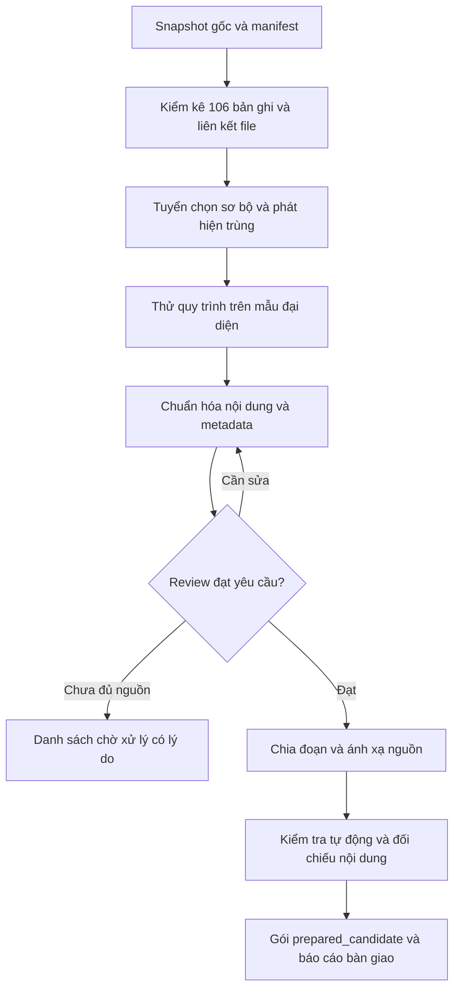

# Kế hoạch tiền xử lý dữ liệu HUS trước khi đưa vào RAG

Cập nhật: **23/10/2026**. **Trạng thái lịch sử:** đây là kế hoạch và kết quả của đợt tiền xử lý thử đã bị dừng. Theo yêu cầu người dùng, toàn bộ `backups/rag_preparation/` (gồm normalized, documents, chunks, review CSV và các build tái lập) cùng hai bộ annotation/câu hỏi tự tạo đã được xóa. **Chỉ snapshot crawl từ nhánh `crawldata` còn là dữ liệu của đợt này** tại `data/hus/releases/2026-10-22-3a45aae-candidate/`. Các số liệu bên dưới ghi lại quan sát trước khi xóa, không mô tả artifact hiện còn hoặc kế hoạch đã được nhóm chốt.

Phân tích số liệu theo ngành/loại và mức độ khả thi RAG được trình bày riêng tại [báo cáo thống kê](THONG_KE_VA_DANH_GIA_KHA_THI_RAG_HUS_2026_10_23.md).

## Tiến độ và kết quả thử trước khi xóa artifact

| Mốc | Kết quả |
| --- | --- |
| M1 — Kiểm kê | Đã kiểm kê và hash đủ 106 bản ghi; file Markdown được đối chiếu với catalog. Raw HTML chưa ánh xạ chắc chắn được gắn cờ, không suy là file bị mất. |
| M2 — Tuyển chọn sơ bộ | Build07: 6 include, 6 exclude khỏi tập bằng chứng, 88 needs_review, 6 pending_ocr. Trong 88 mục chờ có 27 ứng viên sau đại học được phục hồi từ quyết định loại theo phạm vi cũ. Cặp giống text chỉ là ứng viên trùng. |
| M3 — Chuẩn hóa | Chạy chuẩn hóa Unicode/line ending trên 106 bản ghi; đối chiếu 15 mẫu (6 đọc đầy đủ, 9 screening). Sáu tài liệu include được so trích đoạn với HTML lưu sẵn. Chưa OCR/phục hồi bảng. |
| M4 — Metadata | Sáu tài liệu include có metadata mô tả đã review; năm/khóa/hiệu lực chưa biết giữ null/unknown. |
| M5 — Chia đoạn | Tạo 10 chunk từ sáu tài liệu, giữ hash, vị trí trong nội dung chuẩn hóa, ID và nguồn. PDF/bảng chưa đạt không được chia vào tập include. |
| M6 — Kiểm tra | 40 câu hỏi kiểm tra dữ liệu: 30 có đoạn bằng chứng, 10 ca giới hạn. Tập câu hỏi chưa được review độc lập và chưa đo retrieval. |

Sáu tài liệu từng được include là Sứ mệnh, Triết lý giáo dục và bốn trang giới thiệu ngành. Các quyết định của agent không phải xác nhận học vụ độc lập hoặc xác nhận quy định hiện hành. Build06, build07 và các bản tái lập từng cho kết quả kỹ thuật nhất quán, nhưng **mọi file đầu ra của chúng đã bị xóa** theo yêu cầu; không còn 10 chunk thử hoặc tập `prepared_candidate` để dùng. Sáu kiểm thử synthetic và Ruff từng đạt trước khi dừng đợt thử này.

Đầu ra từng có `document_review.csv`, `inventory.jsonl`, `documents.jsonl`, `chunks.jsonl`, `source_map.jsonl`, `issues.jsonl`, `evaluation_cases.jsonl` và `normalized/`; toàn bộ đã được xóa. Mã thử nghiệm [prepare_hus_corpus.py](../tools/prepare_hus_corpus.py) vẫn còn để tham khảo, nhưng annotation/câu hỏi đầu vào của lần chạy cũ không còn.

Chưa chạy lại công cụ/chunking. Nhóm sẽ thảo luận và chốt cách xử lý trước khi tạo bộ dữ liệu dẫn xuất mới.

Chưa xác minh bản PDF/DOCX gốc cho các bản đính kèm; sáu placeholder OCR vẫn chờ. Bảng/ma trận vỡ cột, nguồn có thời gian lẫn nhau, biến thể CLC/tài năng/tiên tiến và các cặp PDF giống tên hoặc giống text cần review tiếp. Sáu tài liệu từng được chọn chủ yếu là trang giới thiệu, chưa bao phủ thủ tục, biểu mẫu và học phí. Công cụ thử nghiệm từng chia theo dòng hoàn chỉnh với ngưỡng UTF-8 byte, chưa có tokenizer embedding; nhóm chưa chọn cách chunk mới. Review nguồn học vụ, câu hỏi và hiệu lực còn cần người đánh giá độc lập trước khi phát hành.

Cờ dữ liệu cụ thể từ khảo sát: trang Địa chất và Địa lý bị gắn `mathematics`; danh sách cán bộ và hội nghị bị gắn `form`; Sứ mệnh & Tầm nhìn bị gắn `curriculum`. Trang Đào tạo chủ yếu là liên kết. Hai phụ lục tuyển sinh 1/2 có cùng text trích xuất nhưng URL khác; cần kiểm tra file gốc trước khi gộp. Trang tuyển sinh có cả thông tin 2021 lẫn dự kiến 2026; trang Hội đồng ghi nhiệm kỳ 2020–2025. README crawler và cấu hình nguồn bật có điểm bất nhất cần rà trước đợt crawl phát hành.

## 1. Mục tiêu và điểm kết thúc

Chuyển snapshot crawl hiện có thành bộ tài liệu sạch, metadata đã review và các đoạn có thể truy ngược về nguồn. Đầu ra bàn giao cho giai đoạn xây retrieval/RAG; trạng thái bàn giao là `prepared_candidate`, không phải corpus đang phục vụ người dùng.

Phạm vi gồm kiểm kê, tuyển chọn, xử lý trùng, chuẩn hóa HTML/Markdown/PDF, review metadata, chia đoạn, kiểm tra chất lượng và đóng gói. Embedding, vector database, index tìm kiếm, intent router, sinh câu trả lời, API/UI và kích hoạt release thuộc giai đoạn sau. Kế hoạch này không yêu cầu sửa database nghiệp vụ hoặc cấu hình `.env`.

Candidate dùng để xây và kiểm tra quy trình. V1 chính thức vẫn cần đợt crawl phát hành và review theo quyết định trong memory; quy trình này phải chạy lại được trên snapshot đó.

## 2. Đầu vào và vấn đề đã biết

Nguồn: `data/hus/releases/2026-10-22-3a45aae-candidate/`.

| Dữ liệu | Hiện trạng khảo sát |
| --- | --- |
| Catalog | 106 bản ghi; `documents` là object theo ID, không phải danh sách |
| Markdown / raw HTML | 106 / 101 theo manifest; không mặc định mỗi PDF phải có HTML |
| Trạng thái crawler | 100 `active`, 6 `pending_ocr`; chưa phải trạng thái review |
| Năm học | 106 bản ghi có `academic_year=null` |
| Độ dài nội dung catalog | Trung vị 3.259 ký tự, lớn nhất 398.759; 28 bản ghi trên 20.000 ký tự |
| Nội dung mẫu | Có trang điều hướng, bài giới thiệu và bảng PDF bị vỡ cột |
| Phân loại | Kế hoạch trước đã ghi nhận nhãn ngành/loại sai; cần kiểm tra toàn bộ |

Số liệu độ dài tính trên `content_markdown` trong catalog, không phải số token hoặc số byte file. Đã khảo sát mẫu, chưa review toàn bộ 106 tài liệu. Các bản đính kèm có tên giống nhau hoặc URL mã hóa khác nhau chỉ là ứng viên trùng.

## 3. Luồng thực hiện



## 4. Các mốc công việc và tiêu chí hoàn thành

### M1 — Kiểm kê và xác lập nguồn

- Đọc manifest, kiểm tra hash catalog; lưu hash các file đầu vào thực tế.
- Liên kết document ID, URL, Markdown, raw HTML và file đính kèm nếu có. Đối chiếu metadata đầu file Markdown với catalog; giữ cả giá trị gốc khi khác nhau.
- Catalog và Markdown chứa cùng nội dung chỉ được tạo một tài liệu chuẩn hóa. Nếu hai bản khác nhau, ghi lỗi để kiểm tra nguồn thay vì âm thầm chọn một bản.
- Ghi nhận file thiếu, bản ghi mồ côi, nội dung rỗng, lỗi encoding, trang điều hướng và bảng nghi lỗi. Quy tắc tự động chỉ tạo cờ kiểm tra.

**Đầu ra:** `inventory.jsonl`, `input_manifest.json`, danh sách lỗi liên kết nguồn.

**Đạt khi:** đủ 106 bản ghi; mỗi bản có đường dẫn/file hash hoặc lý do thiếu. Không yêu cầu số HTML bằng số tài liệu.

### M2 — Tuyển chọn và xử lý trùng

Phạm vi tra cứu dự kiến: thông tin đại học của bốn ngành đang hỗ trợ, thông tin chung liên quan và lộ trình học tiếp thạc sĩ/tiến sĩ. Nguồn sau đại học cần được gắn đúng bậc học, chương trình/ngành, khóa áp dụng và hiệu lực trước khi được dùng trả lời. Nội dung ngành khác, nghiên cứu, thực tập và hội nghị cũng được giữ trong hàng chờ để đánh giá giá trị tra cứu thay vì loại chỉ do phạm vi bản đầu. Tất cả 106 bản nguồn và bản chuẩn hóa đều được giữ; `exclude` chỉ biểu thị không dùng làm bằng chứng trả lời trong build hiện tại.

Tạo `document_review.csv` với ID, nhãn crawler gốc, nhãn đề xuất, quyết định, lý do, reviewer, ngày review và locator bằng chứng. Quyết định sơ bộ có thể thay đổi sau khi trích xuất/review nội dung:

| Quyết định | Ý nghĩa |
| --- | --- |
| `include` | Nội dung và phạm vi đã được kiểm tra, đủ điều kiện chuyển sang chia đoạn |
| `exclude` | Chưa dùng làm bằng chứng trả lời vì chỉ là trang điều hướng, không có nội dung độc lập, hoặc là bản trùng đã xác minh; vẫn giữ nguồn để lần theo liên kết |
| `needs_review` | Thiếu nguồn, nhãn mơ hồ, bảng lỗi, chưa xác định hiệu lực/phạm vi hoặc chưa đánh giá đủ giá trị tra cứu |
| `pending_ocr` | Cần OCR/trích xuất và kiểm tra trước khi quyết định sử dụng |

So sánh hash file để tìm bản trùng chính xác; dùng độ giống nội dung để đề xuất các cặp cần review. Giữ `duplicate_of`, URL thay thế và bằng chứng gộp. Không gộp tài liệu chỉ vì trùng tên, khác cách mã hóa URL hoặc có phần mở đầu giống nhau. Khác phiên bản/ngày/khóa có thể là các văn bản độc lập.

**Đạt khi:** mọi bản ghi có quyết định hoặc trạng thái chờ rõ ràng; mọi bản trùng có liên kết tới bản giữ lại. Không đặt mục tiêu phải giữ đủ 106 tài liệu.

### M3 — Làm thử trên mẫu rồi chuẩn hóa toàn bộ tài liệu được chọn

Chọn khoảng 10–15 tài liệu đại diện: bài giới thiệu sạch, trang nhiều menu, tài liệu dài, PDF text, PDF scan, bảng phức tạp, cặp nghi trùng, tài liệu thiếu năm và tài liệu nghi sai ngành. Bao phủ các nhóm thực sự có trong snapshot; nhóm thiếu được ghi nhận thay vì tạo mẫu giả làm nguồn.

| Loại nội dung | Cách xử lý |
| --- | --- |
| HTML/Markdown | Tách metadata đầu file; bỏ menu/footer/khối lặp đã xác minh; giữ nội dung chính và liên kết có ý nghĩa |
| Văn bản | Chuẩn hóa Unicode và khoảng trắng; giữ bản gốc cùng nhật ký biến đổi; lỗi không chắc chắn chuyển review |
| PDF text | Trích xuất theo trang, giữ page marker và kiểm tra thứ tự đọc |
| PDF scan | OCR theo trang; đối chiếu hình trang với nội dung sẽ được bàn giao |
| Bảng | Giữ tên bảng, cột, đơn vị, hàng và chú thích; bảng vỡ phải đối chiếu PDF trước khi chuẩn hóa |
| Trang tổng hợp link | Giữ vai trò đầu mối nguồn; tiêu đề/link tải xuống không thay cho nội dung tài liệu đính kèm |

Có thể tái sử dụng PDF tại `docs/pdf/` và bằng chứng OCR nếu xác nhận đúng tài liệu/phiên bản bằng hash hoặc bằng chứng nguồn. Không mặc định PDF cùng tên là cùng bản. File gốc chưa có thì ghi vào danh sách thiếu; việc thu thập bổ sung phải giữ URL, hash và thời điểm lấy.

Không tự diễn giải lại văn bản thành bản tóm tắt để thay nguồn. LLM, nếu dùng, chỉ đề xuất nhãn hoặc vị trí lỗi; không tự sửa số tiền, ngày, mã môn, điều kiện hay xác nhận hiệu lực. Nội dung crawl được xử lý như dữ liệu, không thực thi các chỉ dẫn trong đó.

**Đầu ra:** `normalized/`, `normalization_log.jsonl`, danh sách vấn đề OCR/bảng và bộ mẫu trước/sau.

**Đạt khi:** mẫu được đối chiếu đạt yêu cầu trước khi chạy hàng loạt; mọi tài liệu đưa vào đầu ra sạch giữ được thông tin và điều kiện quan trọng. Tài liệu chưa sửa được ở lại danh sách chờ, không ép thành `include`.

### M4 — Review metadata và xác nhận nội dung được dùng

| Nhóm | Trường tối thiểu |
| --- | --- |
| Định danh | `document_id`, `source_document_ids`, `canonical_url`, `alternate_urls`, `parent_document_id` |
| Nguồn | `title`, `publisher`, `source_paths`, `source_hashes`, `published_at`, `fetched_at` |
| Phạm vi | `document_type`, `education_level`, `majors`, `scope` |
| Thời gian | `academic_year`, `admission_cohort`, `effective_from`, `effective_to`, `validity_status` |
| Review | `extraction_status`, `review_decision`, `reviewer`, `reviewed_at`, `review_note`, `metadata_evidence` |
| Tái lập | `build_id`, `source_snapshot_id`, `normalized_content_hash`, `pipeline_version` |

`majors` hỗ trợ nhiều ngành; `scope` phân biệt `general`, `major_specific`, `unknown`. `education_level` phải tách `undergraduate`, `master`, `doctoral` hoặc `unknown`; trang dùng chung cho nhiều bậc học cần ghi rõ phạm vi thực tế. Khi có bằng chứng, bổ sung chương trình/biến thể và khóa tuyển sinh; không suy từ tên thư mục hoặc ngày crawl. Trong `document_review.csv`, `proposed_education_level` chỉ là nhãn đề xuất từ tiêu đề cho mục chờ review, không phải metadata đã xác minh của corpus. Review trích xuất và xác minh hiệu lực là hai việc riêng: đọc đúng văn bản không chứng minh nó còn hiệu lực.

Tài liệu không phụ thuộc thời gian vẫn có thể được chọn khi thiếu năm. Với học phí, hạn nộp hoặc điều kiện áp dụng, thiếu phạm vi quyết định ý nghĩa thì giữ chờ review. Văn bản lịch sử có thể được giữ khi xác định rõ phạm vi lịch sử. Ghi nhận nguồn mâu thuẫn và khác biệt với catalog nghiệp vụ; không tự sửa catalog.

**Đầu ra:** `documents.jsonl` gồm các tài liệu `include`, bảng review cập nhật và `issues.jsonl` cho các vấn đề còn lại.

**Đạt khi:** 100% tài liệu được chọn có nguồn và quyết định review; mọi trường chưa biết được biểu diễn rõ; nhãn crawler gốc vẫn truy vết được.

### M5 — Chia đoạn và giữ vị trí trích dẫn

- Chia theo tiêu đề, điều/khoản, đoạn văn và bảng; không ghép hai tài liệu vào một chunk.
- Thử khoảng 300–600 token/đoạn cho văn xuôi. Đây là cấu hình thử; ghi rõ tokenizer/version trong build, chưa ràng buộc embedding model. Tài liệu ngắn đủ ý có thể là một đoạn.
- Chỉ overlap khi cần nối ý trong cùng mục; tránh nhân bản toàn bộ đoạn. Điều kiện và ngoại lệ phải đi cùng nội dung được giới hạn.
- Bảng dài có thể chia nhóm hàng nhưng phải lặp tiêu đề cột, đơn vị và chú thích liên quan. Bảng chưa đọc đúng không được xuất thành chunk sử dụng được.
- Lưu quan hệ đoạn cha/con để giai đoạn retrieval sau có thể lấy thêm ngữ cảnh; bảo toàn page marker của PDF và offset/khối của bản HTML gốc lưu tại snapshot.

Mỗi chunk có `chunk_id`, `document_id`, `build_id`, `source_snapshot_id`, `text`, `heading_path`, `parent_section_id`, `source_locator`, `normalized_span`, `source_url`, metadata phạm vi và `content_hash`. ID phải ổn định với cùng nội dung và cấu hình. `release_id` phục vụ runtime chỉ được gắn khi đóng gói release ở giai đoạn sau; không coi build tiền xử lý là active release.

**Đầu ra:** `chunks.jsonl`, `source_map.jsonl`, cấu hình chia đoạn.

**Đạt khi:** mọi chunk liên kết tới tài liệu `include`, ánh xạ về đoạn/trang nguồn thật; không có chunk mồ côi hoặc mất điều kiện quan trọng.

### M6 — Kiểm tra và đóng gói bàn giao

Kiểm tra tự động toàn bộ đầu ra: schema, ID duy nhất, liên kết nguồn, hash, trạng thái review, metadata, đoạn rỗng, nội dung lặp, giới hạn kích thước và tái lập build. Trường chưa biết hợp lệ không bị tự điền chỉ để vượt kiểm tra.

Đối chiếu thủ công toàn bộ nội dung OCR/bảng rủi ro cao và thông tin số tiền, hạn, mã môn, điều kiện áp dụng được chọn. Lấy mẫu theo ngành/loại/độ dài với văn xuôi còn lại; báo rõ số lượng và phạm vi đã kiểm tra. Có lỗi mất nghĩa thì sửa quy tắc và kiểm tra lại các tài liệu bị ảnh hưởng.

Chuẩn bị tối thiểu 40 câu hỏi kiểm tra dữ liệu, mỗi câu có document ID, locator và đoạn bằng chứng hoặc lý do không có đáp án. Bao phủ nguồn chung, bốn ngành khi có dữ liệu, mã chính xác, bảng/số liệu, thời gian, mâu thuẫn và thiếu nguồn. Nếu corpus không đủ bao phủ, ghi khoảng trống và không tạo đáp án giả. Chia tập phát triển/giữ lại trước khi tối ưu retrieval ở giai đoạn sau. Giai đoạn này chỉ xác minh bằng chứng tồn tại và chunk giữ được nó, chưa đo Recall@k hoặc chất lượng câu trả lời LLM.

**Đạt khi:** kiểm tra tự động đạt; không còn lỗi đã biết nghiêm trọng trong phần bàn giao; bảng review đủ 106 bản ghi; báo cáo nêu rõ số giữ/loại/chờ/trùng và phạm vi đối chiếu. Không cần xử lý xong mọi tài liệu chờ để bàn giao tập con đạt chất lượng.

## 5. Cấu trúc đầu ra dự kiến

Build thử đặt dưới `backups/rag_preparation/<build_id>/`, tách khỏi snapshot nguồn:

```text
<build_id>/
  input_manifest.json
  inventory.jsonl
  document_review.csv
  normalized/
  normalization_log.jsonl
  documents.jsonl
  chunks.jsonl
  source_map.jsonl
  issues.jsonl
  evaluation_cases.jsonl
  build_config.json
  validation_report.json
  preparation_report.md
  manifest.json
```

Manifest cuối ghi `status=prepared_candidate`, hash artifact, hash đầu vào, phiên bản công cụ/cấu hình và thống kê tài liệu/chunk. Đầu ra lỗi nằm trong build riêng; không ghi đè một build đã nghiệm thu. Các trường thời gian chạy có thể khác, còn nội dung chuẩn hóa và ID phải tái lập được với cùng đầu vào/cấu hình.

Mã xử lý, schema và tài liệu nghiệm thu có thể đưa vào Git theo yêu cầu commit sau này; build thử giữ trong backups. Không đưa credentials, transcript hoặc hội thoại vào artifact.

## 6. Thứ tự triển khai và phân công dự kiến

| Thứ tự | Công việc | Phụ thuộc | Người thực hiện dự kiến |
| --- | --- | --- | --- |
| 1 | M1: kiểm kê và hash nguồn | Snapshot hiện có | Người triển khai pipeline |
| 2 | M2: review sơ bộ 106 tài liệu | M1 | Người triển khai đề xuất; reviewer kiểm tra |
| 3 | M3: thử 10–15 mẫu rồi chuẩn hóa | M2 | Người triển khai và người đối chiếu PDF |
| 4 | M4: chốt metadata, phần được dùng | M3 | Reviewer nội dung; người dùng chốt vấn đề học vụ |
| 5 | M5: tạo chunk và ánh xạ nguồn | M4 | Người triển khai pipeline |
| 6 | M6: kiểm tra và bàn giao | M5 | Người triển khai báo cáo; reviewer nghiệm thu dữ liệu |

Chưa ước lượng thời gian OCR/review vì chưa biết lượng tài liệu phải xử lý lại. Ưu tiên review 27 ứng viên sau đại học: xác định thạc sĩ/tiến sĩ, ngành và quan hệ với bốn ngành đại học; lấy/đối chiếu PDF gốc, bảng, phiên bản, khóa và hiệu lực. Sau đó review 15 nội dung mở rộng cùng các mục chờ cũ; câu hỏi kiểu “tốt nghiệp rồi học tiếp thế nào?” cần nguồn tuyển sinh/điều kiện chuyển tiếp thực sự, không suy từ riêng khung chương trình. Báo tiến độ theo các mốc nghiệm thu, số tài liệu đã review và số vấn đề còn chờ; không lấy số file đã chạy script làm tỷ lệ xác minh học vụ.

Việc bàn giao tiền xử lý không thay thế nghiệm thu retrieval, câu trả lời hoặc phê duyệt release chính thức.

## 7. Tài liệu liên quan

- [Kế hoạch RAG tổng thể](KE_HOACH_XU_LY_DATA_RAG_HUS.md).
- [Module chuẩn bị và phát hành corpus](../modules/10-hus-corpus-release.md).
- [Module hỏi đáp HUS](../modules/11-hus-rag-qa.md).
- [Memory và quy tắc dự án](../.agent/AGENTS.md).
