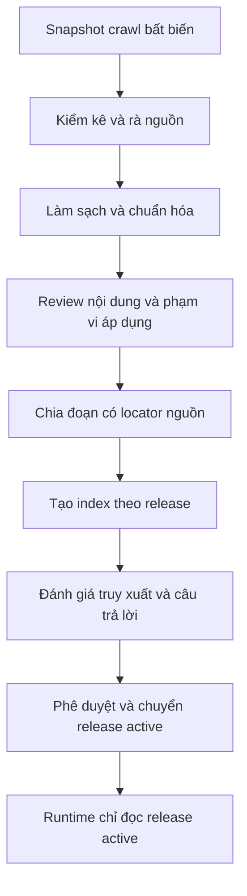

# Kế hoạch xử lý dữ liệu cho luồng tra cứu thông tin HUS bằng RAG

Ngày lập: **22/10/2026**. Trạng thái: **kế hoạch triển khai**, chưa có pipeline hoặc corpus RAG được kích hoạt.

## 1. Kết luận rà soát

Hướng xử lý đã trao đổi là phù hợp: tuyển chọn tài liệu → chuẩn hóa → chia đoạn → lập chỉ mục → đánh giá → phát hành theo phiên bản. Tuy nhiên, chưa nên dùng toàn bộ dữ liệu crawl và nhãn hiện tại làm đầu vào trực tiếp cho chatbot.

Các điều chỉnh cần đưa vào kế hoạch:

- Rà lại nhãn ngành và loại tài liệu trước khi dùng chúng làm bộ lọc truy xuất.
- Phân biệt trạng thái trích xuất, kết quả review nội dung và hiệu lực văn bản. `active` của crawler không có nghĩa là đã duyệt hoặc còn hiệu lực.
- Không bắt buộc mọi tài liệu có năm học. Phân biệt năm học, khóa tuyển sinh, ngày ban hành và khoảng hiệu lực; không suy ra từ ngày crawl.
- Chỉ kết luận hai bản đính kèm trùng nhau sau khi đối chiếu nội dung hoặc hash file.
- Dùng candidate hiện tại để phát triển và đánh giá pipeline. Bản v1 chính thức vẫn theo mô hình crawl tại thời điểm phát hành đã thống nhất trong memory.
- Chọn cách lưu index và mô hình embedding sau khi có corpus sạch và bộ câu hỏi đánh giá; chưa cần thay đổi database runtime để viết kế hoạch này.

## 2. Dữ liệu đang có và giới hạn khảo sát

Nguồn: `data/hus/releases/2026-10-22-3a45aae-candidate/`, lấy từ commit `3a45aae1732eccbb011f43428bee48add9bb718a` của nhánh `crawldata`.

| Hạng mục | Ghi nhận |
| --- | --- |
| Tài liệu trong catalog | 106 |
| Markdown / raw HTML theo manifest | 106 / 101 |
| Nhãn loại hiện tại | 46 general_info, 36 curriculum, 23 form, 1 announcement |
| Trạng thái trích xuất | 100 active, 6 pending_ocr |
| academic_year | null ở cả 106 bản ghi |
| Trạng thái snapshot | candidate_not_active |

Đã đọc manifest, thống kê catalog và xem một số bản ghi; **chưa audit toàn bộ nội dung hoặc xác minh hiệu lực nguồn**. Số liệu loại tài liệu phía trên phản ánh nhãn crawler, không phải kết quả phân loại đã duyệt.

Các mẫu đã thấy cho biết nhãn cần sửa: trang Địa chất và Địa lý được gắn `mathematics`; trang danh sách cán bộ và hội nghị được gắn `form`; trang Sứ mệnh & Tầm nhìn nằm trong nhóm `curriculum`. Trang Đào tạo có phần nội dung chủ yếu là danh sách điều hướng. Sáu mục `pending_ocr` có tên giống ba PDF chương trình, mỗi tên xuất hiện dưới hai cách mã hóa URL; đây mới là dấu hiệu trùng.

Manifest còn ghi bất nhất giữa README crawler và cấu hình nguồn bật. Phải đối chiếu cấu hình ở đúng commit crawler trước lần crawl chính thức. Tài liệu này không thay thế audit mã crawler hoặc kết luận crawler đã sẵn sàng tích hợp.

## 3. Phạm vi bản đầu

Ưu tiên câu hỏi tra cứu thông tin đại học của bốn ngành đang hỗ trợ và thông tin chung liên quan: thủ tục, biểu mẫu, chương trình đào tạo, thông báo, tuyển sinh và học phí khi có nguồn và phạm vi áp dụng rõ. Tài liệu sau đại học, ngành khác, nghiên cứu hoặc sự kiện ngoài phạm vi được ghi nhận và loại khỏi corpus bản đầu với lý do.

Tra cứu văn bản chương trình có thể trả đoạn nguồn và trích dẫn. Các câu hỏi tính tiến độ, kiểm tra đủ điều kiện học hoặc đề xuất môn phải đi qua nghiệp vụ hiện có. RAG không sửa tiên quyết, quota, trạng thái catalog hoặc kết quả eligibility. Nếu nguồn web khác catalog, trình bày khác biệt có nguồn, giữ kết quả nghiệp vụ theo catalog đang dùng và ghi vấn đề cần review.

## 4. Pipeline đề xuất

### Giai đoạn 1 — Kiểm kê và tuyển chọn

Tạo bảng review đủ 106 bản ghi với ID nguồn, URL, tiêu đề, publisher, loại/ngành crawler gán, loại/ngành sau review, chất lượng nội dung, phạm vi thời gian, quyết định và lý do.

Quyết định gồm `include`, `exclude`, `needs_review`, `pending_ocr`. Chỉ `include` mới đi vào index phục vụ trả lời. Một trang tổng hợp liên kết có thể giữ làm đầu mối khám phá nhưng không được dùng để chứng minh nội dung của PDF chưa đọc.

Đối chiếu catalog với file Markdown/raw tương ứng, phát hiện thiếu file, nội dung rỗng, trang lỗi, điều hướng, nội dung lặp và nguồn ngoài phạm vi. Chuẩn hóa URL thận trọng: không tự xóa query có ý nghĩa hoặc gộp hai tài liệu chỉ vì tên giống nhau. Gộp bản trùng có bằng chứng hash/nội dung, giữ danh sách URL thay thế và quan hệ tới trang cha.

**Hoàn thành khi:** mọi bản ghi có quyết định và lý do; không còn dùng nhãn crawler chưa review làm căn cứ lọc cứng.

### Giai đoạn 2 — Chuẩn hóa nội dung và metadata

Giữ nguyên candidate và raw HTML. Viết đầu ra chuẩn hóa ở thư mục build riêng, có phiên bản pipeline và hash đầu vào.

- Bỏ menu, footer, banner, khối liên kết lặp; giữ tiêu đề, đoạn văn, danh sách, bảng, chú thích và liên kết tài liệu cần thiết.
- Chuẩn hóa Unicode và khoảng trắng; ghi lại lỗi encoding/OCR không thể sửa chắc chắn, không tự đoán số tiền, ngày, mã môn hoặc điều kiện.
- Với PDF có text, trích xuất theo trang và kiểm tra bảng. Với PDF scan, OCR theo trang rồi rà những nội dung được dùng để trả lời, đặc biệt số liệu và điều kiện áp dụng.
- Có thể tái sử dụng năm PDF và bằng chứng OCR trong dự án nếu xác nhận đúng tài liệu bằng hash. Bộ acceptance catalog hiện có chỉ chứng minh phạm vi assertions đã ghi, không chứng minh mọi nội dung PDF đều chính xác cho RAG.
- Thiếu file đính kèm phải được ghi nhận rõ; không coi tiêu đề/liên kết tải xuống là nội dung tài liệu.

Metadata chuẩn hóa đề xuất:

| Nhóm | Trường và ý nghĩa |
| --- | --- |
| Định danh | document_id, canonical_url, alternate_urls, parent_document_id |
| Nguồn | title, publisher, source_url, source_file_hash, fetched_at, published_at |
| Phạm vi | document_type, education_level, majors, scope: general/major_specific/unknown |
| Thời gian | academic_year, admission_cohort, effective_from, effective_to; null khi chưa biết |
| Review | extraction_status, review_status, validity_status, review_note, bằng chứng và người review |
| Phiên bản | release_id, normalized_content_hash, pipeline_version |

Một tài liệu có thể áp dụng cho nhiều ngành. `general` chỉ dùng cho phạm vi chung đã xác định, không dùng thay cho ngành chưa biết. Ghi locator cho metadata suy ra từ nội dung; giữ nhãn crawler gốc để truy vết.

Tài liệu không phụ thuộc năm vẫn có thể được chọn khi `academic_year=null`. Tài liệu học phí/tuyển sinh cần đủ phạm vi thời gian để trả lời câu hỏi tương ứng. Không khẳng định “hiện nay” chỉ vì đó là tài liệu mới nhất trong corpus. Khi chưa xác định hiệu lực, câu trả lời phải thể hiện giới hạn của nguồn.

**Hoàn thành khi:** nội dung được chọn đọc hiểu được, có provenance và không mất bảng/điều kiện quan trọng; các trường chưa biết được giữ rõ ràng.

### Giai đoạn 3 — Chia đoạn và giữ khả năng trích dẫn

Chia theo tiêu đề, điều/khoản, đoạn văn và cấu trúc bảng. Thử nghiệm ban đầu khoảng 300–600 token/đoạn với tokenizer của mô hình được chọn; đây là tham số khởi đầu để đánh giá, không phải tiêu chí bắt buộc. Chỉ overlap khi cần giữ ngữ cảnh giữa các đoạn cùng mục.

Mỗi chunk phải có `chunk_id`, `document_id`, `release_id`, nội dung, đường dẫn tiêu đề, metadata phạm vi, hash và locator: trang PDF hoặc mục/khối/offset trong bản chuẩn hóa. Lưu ánh xạ về nguồn gốc để kiểm tra trích dẫn. ID ổn định theo phiên bản nội dung và cấu hình chia đoạn.

Bảng phải giữ đơn vị, tiêu đề cột và chú thích liên quan. Nếu chia theo hàng, mỗi phần lặp lại ngữ cảnh bảng. Điều kiện, ngoại lệ và mốc áp dụng không được tách mất khỏi nội dung mà chúng giới hạn. Không ghép nhiều tài liệu vào một chunk. Có thể mở rộng sang đoạn cha khi truy xuất cần ngữ cảnh, trong giới hạn token.

**Hoàn thành khi:** mọi chunk truy được về nguồn; mẫu bảng, điều kiện và tài liệu dài không bị cắt sai nghĩa.

### Giai đoạn 4 — Lập chỉ mục và tích hợp truy xuất

Đầu tiên tạo baseline tìm kiếm từ khóa để biết corpus đã tìm được câu trả lời chưa. Sau đó so sánh với vector và kết hợp hai kết quả trên cùng bộ đánh giá. Truy vấn chứa mã môn, mã biểu mẫu, số quyết định cần được đánh giá riêng; truy vấn diễn đạt tự nhiên cần mẫu tiếng Việt thực tế. Chỉ thêm bước xếp hạng lại nếu kết quả đánh giá cho thấy cần thiết.

Chưa chốt model embedding hoặc vector store trong kế hoạch này. Khi chọn, ghi nhận khả năng tiếng Việt, chất lượng trên bộ câu hỏi, chi phí, yêu cầu vận hành và phiên bản/dimension. Cache embedding theo hash nội dung thực đưa vào model, model/version và cấu hình. Không dùng lẫn index của hai cấu hình embedding.

Có thể cân nhắc PostgreSQL với vùng dữ liệu RAG riêng nếu phù hợp môi trường thực tế, nhưng không bắt buộc thêm extension hoặc sửa schema nghiệp vụ ngay. Index là artifact có thể dựng lại từ corpus đã chuẩn hóa.

Luồng runtime dự kiến:

1. Xác định câu hỏi tra cứu hay nghiệp vụ môn học; xác định ngành, năm/khóa nếu câu hỏi yêu cầu.
2. Chọn release active một lần cho toàn request.
3. Truy xuất tài liệu được include; với câu hỏi theo ngành, xét tài liệu ngành phù hợp và tài liệu chung đã review. Không dùng nhãn `unknown` để tự kết luận phạm vi.
4. Khi thiếu năm/khóa làm thay đổi câu trả lời, hỏi lại hoặc trình bày rõ phạm vi nguồn tìm được. Giữ nguồn cũ cho câu hỏi lịch sử.
5. Chọn các đoạn đủ hỗ trợ câu trả lời; xử lý mâu thuẫn theo bằng chứng phạm vi/hiệu lực. Nếu không đủ căn cứ ưu tiên nguồn nào, trình bày sự khác biệt và chưa kết luận.
6. Sinh câu trả lời từ các đoạn đã lấy, kèm trích dẫn do backend ánh xạ từ chunk. Không cho mô hình tự tạo URL nguồn.

Nội dung tài liệu được coi là dữ liệu tham khảo; chỉ dẫn nằm trong trang crawl không được thay đổi quy tắc hệ thống hoặc kích hoạt công cụ. Khi không có bằng chứng hoặc index lỗi, trả thông báo phù hợp, không chuyển sang câu trả lời học vụ dựa trên suy đoán của model.

**Hoàn thành khi:** câu trả lời truy vết được tới đoạn nguồn trong cùng release và luồng eligibility/recommendation vẫn dùng nghiệp vụ hiện có.

### Giai đoạn 5 — Đánh giá trước khi phát hành

Soạn tối thiểu 40 câu hỏi từ tài liệu đã chọn, do người review xác định nguồn và đoạn trả lời kỳ vọng. Chia tập hiệu chỉnh và tập giữ lại trước khi tối ưu. Có câu hỏi về bốn ngành, tài liệu chung, bảng/số liệu, mã chính xác, diễn đạt lại, phạm vi năm/khóa, nguồn mâu thuẫn, tài liệu bị loại và câu hỏi không có đáp án.

Ngưỡng đề xuất ban đầu, cần chốt trước khi đánh giá bản phát hành:

| Nội dung | Điều kiện |
| --- | --- |
| Kiểm kê | 100% tài liệu có quyết định; không index pending_ocr hoặc needs_review |
| Truy vết | 100% chunk có nguồn, locator, hash và release_id hợp lệ |
| Truy xuất | Ít nhất 90% câu hỏi có đáp án trong tập giữ lại lấy được đoạn đúng trong top 5; báo số tuyệt đối và từng nhóm |
| Câu trả lời | Không có lỗi nghiêm trọng về số tiền, hạn nộp, điều kiện hoặc ngành/khóa trong tập kiểm tra |
| Trích dẫn | Mọi khẳng định thực tế trong câu trả lời kiểm tra đều được nguồn trích dẫn hỗ trợ; link và locator hợp lệ |
| Thiếu/mâu thuẫn nguồn | Các ca đã định nghĩa phải hỏi lại, nêu giới hạn hoặc từ chối kết luận đúng kỳ vọng |
| Phiên bản | Request không trộn release; build/publish lỗi giữ nguyên bản active trước đó |

Ghi cả lỗi và trường hợp chưa bao phủ. Tập nhỏ đạt ngưỡng không chứng nhận toàn bộ dữ liệu học vụ. Đo thời gian truy xuất, thời gian trả lời, số token và chi phí để chốt mục tiêu vận hành trước khi publish; chưa có số đo ở thời điểm lập kế hoạch.

### Giai đoạn 6 — Đóng gói và phát hành

Candidate hiện tại dùng cho prototype. Trước v1 chính thức, rà cấu hình nguồn, thực hiện đợt crawl phát hành đã thống nhất, rồi chạy lại pipeline và review trên snapshot mới. Nếu muốn sử dụng lại candidate làm nguồn chính thức, cần ghi nhận thay đổi quyết định phát hành rõ ràng.

Mỗi release chứa manifest nguồn, bảng review, corpus chuẩn hóa, chunks, cấu hình index/model, hash, phiên bản pipeline và báo cáo đánh giá. Chỉ chuyển con trỏ active sau khi toàn bộ artifact sẵn sàng và bản phát hành được duyệt. Giữ release cũ để rollback; chuẩn bị hoặc kích hoạt lỗi không làm mất bản đang dùng.

Ứng dụng không crawl khi khởi động, theo request hoặc theo lịch tuần. Cập nhật tương lai là release v2/v3 chủ động. Không gộp toàn nhánh crawler vào codebase chỉ để sử dụng dữ liệu; phần mã cần tích hợp phải được chọn và review riêng.

## 5. Thứ tự triển khai và đầu ra

| Thứ tự | Công việc | Đầu ra dự kiến |
| --- | --- | --- |
| 1 | Audit 106 tài liệu | document_review.csv, báo cáo lỗi/phạm vi nguồn |
| 2 | Chọn mẫu đại diện và chuẩn hóa | documents.jsonl, báo cáo OCR/bảng/trùng lặp |
| 3 | Chia đoạn và tạo bộ câu hỏi | chunks.jsonl, evaluation_cases.jsonl có expected source/locator |
| 4 | Đo baseline và lựa chọn index | Báo cáo so sánh từ khóa/vector/kết hợp, quyết định model/storage |
| 5 | Tích hợp luồng tra cứu | API/UI trích dẫn, xử lý thiếu nguồn và giới hạn phạm vi |
| 6 | Crawl release, review và phát hành | Release manifest, báo cáo nghiệm thu, active pointer và bằng chứng rollback |

Các tên đầu ra là đề xuất; chưa tạo trong lần viết kế hoạch. Build thử lưu ngoài snapshot candidate, ví dụ `backups/rag_preparation/<run_id>/`; quyết định lưu artifact chính thức trong Git hay kho artifact khi chốt cơ chế phát hành. Không lưu transcript/chat hay khóa nhà cung cấp vào corpus hoặc báo cáo.

**Tiến độ hiện tại:** phần rà hướng tiếp cận và viết kế hoạch hoàn tất. Chưa hoàn thành mốc triển khai nào trong sáu mốc trên. Công việc tiếp theo là audit toàn bộ 106 tài liệu, đặc biệt nhãn sai, nguồn ngoài phạm vi, trùng URL và PDF thiếu text.

## 6. Tài liệu tham chiếu nội bộ

- [Memory và quy tắc dự án](../.agent/AGENTS.md)
- [Candidate README](../data/hus/releases/2026-10-22-3a45aae-candidate/README.md)
- [Candidate manifest](../data/hus/releases/2026-10-22-3a45aae-candidate/manifest.json)
- [Đặc tả hệ thống](SYSTEM_SPECIFICATION.md)
- [Phạm vi nghiệm thu PDF HUS](HUS_PDF_ACCEPTANCE_REVIEW.md)
- [Vận hành catalog HUS](../database/HUS_RUNTIME.md)

Đây là kế hoạch dựa trên snapshot local và bối cảnh dự án, chưa phải báo cáo nghiệm thu RAG. Lần lập tài liệu không chạy crawler, tạo embedding, sửa dữ liệu nguồn, publish runtime, commit hoặc push.
