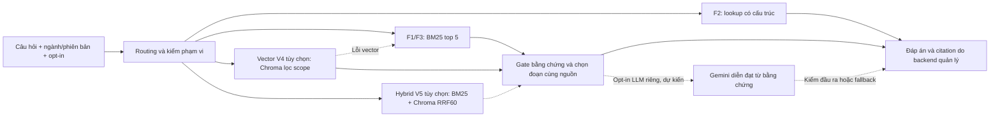

# Chatbot hỏi đáp HUS — tiến độ và kế hoạch hoàn thiện

Cập nhật **10/11/2026**, nhánh local **`hus-embedding-chromadb`**, HEAD `1ad85e3` + WIP V4/V5 (mốc triển khai V1–V2 từ base `1287e2a`). Phạm vi: **chatbot hỏi đáp thông tin ngành, chương trình và môn học F1/F2/F3, cùng trò chuyện cơ bản**. Chatbot này độc lập với chatbot đề xuất môn học; không dùng bảng điểm, tập môn eligible, ranking, lịch học hoặc chức năng tư vấn cá nhân để trả lời RAG.

**Hiện trạng:** A1/A1b/A2,Q027/1a,A3/V1–V4 và **A4/V5 đã triển khai/đo local**. Chroma giữ939vector/935parent; hybrid tùy chọn dùng top20mỗi leg→dedup parent→RRF60→final5, cùng scope/canonical/citation V4. **Mặc định vẫn `HUS_RETRIEVAL_MODE=lexical`**; F2 lookup riêng, không gọi ML. So160câu/mode: Recall@5 lexical55/56,vector55/56,hybrid56/56; MRR0,87649/0,88690/0,88155; false refusal5/6/5. Không có scope/source-audit/HTTP error; F2source54/54,vector/hybrid56querythật/0fallback. Hybrid cải thiện strict anchor dev, **chưa chứng minh Recall độc lập≥90% hoặc cải thiện ngữ nghĩa**; review entailment/completeness còn pending nên giữ lexical. Chưa có LLM/commit/push/deploy V4–V5.

**Kiểm chứng V5 10/11:** 2103test đạt,2skip,90deselected;50Chromium,5Node,Ruff đạt.36ca mới đóng băng trước inference, thêm dev96/contracts28;480prediction replay khớp. Hybrid HTTP12ca, F3opt-out/F2noML, copied-index fallback và canonical503 đạt. Review AI2Important đã RED→GREEN; self-audit nested fallback đã sửa. [Báo cáo V5](RAG_HYBRID_V5_2026_11_10.md),[receipt](acceptance/hus_hybrid_v5_report.json). Index/model/source/lock và evidence cũ giữ nguyên; benchmark local một lượt, không production SLO. Tiếp theo là review nội dung/A6–A7 hoặc LLM tùy chọn khi được chọn.

**Kiểm chứng V4 10/11:** 60 test tập trung đạt; full regression **2.067 đạt,2skip,90deselected**,50Chromium,5Node,Ruff đạt. Hai process chạy8query vector thật, thứ hạng parent khớp;12HTTP F1/F2/F3 qua service đạt, F2 không gọi vector/F3 opt-out bị chặn. Query quá budget và sửa manifest bản sao fallback đúng;8file index gốc giữ SHA. Rà soát kỹ thuật AI không có lỗi xác nhận; không có phép đo Recall mới. [Báo cáo V4](RAG_VECTOR_QUERY_V4_2026_11_10.md),[receipt](acceptance/hus_vector_query_v4_report.json). HEAD thay đổi bên ngoài từ586e460 về1ad85e3 trong lúc làm; V4 áp lại và regression cuối chạy trên HEAD hiện tại.

**Kiểm chứng 09/11:** Lượt tái kiểm V2 trước đó:54test đạt/1skip, [receipt riêng](acceptance/hus_token_passages_v2_recheck_2026_11_09.json), không đo Recall mới. Lượt V3: **39test mới;2.019test regression đạt,2skip,90deselected;50Chromium,5Node,Ruff đạt**.1.108file cũ và môi trường chính giữ nguyên; archive357file code/inventory, không kèm trọng số/binary Chroma. [Báo cáo V3](RAG_OFFLINE_VECTOR_INDEX_V3_2026_11_09.md),[receipt/pins](acceptance/hus_offline_vector_index_v3_report.json).

## 1. Luồng và các thành phần đang có



| Thành phần | Hiện có và giới hạn |
| --- | --- |
| API demo | `app.hus.demo:app`: `GET /hus/config`, `GET /hus/questions`, `POST /hus/chat`, `GET/HEAD /hus/sources/{source_id}`; trang `/` và static UI. Đây là demo loopback, chưa có bảo vệ điểm vào để công khai Internet. |
| Hợp đồng chat | `app/schemas/hus.py`, `app/hus/chat.py`: câu hỏi, ngành, phiên bản, hệ, mã môn/nhóm, field và `allow_generated_reference` strict boolean; thêm `program_credits`, `program_groups`, `group_rules`, `group_key`. Trả `answered`/`no_information`/`needs_clarification` kèm facts/citation/warnings; mỗi lượt riêng, không nhận history. |
| Chọn dữ liệu | `app/services/hus_service.py`, `rag_loader.py`, `portable_adapter.py`: nạp `CURRENT` đã kiểm hash, cache một snapshot. Đổi release cần reload/restart được kiểm soát; không tự crawl/build, không fallback sang gói legacy khi canonical lỗi. |
| Vector V1–V4 | V1:`vector_contract.py`,`retrieval_config.py`; V2:`passage_tokenizer.py`,`passages.py`; V3:`embedding.py`,`vector_index.py`,`tools/build_hus_vector_index.py`; V4:`vector_query.py`,`vector_runtime.py`. Chroma939vector/384chiều; query có lọc canonical trước top-k và fallback BM25. Verify cần index ID ghim riêng. Lexical mặc định không import ML; vector bật tường minh, hybrid V5 có thể bật tường minh. |
| Routing/gate | `question_routing.py`, `answer_support.py`, `answering.py`: kiểm mã/ngành/phiên bản, phạm vi, field, yêu cầu official và quyền F3; F1/F3 tìm top 5 rồi chọn các đoạn đủ từ khóa bằng chứng trong một nguồn/phạm vi/review nhất quán. Đây là quy tắc lexical có giới hạn, chưa phải bộ hiểu ngữ nghĩa tổng quát. |
| Citation | `citations.py`, `citation_assets.py`, `source_response.py`: web giữ URL nguồn; PDF đúng binary/hash/trang vật lý và byte range; DOCX tải file; nguồn AI không có link tài liệu giả. Hash đúng không xác nhận hiệu lực học vụ hiện tại. |
| Giao diện hỏi đáp | `app/static/hus-rag-demo.html`, `app/static/hus-rag-demo.js`, `app/static/hus-rag-demo.css`: chọn bốn ngành, hiển thị phiên bản, trả lời kèm nguồn, opt-in F3, đổi ngành xóa hội thoại/tắt AI/bỏ phản hồi muộn; render bằng `textContent`. Hội thoại chỉ hiển thị trong bộ nhớ tab. |
| Danh mục câu hỏi | `question_catalog.py`: **2.414 câu mẫu**, gồm 50 câu chương trình/nhóm mới; bấm gửi qua chat thật, tìm không dấu theo tên/mã. F1 giữ edition/hệ nguồn; F2/F3 theo CTĐT đã chọn. Phủ field mẫu, không phải mọi cách diễn đạt tự nhiên. |

**Giới hạn sản phẩm cần giữ rõ:** trả lời thông tin đã có nguồn; không quyết định đủ điều kiện đăng ký/tốt nghiệp, đề xuất môn, hoặc thao tác tài khoản. Nếu cần đưa vào website chung sau này, dùng màn hình/endpoint hỏi đáp riêng; không chuyển câu hỏi qua chatbot đề xuất môn học. Demo độc lập có thể là đích nộp đồ án, không bắt buộc tích hợp tài khoản/VNU/DB.

## 2. Dữ liệu, chunk và chỉ mục hiện tại

Snapshot **`hus-data-20261031-v3`**, release SHA-256 `27bdf3714216292af6d6c6da10e7edd164fa6cf8a286fca7338d18bcb05501f4`.

| Nhóm | Cách tổ chức và số lượng đã đối chiếu |
| --- | --- |
| F1 | 15 nguồn metadata/14 nguồn citation chính; **65 chunk**: 7 introduction, 25 objectives, 21 careers, 12 further_study. Chọn đoạn đã review theo field; chia tại ranh giới đoạn/câu/chấm phẩy, tối đa khoảng **2.400 ký tự**, tránh đuôi dưới 260 ký tự, không overlap. Giữ quote gốc, offset và hash; sửa hiển thị không thay bằng chứng. Giữ 5 nguồn `include`, 10 `include_markdown`; chưa xác minh hiện hành. |
| F2 | **290 membership/297 dòng nguồn** thuộc bốn CTĐT; xuất **336 chunk**: 4 program, 42 group_rules, 290 course_facts. Runtime lookup cấu trúc cấp môn và chương trình/nhóm, không dùng ranking vector. Giữ 223 `draft_unverified`/67 `verified` cấp dự án; 103 ô tiên quyết trống, 1 membership conflict, 42 có mã chưa giải quyết. A1b kiểm bản ghi chương trình/nhóm khớp canonical, review và provenance; không cộng nhóm cha/con hoặc suy điều kiện đăng ký/tốt nghiệp. |
| F3 | **290 record × 3 field = 870 chunk**: content, objectives, suggested_assessment. Trong release này, content là summary tham khảo; mỗi field một chunk, không dùng ngưỡng cắt 2.400 ký tự của F1. Tất cả `generated`, nhãn **“kiến thức AI”**, opt-in mặc định tắt; không phải đề cương/đánh giá chính thức. |
| Tệp mở citation | Registry hiện có **14 binary: 12 PDF + 2 DOCX**, đều khớp hash trong lượt rà soát này. Web không được tự tải lại mỗi request; không suy hash/truy cập được thành chứng nhận nguồn còn hiệu lực. |
| Retrieval | Mặc định BM25 trên **935 parent F1/F3**, lọc scope/field/môn/quyền trước xếp hạng; F2 lookup riêng. Vector V4 tùy chọn truy vấn Chroma939passage, kiểm parent/citation và fallback cùng scope. Hybrid V5 RRF60 tùy chọn đã đo; reranker chưa có. Không đưa QA/gold vào corpus/index. |
| Hợp đồng index V1 | Inventory935parent giữ hash body/text/fullmetadata/package và metadata scalar scope/field/code/review/origin/release/source/opt-in. Model+tokenizer E5-small cùng commit cố định; lock112package WindowsAMD64/Python3.11 có hash, giữ core constraints. **Passage count=null,index_built=false,activation_allowed=false**; không coi inventory là vector. |

Code tạo release: [data_release.py](../app/hus/data_release.py), [quy tắc chia F1](../app/hus/release_text.py), [retrieval](../app/hus/retrieval.py). **Ký tự khác token**: không thể lấy ngưỡng 2.400 ký tự để mặc nhiên bảo đảm vừa cửa sổ của model embedding.

## 3. Các khoảng trống còn phải xử lý

| Vấn đề | Đã xác nhận và hướng xử lý |
| --- | --- |
| Tiên quyết — đã sửa A1 | Facts có `prerequisite_status`: `unknown`/`present`/`conflict`/`unresolved`; giữ raw `[null]`, review và từng citation. MAT2400/Q048 có cảnh báo ô trống chưa đủ căn cứ kết luận “không có tiên quyết”; không suy điều kiện đăng ký. Mismatch `[]`/`[null]` của scorer cũ vẫn báo nguyên, không sửa gold để nâng điểm. |
| Hỏi nhiều trường — đã sửa A1 | MVP một môn/một loại thông tin mỗi lượt. Câu yêu cầu nhiều field, kể cả có field hint, trả `needs_clarification`, chưa phát facts/citation. Không coi phần đã trả là toàn bộ đáp án; giữ nhận diện phủ định và cách hỏi không dấu. Đây là rule lexical có test, chưa chứng minh hiểu mọi câu tiếng Việt. |
| CTĐT/nhóm — đã sửa A1b | Tra tổng tín chỉ 135/132/129/127 theo bốn ngành; danh sách 42 nhóm và từng mã như II/V.2.1 không cần mã môn. Giữ riêng yêu cầu tối thiểu nếu chọn/tín chỉ liệt kê/null/ghi chú, không cộng hoặc sửa mâu thuẫn cha/con. Citation canonical có hash và JSON pointer, không đoán trang PDF. Chưa hỗ trợ danh sách học phần theo nhóm hoặc mọi dữ kiện chương trình ngoài ba field đã chốt. |
| Hội thoại nối tiếp | MVP single-turn đã ghi trong help/UI: “môn đó” cần mã hoặc tên đầy đủ; vẫn hỗ trợ tên khớp duy nhất trong đúng ngành/phiên bản. Không lấy môn từ câu trước. Context nhiều lượt là bổ sung tùy chọn, phải ràng buộc ngành/phiên bản và reset khi đổi scope. |
| Chọn nguồn và đủ ý — đã sửa DEV-Q027 | Giữ bối cảnh `doanh nghiệp`/`công ty` như yêu cầu bằng chứng trong F1 careers; kiểm nguyên cụm ở body, cùng nhóm nguồn/scope/review, giữ citation của đoạn bối cảnh và đoạn chứa ý cụ thể. DEV-Q027 nay có đủ bốn vai trò theo nguồn web edition `unknown`; không mượn nguồn đó khi chọn2015. BM25/top5/gold/A2 không đổi. 39test mới và run mới đã kiểm. Q043/Q044 vẫn đủ các phần và điều kiện. |
| Hai lỗi diagnostic — đã sửa1a | C003 dev6 gốc nay route `careers` với “vai trò nào/gì” trong bối cảnh việc làm; không suy vai trò của doanh nghiệp/môn/chương trình thành nghề nghiệp. C007 loại nguyên đoạn giảng dạy đã bị từ chối, giữ đủ vai trò doanh nghiệp; loại trừ có địa điểm giữ phạm vi, không xóa yêu cầu dương/số liệu/official phía sau. Không sửa quote hay dùng đoạn bị loại để bù bằng chứng; thiếu đoạn phù hợp thì từ chối. Dev6 gốc/r2 đủ ý8/8, dev7 đủ ý12/12/control2/2. Giữ nguyên các pack/run cũ; đây vẫn là grammar lexical có giới hạn, chưa phủ mọi cách hỏi. |
| Anchor khác ngữ nghĩa | Raw dev A2 giữ60/64; run sau sửa **61/64**. AI đủ ý dev63/64 →64/64; Q027 đã được đọc lại theo phản hồi mới. Q004 chỉ chấp nhận trong phạm vi **talent2015 đã ghi rõ**, Q049/050 với objectives DOCX standard2023 cho câu không chỉ định edition; các judgment này chỉ kế thừa khi hash request/response/gold/audit giống A2. Không sửa gold hoặc chứng nhận hiệu lực nguồn; Q006 giữ điều kiện và Thạc sĩ/Tiến sĩ. |
| Kiến thức còn thiếu | F3 hiện là nội dung AI đóng gói ngắn, không phủ mọi câu chuyên sâu; không dùng LLM hoặc vector để biến kiến thức ngoài nguồn thành dữ kiện official. Thiếu nguồn vẫn từ chối/hỏi rõ. |
| UI và trạng thái | A1 đã phân biệt trả lời/thiếu thông tin/cần làm rõ/tiên quyết chưa rõ và thêm hướng dẫn single-turn. Tiếp tục kiểm citation nhiều đoạn, tìm tên/mã, mobile/bàn phím, retry và response cũ; catalog có field hint không chứng minh routing mọi câu nhập tự nhiên. |
| Vận hành | Health/ready/metrics và activation/rollback hiện nằm trong **harness diễn tập local**, chưa là bộ vận hành production gắn sẵn vào demo. Cache/index/LLM tương lai cần cùng release identity, không trả trộn snapshot. |

Probe kiểm mã ngoài membership MAT3540/KHDL đã từ chối đúng; đó không phải ca tiên quyết trống. Các probe mới là diagnostic đã xem, không phải holdout. [Biên bản rà soát máy](acceptance/hus_chatbot_scope_audit_2026_11_04.json).

## 4. Phép đo và bằng chứng đã có

| Bộ/mốc | Kết quả và cách hiểu |
| --- | --- |
| Baseline lịch sử | Recall 8/20, F2 7/12; giữ nguyên code/data/gold/cache/receipt của mốc đó. |
| H2 56 câu trước sửa routing/gate cuối | Route 28/36; routed Recall@5 **16/20=80%**, conditional 16/16; F2 strict 11/16; đáp án đủ ý theo AI review 11/36, Q048 partial; từ chối sai 20/36. Citation integrity 16/16, citation đúng yêu cầu 12/16; thiếu nguồn/OOS đúng 16/16, chặn chưa opt-in 4/4. Đây là số cũ, chưa phải điểm code hiện tại. |
| Dev v2 routing | Tám ca: route 0/8→8/8; bốn tên/mã trả đúng F2, bốn preview route/search đúng F3. |
| Dev v3 gate | 20 ca đã xem: 0/20→20/20 có nguồn khớp anchor và toàn bộ quote gold trong citation; top 5 không đổi. Không dùng điểm này thay chứng nhận ngữ nghĩa tổng quát. |
| Dev96 — A2 ghim sau A1b | Route64/64, Recall **39/40**, F2 nguồn24/24, integrity64/64, controls32/32 (opt-in8/8), false refusal0/64, filter errors0. **Anchor raw60/64** giữ nguyên; AI entailment64/64, đủ ý **63/64** (DEV-Q027 thiếu vai trò cụ thể). |
| Rà soát 04/11 trước A1 | Mốc audit khớp receipt gate lúc đó: **894 test HUS/1.633 test chung**, 50 Chromium, 5 Node đạt; kiểm 14 binary. Đây là bằng chứng trước thay đổi A1. |
| A1 — hoàn thành 04/11 | Dev v4 đóng băng **16 ca: 1/16→16/16 đạt hợp đồng mới**, không phải điểm scorer cũ hay Recall độc lập. 65 test hợp đồng mới + 3 test browser mới; toàn suite **1.701 đạt/90 deselected**, 50 Chromium/5 Node/Ruff đạt. Cả 2.364 mục menu vẫn được kiểm qua API; PDF endpoint mở trong test UI, chưa nghiệm thu lại viewer thực. **744 file cũ được bảo vệ không đổi**, code/data/test ổn định qua các lệnh. Đo lại gate dev v3: vẫn 20/20 trả lời/route/hỗ trợ nguồn. |
| A1b — hoàn thành 04/11 | Dev v5 đóng băng **12 ca: 0/12→12/12** đạt lookup và nguồn; chỉ là dev. 60 test chương trình + 2 browser mới; full suite **1.763 đạt/90 deselected**, 50 Chromium/5 Node/Ruff đạt; kiểm toàn bộ 2.414 mục menu qua API. **758 file cũ bảo vệ không đổi**; pins ổn định. Gate dev v3 vẫn 20/20. Lượt regression đầu phát hiện 10 lỗi routing/test UI, đã sửa và giữ log cũ, chạy lượt cuối riêng; không đổi gold/scorer. |
| A2 — hoàn thành 04/11 | Full H2 exposed: route36/36, Recall **20/20**, F2 raw15/16 vs nguồn16/16, integrity/AI entailment/đủ ý36/36; thiếu nguồn/OOS16/16, opt-in4/4, false refusal0/36, filter errors0. Tập hợp đồng28: F2 26/26 + clarification2/2, không vào Recall. Latency p50/p95 local: dev26,85/67,77ms; H2 32,01/88,64ms; contracts26,60/68,88ms. 31test mới; full **1.794 đạt/90 deselected**, 50Chromium/5Node/Ruff đạt; **850file cũ không đổi**, không sửa runtime. Ba run + ba overlay replay đúng; archive327file code/test/dependency giữ bytes WIP. |
| DEV-Q027 — hoàn thành 04/11 sau A2 | Chỉ sửa `answer_support.py`; dev96 chỉ đổi Q027, đủ bốn vai trò, AI đủ ý64/64 và raw anchor61/64; Recall39/40 không đổi. H2/contracts giữ nguyên phản hồi và mọi trace retrieval giống trước sửa. Tại mốc này dev6 r2 quote8/8/control2/2 nhưng AI đủ ý7/8; hai lỗi được xử lý riêng ở1a05/11. **1.833test đạt/90 deselected**, 50Chromium/5Node/Ruff đạt; **895file cũ không đổi**, 8run/overlay replay đúng. Review mới11phản hồi, kế thừa179judgment giống hash, không gọi là review độc lập mới. Latency p50/p95 ms: dev25,45/40,88; H2 36,05/96,49; contracts28,82/80,57; local một lượt, không kết luận nhanh hơn. |
| 1a — hoàn thành 05/11 | Chỉ đổi routing/support; dev6 gốc đổi C003/C007, r2 chỉ đổi C007, đủ ý8/8 mỗi tập; dev7 freeze14câu trước tuning: đủ ý12/12/control2/2. Dev96/H2/contracts không đổi phản hồi/trace, filter errors0. **1.882test đạt/90 deselected**, 49test mới, 50Chromium/5Node/Ruff đạt; **968file cũ không đổi**, 6measurement+6AIoverlay replay đúng. Review mới17lượt/kế thừa197judgment đủ4hash;0human. Archive329file code/test/dependency. Latency p50/p95 ms: dev32,57/51,69; H2 34,69/100,56; chỉ local một lượt. |
| V1 — hoàn thành 05/11 | Manifest/model profile/lock riêng đã ghim;935parent F1/F3,F2 ngoài vector. **1.926test đạt,1skip symlink thật,90deselected**;45test mới(44đạt/1skip),50Chromium/5Node/Ruff đạt. Test giả lập redirect-root và7ca đổi kiểu JSON giữ ID cũ đã RED→GREEN. **1.057file cũ không đổi**;180phản hồi/trace lexical giống1a,environment không đổi,không review ngữ nghĩa mới. Archive341file code/contract/profile/lock. Chưa kiểm inference,tokenizer thực hoặc model bytes lớn; không có điểm Recall/vector mới. |

**Review và exposure:** đã AI review 56/56 theo quyết định bỏ điều kiện reviewer người thật; vẫn `reviewer_kind=ai`, **0 human review**. **25 câu H2 đã dùng tuning**: 24 câu qua dev v2/v3 (bốn preview trùng pack) và Q048 qua dev v4 A1. Dev v4 đóng băng 16 ca trước sửa; các test bổ sung cũng là dev. Không coi H2 hoặc các câu đã xem là holdout độc lập. Chưa chứng minh Recall@5 độc lập ≥90%.

Bằng chứng: [A2: báo cáo và định nghĩa metric](RAG_BASELINE_A2_2026_11_04.md), [receipt/pins A2](acceptance/hus_chatbot_baseline_a2_report.json), [A1b](RAG_PROGRAM_QUESTIONS_A1B_2026_11_04.md), [receipt A1b](acceptance/hus_program_questions_a1b_report.json), [A1](RAG_CHAT_CONTRACTS_A1_2026_11_04.md), [H2 lịch sử](RAG_AI_REVIEW_AND_MEASUREMENT_2026_11_03.md), [gate](RAG_SUPPORT_GATE_FIX_2026_11_03.md). Receipt/gold/scorer cũ giữ nguyên. A2 có breakdown theo ngành/nhóm; semantic là AI ở cấp đáp án, không phải precision từng citation. Chưa gọi LLM/embedding, chạy PostgreSQL/full-catalog hoặc nghiệm thu lại PDF viewer thực.

Sau A2: [sửa DEV-Q027 và giới hạn diagnostic](RAG_DEV_Q027_COVERAGE_2026_11_04.md), [receipt/run/pins mới](acceptance/hus_dev_q027_coverage_report.json). Phần kế thừa review ghi rõ nguồn/hash; **0human review**, không nâng kết quả dev thành nghiệm thu độc lập.

Mốc1a mới nhất: [routing vai trò và loại trừ giảng dạy](RAG_ROLE_EXCLUSION_2026_11_05.md), [receipt/pins/run mới](acceptance/hus_role_exclusion_report.json). Giữ kết quả cũ7/8 đúng mốc lịch sử; không sửa lại thành8/8. Các biến thể cùng nguồn không phải mẫu độc lập.

V1: [manifest contract-only](../data/hus/vector_contracts/e5_small_v1_20261105/manifest.json), [báo cáo/giới hạn](RAG_VECTOR_CONTRACT_V1_2026_11_05.md), [receipt và3run lexical](acceptance/hus_vector_contract_v1_report.json). Checksum trọng số/tokenizer lớn mới là **expected Hub LFS hash**, chưa phải hash đã kiểm trên bytes local.

## 5. Thứ tự hoàn thiện và tiêu chí ra khỏi từng bước

Đây là kế hoạch **chỉ cho hỏi đáp HUS**. Trước mỗi bước triển khai: ghim code/data/test, bổ sung test lỗi trước khi sửa, giữ bộ đo cũ, ghi kết quả vào run/receipt mới. Không đồng thời đổi retrieval, prompt LLM và dữ liệu rồi quy toàn bộ cải thiện cho một thành phần.

### 5.1. Đọc mục 5–7 và chọn thứ tự thực hiện

**Không làm hết mục 5 rồi mới sang mục 6 và 7.** Mục 5 là lộ trình tổng; **mục 6 là chi tiết của A3–A4**, **mục 7 là chi tiết của A5**. Khi đến A3 thì thực hiện V1–V4 trong mục 6; đến A4 thì thực hiện V5; đến A5 thì thực hiện L1–L6 trong mục 7. Các mã A/V/L chỉ các cấp công việc, không phải ba dự án nối tiếp nhau.

| Thứ tự khuyến nghị từ hiện tại | Làm gì và đọc phần nào | Phụ thuộc / có thể song song |
| --- | --- | --- |
| 0 — Giữ mốc đã có | A1 → A1b → A2 đã xong local. Giữ baseline BM25 A2 và các run cũ để so sánh. | Không cần làm lại; mỗi thay đổi tiếp theo tạo snapshot/run mới. |
| 1 — Đã xong: sửa DEV-Q027 | Đã thêm test, giữ bối cảnh nghề nghiệp/citation cần thiết và đo BM25 trong **run mới**; đủ bốn vai trò. A2 giữ nguyên, chỉ Q027 đổi trong dev96, retrieval không đổi. | A3–A5 dùng cùng bản gate mới giữa các nhánh so sánh và báo riêng đối chiếu A2 lịch sử. |
| 1a — Đã xong05/11: hai lỗi diagnostic | Đã sửa role routing và loại trừ giảng dạy,49test mới và6run mới; dev6 gốc/r2 đủ ý8/8, dev7 đủ ý12/12/control2/2. Giữ nguyên pack/gold/run trước1a, không dùng vector/LLM. | Bản routing/gate mới đã ghim làm nền cho các nhánh A3–A5; không so hai chế độ bằng hai phiên bản gate/dữ liệu khác nhau. |
| 2 — A3: V1–V4 đã xong local | Đã có query scope/review/opt-in, kiểm canonical và fallback;8query thật/reopen,12HTTP và60test tập trung đạt. | Giữ đúng index ID/release/model đã ghim, routing/gate1a và lexical mặc định; chưa chọn vector thay baseline qua phép đo. |
| 3 — A4/V5 đã đo local | So160câu/mode, Recall55/56→56/56hybrid, MRR và source/control báo riêng. | Giữ lexical: review ngữ nghĩa còn pending; raw retrieval dev không thay nghiệm thu nội dung hoặc A7. |
| 4 — A5: thử LLM diễn đạt | Làm **L1 → L2 → L3 → L4 → L5 → L6**, mục 7; L6 có điều kiện nghiệm thu riêng, chưa tự bật mặc định khi mới viết xong code. | LLM chỉ cần đáp án có bằng chứng; **không bắt buộc có Chroma/hybrid**. Có thể chuẩn bị L1–L4 bằng mock song song A3–A4; nên đo A/B L5 sau khi chọn và ghim retrieval để không đổi hai yếu tố cùng lúc. |
| 5 — A6: hoàn thiện UI/API | Phần trạng thái, nguồn, mobile/bàn phím có thể làm sớm; phần opt-in LLM/generation/fallback làm cùng L2–L4 khi hợp đồng rõ. | Không phải đợi A5 xong toàn bộ mới bắt đầu. Regression UI cuối chạy sau khi các chế độ sẽ nộp đã ổn định. |
| 6 — A7: đánh giá cuối | Chốt các tính năng thực sự dùng, freeze code/data/index/model/prompt phù hợp rồi chạy bộ mới chưa dùng tuning. | Sau các thay đổi được chọn ở A3–A6 và regression. Có thể chuẩn bị quy tắc/dạng bộ câu hỏi sớm; không dùng câu nghiệm thu để sửa runtime. AI review và exposure vẫn phải ghi trung thực. |
| 7 — A8: đóng gói/nộp; xuất bản nếu được yêu cầu | Dùng kết quả A7 để hoàn thiện báo cáo, bản demo, hướng dẫn và kiểm môi trường đích. | Sau nghiệm thu; công khai cần thêm bảo vệ/vận hành/rollback, không tự triển khai từ việc hoàn thành kế hoạch. |
| Xuyên suốt — Review nguồn | Làm mục 8 song song với các bước trên, ưu tiên nguồn trong phạm vi release. | Thử nghiệm dùng selection v3 đã ghim. Nếu duyệt nguồn mới thì tạo release mới và đo lại trên release đó; không thay dữ liệu giữa một phép A/B. |

**Đường đi khuyến nghị:** A2,Q027,1a,V1–V5 đã triển khai/đo local; giữ lexical → review nội dung và A6 → A7 → A8; A5/L1–L6 vẫn tùy chọn. UI,review nguồn và mock LLM có thể chuẩn bị song song. Vector/hybrid và LLM vẫn tùy chọn: nếu không dùng thì ghi rõ bỏ qua bước tương ứng,giữ bản trích nguồn và đi tiếp A6–A8.

### 5.2. Công việc và điều kiện hoàn thành

| Ưu tiên | Việc làm, file chính dự kiến | Đầu ra và điều kiện hoàn thành |
| --- | --- | --- |
| A1 — Hoàn thành local | Chuẩn hóa trạng thái tiên quyết, giữ raw, sửa Q048; nhiều field hỏi lại, MVP single-turn và UI nhất quán. Thay đổi trong `answering.py`, routing, schema, chat, HTML/JS; có test hợp đồng/API/trình duyệt. | Dev v4 16/16; regression 1.701 test, 50 Chromium, 5 Node đạt, receipt mới đã ghim. Giữ scorer cũ; không suy eligibility, không nới scope/review/opt-in; không chứng nhận độc lập từ dev. |
| A1b — Hoàn thành local | Đã có lookup program/group_rules trong snapshot, API ba field và 50 câu menu; câu cấp chương trình không cần mã môn. Giữ source/review, null, ghi chú, từng nhóm cha/con; kiểm cả tên hệ, hint và câu nhiều ý. | Dev v5 12/12, full 1.763 test/50 Chromium/5 Node đạt, receipt ghim code/data. Không cộng tín chỉ, xếp môn hoặc tính đủ điều kiện tốt nghiệp. Danh sách môn theo nhóm còn ngoài hợp đồng này. |
| A2 — Hoàn thành local | Có `tools/evaluate_hus_chatbot.py`, `tools/hus_rag_metrics_v2.py`, source auditor và31test; đo dev96/H2exposed56/contracts28, lưu inference và overlay AI riêng. Snapshot code/data/test/dependency/environment, raw metrics và code archive đã ghim; runtime không sửa trong A2. | Báo riêng đầy đủ các lớp, theo ngành/nhóm và latency; replay6run không inference mới. Giữ scorer/gold cũ, Q048 raw15/16 vs nguồn16/16 rõ ràng. Bản sửa Q027 đo riêng sau A2, không ghi đè đối chứng; chưa là nghiệm thu độc lập. |
| A3 — V1–V4 xong local | Đã có hợp đồng/passage/embedding/index, CLI build/verify và query V4 vào service; index939vector/935parent, artifact cũ giữ nguyên. Giữ F2 lookup, baseline A2 và routing/gate1a. | Wrapper fast từ graph đã kiểm hash; test prefilter/canonical/hash/citation/fallback/concurrency đạt. Lexical mặc định, không download/build trong request; chưa có phép đo Recall mới. |
| A4/V5 — Đã triển khai/đo local | Hybrid adapter, comparator20→5 và evaluator v3;3process độc lập/cùng160câu/pins. | Final Recall55/56lexical→56/56hybrid; MRR0,87649→0,88155, source/control/F2 giữ đúng. Giữ lexical do semantic review pending. Không sửa gate/gold để nâng điểm. |
| A5 — LLM tùy chọn | Adapter 9Router/Gemini riêng cho HUS, theo mục 7; không dùng dịch vụ/cấu hình của chatbot đề xuất môn. | Opt-in riêng, facts/citation bất biến, fallback hoạt động; so A/B với bản trích nguồn. Không cho LLM cứu câu đã bị gate từ chối hoặc tạo official F3. |
| A6 — Hoàn thiện UI/API | Trạng thái answered/clarification/no-information/unknown, câu nhiều ý, nguồn và phiên bản dễ đọc, các opt-in độc lập, feedback tối thiểu không lộ secret. Sửa `app/hus/demo.py`, `app/hus/chat.py`, `app/hus/question_catalog.py`, ba file `hus-rag-demo` nêu ở mục 1; kiểm bằng `tools/run_hus_rag_demo.py`, `tests/hus/test_chat_scope.py`, `tests/hus/test_question_catalog_ui.py`. Có thể làm phần không phụ thuộc song song A3–A5. | Bấm menu và nhập tự nhiên cùng đúng hợp đồng; danh mục theo data; đổi ngành reset context/quyền và bỏ phản hồi cũ; mobile/bàn phím, lỗi/timeout và citation PDF/web/DOCX/AI đạt. Không yêu cầu tích hợp luồng tư vấn môn để hoàn thành bước này. |
| A7 — Đánh giá cuối | Chuẩn bị bộ mới tối thiểu **48 câu/12 mỗi ngành**, đủ F1/F2/F3, thiếu nguồn, OOS và chưa opt-in; kiểm nguồn/gold/trùng ý/nguồn thay thế bằng AI theo chính sách đã chốt, ghi exposure và hạn chế độc lập. Freeze trước chạy, không dùng bộ này để tuning. | Chạy trên code/data/index/model/prompt đã ghim; Recall@5 mục tiêu ≥90%, không trộn scope, facts/citation đúng, không bỏ ý gold, control đúng. Báo exposure/AI review trung thực; nếu xem lỗi để sửa thì chuyển bộ đó sang dev và cần bộ mới cho nghiệm thu chưa dùng tuning. |
| A8 — Nộp đồ án/xuất bản | README/lệnh chạy, bản demo tái lập, sơ đồ và báo cáo có giới hạn rõ. Nếu công khai: chốt host, bảo vệ API/secret, rate limit, health/ready, log/metrics và rollback; hướng dẫn ở mục 9. | Nghiệm thu môi trường thực với cùng release/index; thử lỗi provider, đổi release, restart và rollback. Chỉ commit/push/PR/deploy khi có yêu cầu tương ứng; vào main qua feature branch + PR + Create a merge commit. |
| Song song — Nguồn | Tiếp tục phần nguồn thuộc scope release, theo mục 8. Không chặn selection v3 hiện tại chỉ vì mọi raw ngoài scope chưa thu hồi. | Nâng dữ liệu/official field bằng release mới và review riêng; không tự sửa nguồn hoặc nâng trạng thái trong runtime. |

Reranker và hội thoại nhiều lượt có context chỉ là bổ sung sau khi có nhu cầu/phép đo; chưa phải điều kiện bắt buộc để nộp demo. Quyết định [P2 lịch sử](RAG_P2_RETRIEVAL_DECISION.md) được giữ nguyên; bản kế hoạch này đưa Chroma/hybrid và LLM vào **thử nghiệm có đối chứng**, không mặc nhiên coi chúng tốt hơn baseline.

## 6. Kế hoạch embedding và ChromaDB cho F1/F3

**Thực hiện khi đến A3–A4 ở mục 5, không đợi mục 5 hoàn tất.** Thứ tự chính là **V1 → V2 → V3 → V4 → V5**:

1. **A3 / V1–V2 đã xong:** giữ hợp đồng và939passage có ánh xạ parent/citation; đổi policy/lock/profile cần artifact mới,không sửa bộ đã lưu.
2. **A3 / V3 đã xong:** cả9artifact model khớpSHA, wrapper khớp939token-ID, đủ939vector/935parent; mở lại process khác khớp toàn bộ inventory và8probe. Giữ ID index đã ghim,không tự activation.
3. **A3 / V4 đã xong local:** query có lọc scope, kiểm identity và fallback; test index hợp lệ/các ca lỗi,8query thật/reopen và12HTTP đạt. Chưa dùng hybrid hoặc đổi mặc định.
4. **A4 / V5 đã triển khai/đo local:** hybrid và comparator3mode cùng policy/release; giữ lexical chờ review nội dung. Việc sửa gate/chọn nguồn vẫn là thay đổi riêng phải đo lại.

V4/V5 đã kiểm tích hợp với cùng index/release đã ghim; V5 không build lại hoặc sửa model/index. Chưa cần LLM ở bất kỳ bước V1–V5 nào.

Mục tiêu: hỗ trợ câu hỏi khác từ nhưng gần nghĩa bằng **embedding local**,không tiêu quota Gemini.935 là số **parent**,V2 có939passage. V1 ghim **`intfloat/multilingual-e5-small`** commit `614241f622f53c4eeff9890bdc4f31cfecc418b3`,MIT,384chiều,512token,prefix `query: `/`passage: `,masked mean+L2,cosine,CPUfloat32 theo [model card](https://huggingface.co/intfloat/multilingual-e5-small/blob/614241f622f53c4eeff9890bdc4f31cfecc418b3/README.md). V3 đã kiểm bytes cả9artifact và cài112package khóa vào venv riêng; inference thực dùng AutoModel và `PreTrainedTokenizerFast(tokenizer.json)` để giữ đúng V2. Chưa có benchmark Recall hoặc nghiệm thu trên máy khác.

| Bước | Thực hiện và kiểm chứng |
| --- | --- |
| V1 — Đã xong local | Manifest/inventory/profile/lock đã lưu tại cây `vector_contracts`/`vector_profiles`,bind release/corpus/fullmetadata/policy/model/tokenizer/lock. Writer chỉ tạo thư mục mới,verify tái tạo expected+canonical hash; chống stale input,overwrite/redirect và sửa kiểuJSON dưới ID cũ. `HUS_RETRIEVAL_MODE=lexical` đã có,không import ML; vector/hybrid reserved và báo unavailable tạiV1. `contract_only/index_built=false/passages=null/activation=false`; checksum lớn chỉ expected,không nâng thành đã verify local. |
| V2 — Đã xong local: đơn vị embedding | Đã tải tường minh `tokenizer.json` đúng commit (`17.082.730` bytes, khớp SHA-256) vào cache riêng và chạy wheel `tokenizers==0.23.3` đã kiểm hash trong runtime tách biệt (không sửa môi trường chính). Đếm token thật gồm `passage: `/context/special `<s>...</s>`; xuất `data/hus/vector_passages/e5_small_v2_20261105` (`bc9c992887f33f16b7c53a0a5b3b905b046fe24af497972f56e0fdc3987231fb`): **935 parent → 939 passage** (4 parent F1 tách đôi, max input 392/512, max content 388/400, max overlap 64/64). Bảo toàn 100% ký tự và ý cuối, không truncate/ghép khác parent, không tách grapheme Unicode; child giữ `parent_id`, `source_offsets=null`, `parent_chunk()` ánh xạ citation về quote/hash/locator gốc và `collapse_to_parents()` gộp parent cho gold. [Báo cáo V2](RAG_TOKEN_PASSAGES_V2_2026_11_05.md). |
| V3 — Đã xong local: build offline | `data/hus/vector_indexes/e5_small_v3_20261109`,ID `8dad2f0f719a5228403d87f2b0c36a95f64fada9b82bf26bf432d4fed2469f74`:939vector/935parent,384chiều,L2,cosine. PersistentClient lưu đủ scalar scope/review/origin/release/parent/hash; không documents/QA/gold/bảng điểm/F2. Process khác mở lại khớp toàn bộ inventory và8probe;5ca tamper bị chặn.39test mới,regression2019đạt. V1/V2/source và môi trường chính giữ nguyên; Chroma không trả thread/batch sau restart nên chỉ chứng nhận các setting API thực trả về. [Báo cáo V3](RAG_OFFLINE_VECTOR_INDEX_V3_2026_11_09.md). |
| V4 — Đã xong local: query và rào chắn | `vector_query.py`/`vector_runtime.py` dùng `where` scope/review/release/parent allowlist **trước top-k**; F1 giữ edition, F3 generated có opt-in. Verify index ID ghim ngoài DB và kiểm lại toàn inventory/config mỗi query; quote/citation từ canonical. Query >512 token hoặc lỗi vector → BM25 cùng scope, trace lý do; canonical lỗi fail closed. Tại mốc V4:60test tập trung,2067regression đạt;8query thật/reopen,12HTTP và copied-index tamper đạt; mặc định lexical, chưa hybrid/LLM/Recall mới/commit/push. Kết quả hybrid hiện tại ghi ở V5. [Báo cáo V4](RAG_VECTOR_QUERY_V4_2026_11_10.md). |
| V5 — Đã triển khai/đo local | BM25top20/vector20passage→dedup parent→RRF60→final5; policy/hash ghim, pool/leg/final trace riêng, fallback không double-vote. Evaluator v3 so160câu/mode,finalRecall55/56lexical,55/56vector,56/56hybrid;MRR0,87649/0,88690/0,88155,false-refusal5/6/5,F2source54/54,0scope/audit/HTTPerror. Giữ lexical vì semantic review pending; không gọi dev là holdout. [Báo cáo V5](RAG_HYBRID_V5_2026_11_10.md). |

Tham chiếu: [client local Chroma](https://docs.trychroma.com/reference/python), [metadata filtering](https://docs.trychroma.com/docs/querying-collections/metadata-filtering). Chroma local được dùng cho phát triển/demo; nếu chạy nhiều process hoặc public server phải chốt mô hình phục vụ/persistence riêng và kiểm concurrency/rollback, không dùng chung thư mục đang build giữa các worker.

**Điểm nghiệm thu quan trọng:** tăng similarity hoặc Recall không tự chứng minh câu trả lời đúng. Gate vẫn phải giữ yêu cầu dữ kiện, quan hệ/phủ định và đủ ý; không xóa noun/skill như lỗi “năng lực trình bày” đã gặp. Các nguồn khác edition/hệ/review không được bù chứng cứ cho nhau. Reranker chỉ thử nếu candidate pool đã có nguồn đúng nhưng final top 5 còn xếp sai.

## 7. Kế hoạch LLM diễn đạt qua 9Router/Gemini

**Đây là chi tiết A5, chạy được trên BM25 hoặc retrieval đã chọn; không bắt buộc hoàn tất mục 6.** Thứ tự khuyến nghị **L1 → L2 → L3 → L4 → L5 → L6**, với test đi cùng từng bước:

1. **L1–L2:** client/cấu hình, sau đó quyền và response contract; luôn giữ mặc định tắt. Có thể làm song song V1–V5 bằng mock, chưa cần gọi provider.
2. **L3:** dùng contract L2 để dựng bundle/prompt và bộ kiểm đầu ra; bản trích nguồn vẫn là fallback. Chỉ nối model sau gate đã có đáp án/bằng chứng hợp lệ.
3. **L4:** khi contract và kiểm đầu ra rõ, nối timeout/quota/concurrency/fallback với UI. Phần này làm cùng A6; chưa bật mặc định.
4. **L5:** mock test được viết từ L1, không đợi đến cuối. Chỉ chạy phép đo A/B tổng thể khi L1–L4 đạt và retrieval được ghim; nếu dùng hybrid thì đo không LLM trước, sau đó mới bật LLM trên cùng retrieval. Live smoke ghi riêng request/quota và kết quả thực.
5. **L6:** kiểm tắt cờ/rollback sau L5; chỉ bật mặc định khi nghiệm thu nội dung, guard và latency ở A7 đạt. Nếu chưa đạt thì giữ tắt, vẫn có thể nộp demo trích nguồn. Xuất bản công khai vẫn thuộc A8.

Endpoint người dùng đã thử: **`http://localhost:20128/v1`**; model **`gemini/gemini-3.5-flash-lite`**; có kết quả `OK`. Đây là kết quả người dùng báo, không phải kiểm tra quota/availability hiện tại của agent. Các model khác đã có lỗi timeout/Free quota 0; không suy mọi model trong danh sách đều dùng được. Giữ project Free level, model ID tường minh; không tự bật billing hoặc chuyển sang combo/provider trả phí. Key của 9Router chỉ lưu server/env, không đưa vào Git/frontend/log/prompt.

| Bước | Thực hiện và kiểm chứng |
| --- | --- |
| L1 — Client và cấu hình | Dự kiến `app/hus/llm_client.py` dùng HTTP tương thích OpenAI; không import dịch vụ tư vấn môn, không kết nối provider lúc startup. Mẫu cấu hình riêng trong `.env.example`: `HUS_LLM_ENABLED=false`, `HUS_LLM_BASE_URL=http://localhost:20128/v1`, `HUS_LLM_MODEL=gemini/gemini-3.5-flash-lite`, `HUS_LLM_API_KEY` không có secret trong mẫu. Test trước cho thiếu key/sai config/thành công/lỗi HTTP. |
| L2 — Quyền và hợp đồng | Thêm `allow_llm_rewrite` strict boolean mặc định false, độc lập với `allow_generated_reference`. Chỉ gọi khi server bật, người dùng opt-in và F1/F3 đã `answered` có nguồn; F3 cần cả quyền dùng F3 lẫn quyền diễn đạt. F2/basic chat/clarification/no-information không gọi model. Giữ response cũ khi tắt; metadata generation/used/model/fallback riêng, không sửa `hus_answer` gốc, facts, quote, URL/hash hoặc review. |
| L3 — Prompt và kiểm đầu ra | Chỉ gửi câu hỏi và bundle bằng chứng đã chọn của một snapshot; không gửi tài khoản, bảng điểm hay toàn bộ lịch sử. Nguồn là dữ liệu không đáng tin về mặt chỉ dẫn, không cấp tool/action cho model. JSON đầu ra gồm các ý và citation ID backend cấp; kiểm schema/ID, số/mã/phiên bản và coverage ý. ID lạ/URL tự tạo/phát hiện sai hoặc thiếu ý → bỏ bản sinh và fallback. Schema/ID đúng chưa chứng minh entailment: phải review từng ý khi đo, không tự công nhận bằng một LLM judge. |
| L4 — Giới hạn và UI | Dự kiến timeout **20 giây**, tối đa **1.024 output token**, một lời gọi đồng thời/process, không retry tự động khi 429; quá tải hoặc không đủ ngân sách giữ đủ ý thì trả bản trích nguồn. Lỗi 401/403/429/5xx, timeout, phản hồi rỗng/cắt dở/không đạt kiểm tra đều fallback có lý do. Thêm opt-in “AI diễn đạt từ nguồn”, nhãn khi thật sự dùng; F3 giữ “kiến thức AI”. Đổi ngành tắt quyền và bỏ response cũ. |
| L5 — Test và A/B | Dự kiến `tests/hus/test_llm_integration.py`, test client bằng mock HTTP để offline không tiêu quota. Phủ tất cả guard, prompt injection, nguồn giả, thiếu ý, queue/timeout/quota và fallback. Đo riêng BM25 không LLM, hybrid không LLM, rồi cùng retrieval với LLM; ghim model trả về, prompt hash, code/data/index, token, latency và lỗi. Không thay dữ liệu hay đổi retrieval trong cùng phép so sánh diễn đạt. |
| L6 — Bật và rollback | Chỉ bật mặc định sau nghiệm thu facts/citation/đủ ý và cải thiện diễn đạt có review; tính riêng kết quả model trả thật với fallback, không gọi 100% fallback là thành công LLM. Fallback an toàn và latency được đo trên máy demo; tắt cờ phải trở lại bản trích nguồn. `localhost` chỉ dùng cùng máy/network namespace với backend; khi chuyển container/máy khác chốt endpoint có bảo vệ, không coi URL local là đích production. |

LLM không quyết định routing, thêm facts ngoài bundle, sửa tín chỉ/tiên quyết, nâng nguồn thành official hoặc xác nhận hiệu lực hiện hành. Các file orchestration/schema/UI dự kiến sửa nằm trong `app/hus`, `app/schemas/hus.py` và `hus-rag-demo.*`; adapter và opt-in chỉ thuộc chatbot hỏi đáp này.

## 8. Review nguồn và phạm vi release

Giữ selection v3 hiện có; [106 quyết định scope](../data/hus/review/p13_release_scope_v2/source_scope_decisions.csv) và [dependency/hash](../data/hus/review/p13_release_scope_v2/release_source_dependencies.jsonl) phân biệt nguồn trả lời với archive/candidate. AI review được dùng theo yêu cầu của bạn, không ghi thành người thật hoặc chứng nhận của trường.

- OCR lịch sử **72/72 trang**; đã đối chiếu **297 dòng F2 trên 22 trang bảng**, ngoài nhóm 45 cũ bổ sung 252 dòng. 103 ô trống vẫn unknown. Khác biệt tên tiếng Anh, dấu và ô giờ bất thường nằm trong queue, chưa sửa dữ liệu.
- Bốn đề xuất identity: ba có căn cứ ứng viên, một hoãn do xung đột Toán tin 2021/2023. Không áp dụng mapping OOP/nhúng MAT1202/MAT1208; còn errata mục lục/header MAT2505/MAT2316. Duyệt theo span/field, không duyệt cả tài liệu chỉ từ bìa.
- Bốn QĐ 3565/3567/3568/3569-2023 ghi từ cohort 2022; chưa xác minh sửa đổi/hiệu lực hiện tại hoặc applicability. Đề cương KHMTTT 2024/Toán tin 2021 cần bằng chứng áp dụng riêng cho field official định dùng.
- Trong 37 raw thiếu lịch sử đã tải 7 URL ưu tiên: bốn URL khớp ba PDF F2 hiện có, ba tài liệu ma trận/sơ đồ thêm ba hash; tổng sáu binary duy nhất lưu local. 30 nguồn ngoài scope chưa thử lại, không phải 30 lỗi HTTP.
- Bốn phần URL binding hiện tại đã giải quyết; **sáu blocker lịch sử đầy đủ vẫn mở**. Giữ giới hạn byte lịch sử/hiệu lực/applicability; không bắt thu hồi mọi raw ngoài scope để giữ selection cũ. **106 candidate official F3 vẫn ngoài mặc định**; chỉ nâng qua release mới sau review.

[Review nguồn v2](RAG_SOURCE_SCOPE_REVIEW_2026_11_03.md), [ma trận blocker](../data/hus/review/p13_release_scope_v2/blocker_scope_matrix.jsonl). Lượt audit này kiểm code/hash và khả dụng binary, không phải kiểm lại toàn bộ ảnh/bảng hoặc đóng các blocker trên.

## 9. Điều kiện hoàn thành và kiểm thử cuối

**Bắt buộc cho chatbot hỏi đáp:** phạm vi/schema/unknown rõ ràng; câu nhiều ý không bị báo trả đủ khi bỏ sót; không trộn ngành/hệ/phiên bản/môn; facts F2 đúng nguồn; không bịa citation/đủ điều kiện học vụ; thiếu nguồn/OOS/chưa opt-in đúng; mọi ý được trả có bằng chứng và giữ review/AI disclosure. Mục tiêu routed Recall@5 **≥90% trên bộ đánh giá mới đã freeze**, báo exposure và giới hạn AI review; không lấy dev hoặc số test pass làm thay thế.

**Cho các nâng cấp tùy chọn:** có baseline và A/B cùng snapshot; chỉ chọn vector/LLM khi chứng minh có ích. Ghi p50/p95, cold/warm, build time, CPU/RAM, timeout/token/quota trên đúng máy; chưa đặt SLO production từ số mẫu local. Chế độ lexical, F2 lookup và fallback phải chạy được khi chưa có model/index/key/mạng. Candidate/release canonical hỏng phải bị chặn, không trả đáp án từ dữ liệu khác để che lỗi.

Checklist nghiệm thu:

- [x] Test hợp đồng A1 và regression routing/filter/gate/F2/citation đạt; giữ nguyên bộ đo cũ. A2/Q027/1a đã đo, hai lỗi diagnostic được sửa trong run mới; chất lượng ngoài các ca đã kiểm vẫn cần A7.
- [ ] Menu 2.414 mục trên snapshot hiện tại, nhập tự nhiên, mobile/bàn phím, đổi ngành/opt-in/response muộn và lỗi/retry đạt; số menu được tính lại nếu data đổi.
- [ ] PDF binary/hash/trang vật lý, byte range và viewer thật; DOCX/web/AI đúng loại, nguồn thiếu báo rõ.
- [ ] Nếu có vector: đúng model/release/token window/metadata, restart và index hỏng fallback đúng; trace final top 5 độc lập với từng leg.
- [ ] Nếu có LLM: mock tests và live smoke có số request/quota riêng; kiểm nội dung, không chỉ `OK`; tất cả nhánh lỗi và tắt cờ rollback đạt.
- [ ] Run cuối ghim commit hoặc hash WIP, release/registry/index/model/prompt/dependency/environment; report đủ routing, retrieval, F2, citation/entailment, đủ ý và từ chối đúng/sai theo ngành/nhóm.
- [ ] Nếu public: bảo vệ điểm vào, secret, giới hạn tải, health/ready/log/metrics riêng cho Q&A; kiểm restart/activation/rollback **khi đổi data/index release**, không chỉ chuyển hai process cùng release.

Diễn tập vận hành đã có **34 ca HTTP/74 test** theo [P1-4 local](RAG_P14_LOCAL_OPERATIONS.md), chỉ hai process dùng cùng release; các endpoint ops là wrapper harness, chưa chứng minh production. Không sửa registry/`CURRENT` đang dùng để diễn tập; dùng artifact/selector thử riêng.

## 10. Cách chạy, hồ sơ và quy tắc cập nhật

Từ root với môi trường dependency đã cài:

```powershell
python -m tools.run_hus_rag_demo
python -m tools.run_hus_rag_demo --smoke
python -m pytest tests/hus -q -m "not postgres and not hus_postgres and not full_catalog_acceptance"
node --test tests/frontend/chat.test.cjs
```

V1–V5 đã có contract/config/tokenizer/passage/embedding/build/verify, query và hybrid tường minh; LLM chưa triển khai. Hybrid đã đo, lexical vẫn mặc định; xem [báo cáo V5](RAG_HYBRID_V5_2026_11_10.md). Lệnh query/cấu hình V4 và giới hạn nằm trong [báo cáo V4](RAG_VECTOR_QUERY_V4_2026_11_10.md); build/mở lại V3 ở [báo cáo V3](RAG_OFFLINE_VECTOR_INDEX_V3_2026_11_09.md). Không tự gọi endpoint người dùng/đọc key; không crawl/build/download model trong startup/request,giữ dữ liệu đánh giá khỏi corpus/index/prompt.

```powershell
python -m tools.prepare_hus_vector_contract --verify data/hus/vector_contracts/e5_small_v1_20261105
python -m pytest tests/hus/test_vector_index_contract.py tests/hus/test_retrieval_configuration.py tests/hus/test_passage_tokenizer.py tests/hus/test_passages.py tests/hus/test_passage_artifact.py -q
python -m pytest tests/hus/test_embedding.py tests/hus/test_vector_index_build.py -q
```

Lệnh trên chỉ kiểm hợp đồng và đơn vị passage offline, không tải trọng số model hay build index. Lệnh kiểm V2 với cache `tokenizer.json` thực nằm trong [báo cáo V2](RAG_TOKEN_PASSAGES_V2_2026_11_05.md); lệnh cài lock đầy đủ cho V3 nằm trong [báo cáoV1](RAG_VECTOR_CONTRACT_V1_2026_11_05.md).

Evaluator A2 đã có: `python -m tools.evaluate_hus_chatbot --verify-run data/hus/evaluation/runs/a2_h2_exposed_20261104_ai_review` chỉ replay cache. Lệnh thu run mới/chấm review và archive code ở [báo cáo A2](RAG_BASELINE_A2_2026_11_04.md); `--out` phải mới, không ghi đè run.

Run sau sửa Q027: `python -m tools.evaluate_hus_chatbot --verify-run data/hus/evaluation/runs/dev_q027_dev_v1_20261104_ai_review`; code delta gắn archive A2 và hồ sơ ở [báo cáo Q027](RAG_DEV_Q027_COVERAGE_2026_11_04.md).

Run1a: `python -m tools.evaluate_hus_chatbot --verify-run data/hus/evaluation/runs/role_exclusion_dev6_original_20261105_ai_review`; snapshot code đầy đủ và sáu cặp run/review ở [báo cáo1a](RAG_ROLE_EXCLUSION_2026_11_05.md).

[Hướng dẫn demo](HUS_RAG_MANUAL_DEMO.md), [phạm vi thiết kế HUS](superpowers/specs/2026-11-02-hus-rag-scope-design.md). Mỗi lần thay đổi lưu run/receipt mới; phản hồi người dùng dùng để tuning trở thành dev. Không đổi gold/cache/receipt cũ, không gọi AI review là human review hoặc suy điểm dev thành độc lập.

Mọi thay đổi vào `main` qua **feature branch + PR + Create a merge commit**,giữ tác giả/lịch sử thật; không squash/rebase-merge. Xuất bản/deploy sau nghiệm thu và yêu cầu tương ứng. **10/11 đã có A1/A1b/A2,Q027/1a,V1–V5local và phép đo3mode. Giữ lexical chờ review nội dung/A7; LLM tùy chọn chưa triển khai. V4/V5 chưa commit/push/deploy.**
