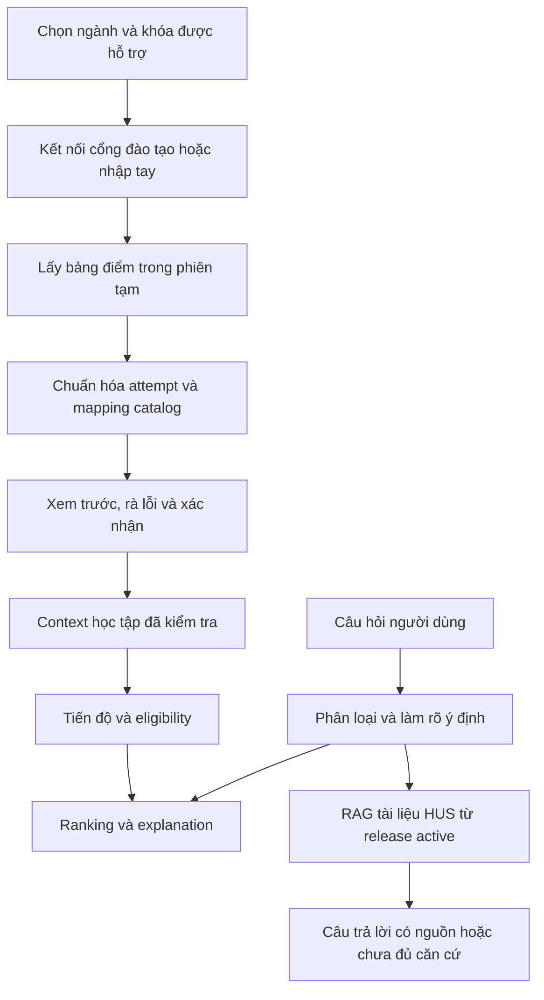

# Rà soát module và kế hoạch chỉnh sửa hệ thống AI-07

Ngày: **23/10/2026**. Phạm vi: 9 đặc tả trong `modules/`, code FastAPI/domain/repository/frontend, kiểm thử offline và kế hoạch RAG hiện có. Đây là kết quả audit và kế hoạch; chưa sửa nghiệp vụ hoặc triển khai kết nối cổng đào tạo.

**Phân công người dùng xác nhận ngày 23/10/2026:** module kết nối cổng đào tạo do bạn của người dùng phụ trách. Phần đăng nhập, SSO/CAPTCHA/OTP và lấy dữ liệu thuộc module đó. Phần hệ thống chính cần chuẩn bị hợp đồng nhận bảng điểm, chuẩn hóa/validation, xem trước/xác nhận và nối vào pipeline hiện có. Không cần người dùng cung cấp URL hoặc credentials để tiếp tục các phần độc lập; việc tích hợp thực tế phụ thuộc đầu ra module của người phụ trách.

## 1. Kết luận và yêu cầu sản phẩm mới

Chưa thể kết luận tất cả module đều đúng hoặc đầy đủ. Pipeline nhập tay → eligibility → recommendation đang có code và regression, nhưng luồng lấy bảng điểm qua tài khoản/mật khẩu cổng đào tạo **chưa có trong code local**. RAG cũng chưa có đường phục vụ runtime; hiện có snapshot crawl candidate và kế hoạch xử lý dữ liệu.

Theo yêu cầu mới của người dùng, nguồn bảng điểm chính dự kiến là cổng đào tạo mà sinh viên kết nối bằng tài khoản của mình. OCR bảng điểm không còn nằm trong phạm vi triển khai ưu tiên. Vẫn giữ nhập tay làm lựa chọn dự phòng khi cổng lỗi hoặc người dùng không muốn kết nối.

OCR văn bản scan phục vụ chuẩn bị tài liệu HUS vẫn có thể cần: nó xử lý PDF quy chế/chương trình để đưa vào corpus, không xử lý ảnh bảng điểm người dùng. Không xóa PDF gốc, bằng chứng OCR học thuật hoặc sáu mục pending_ocr của candidate chỉ vì bỏ OCR bảng điểm.

Yêu cầu mới cho phép thiết kế luồng xử lý bảng điểm cá nhân; chưa đồng nghĩa cho phép lưu lâu dài hồ sơ, mật khẩu hoặc hội thoại. Kiến trúc đề xuất tiếp tục dùng phiên tạm thời cho đến khi có quyết định khác.

## 2. Ma trận rà soát module

| Module hiện tại | Đã có trong code | Chưa khớp hoặc cần bổ sung | Hướng xử lý |
| --- | --- | --- | --- |
| 01 Catalog | HUS repository, validation, builder, migration, publish revision | Đặc tả vẫn lấy bốn catalog từ data/curricula và ghi không xây DB repository; thực tế thư mục đó chỉ là mẫu một ngành | Sửa đặc tả theo database/data/hus_source.json và runtime HUS; giữ trạng thái draft_unverified |
| 02 Transcript/profile | Nhập tay, GPA hệ 4/10, tín chỉ, kiểm tra ngành, từ chối duplicate | Chưa có dữ liệu import portal; chưa hỗ trợ học lại/điểm chữ/miễn học; tài liệu yêu cầu 12 demo profiles trong khi HUS profile API rỗng | Giữ domain chuẩn hóa ở đây; thêm contract dữ liệu import và policy học vụ có nguồn |
| 03 Eligibility | AND/OR, chặn nguồn mâu thuẫn/chưa rõ, track/path, quota, credit budget | Cần regression với transcript đã chuẩn hóa từ portal; policy khớp môn/equivalence chưa có | Giữ làm cổng tất định trước ranking; không cho importer hoặc RAG mở khóa môn |
| 04 Preference/ranking/what-if | Extractor, keyword/LLM ranker, fallback, trọng số | Có lỗi validation preference; số môn/tín chỉ đọc từ câu chưa có quy tắc ưu tiên với form; what-if chưa gắn baseline revision | Sửa input/fallback; định nghĩa precedence và hợp đồng what-if |
| 05 Explanation/LLM validation | Lọc mã ranker, explanation từ facts backend | Đặc tả/đặc tả hệ thống gợi ý LLM sinh explanation nhưng recommendation thực tế dùng template; advisor prose là đường riêng | Ghi đúng việc đã làm; giữ template có căn cứ, chỉ mở rộng LLM prose khi có nhu cầu và kiểm tra riêng |
| 06 Advisor | Course advisor, guardrail, history phiên, LLM/fallback | Chưa có HUS retrieval/citation; chưa thống nhất hoàn toàn giới hạn tư vấn với form recommendation | Thêm phân luồng intent, dùng chung context/constraints; route tra cứu sang module RAG mới |
| 07 API | programs/courses/profiles/summary/eligibility/recommendations/what-if/advisor; health/ready ở main | Chưa có API import portal, review/apply/cancel; danh sách endpoint trong đặc tả thiếu một số route đang có | Mở rộng API điều phối sau khi chốt contract; cập nhật route inventory |
| 08 Web UI | Giao diện tĩnh vừa thiết kế lại, nhập tay, điều kiện, gợi ý, chat | Chưa có kết nối portal/review import/trích dẫn RAG; chưa render progress theo khối/nhóm mà backend đã trả; nút mẫu dựa year không có dữ liệu | Giữ layout mới; thêm trạng thái import và citation; xử lý nút mẫu; hiển thị tiến độ có dữ liệu |
| 09 Transcript OCR | Chỉ có đặc tả, không có implementation upload/OCR bảng điểm trong app | Mục tiêu đã thay đổi sang portal | Chuyển đặc tả OCR thành lịch sử/deferred; module 09 mới là Portal transcript import |
| Mới: 10 Corpus HUS | Candidate 106 tài liệu và kế hoạch xử lý | Chưa có pipeline chuẩn hóa/chunk/index/release active | Module chuẩn bị và phát hành corpus theo kế hoạch RAG |
| Mới: 11 HUS Q&A/RAG | Chưa có service runtime | Thiếu retrieval, grounding, citations, abstention, evaluation | Module tra cứu riêng, được advisor/API gọi sau phân luồng |

Progress là trách nhiệm dùng chung của 02 và `app/progress.py`, không cần tạo module nghiệp vụ trùng chỉ để tăng số module. Corpus preparation và RAG serving có vòng đời khác nhau nên tách trách nhiệm rõ.

## 3. Các phát hiện cụ thể

### F01 — Cao: 5 ca acceptance đang fail vì PDF chuyển thư mục

`tests/support/hus_acceptance.py:39` tìm PDF trực tiếp dưới `docs/` bằng `root.parents[1].glob(...)`, nhưng workspace hiện có năm file dưới `docs/pdf/`. Lượt test có 4 ca inventory theo ngành và 1 ca kiểm tra thiếu coverage fail vì không tìm được PDF; đây là lỗi đường dẫn, chưa phải bằng chứng nội dung catalog sai.

Đã đối chiếu SHA-256 của bốn PDF mà inventory dùng ở vị trí mới: mỗi chương trình có đúng một file và hash đều khớp manifest kỳ vọng. Git đang thể hiện các đường dẫn cũ bị xóa, `docs/pdf/` chưa được track. Không tự di chuyển lại hoặc xóa file trong lần audit này.

Đề xuất: khai báo đường dẫn PDF rõ trong manifest/helper, cập nhật README/báo cáo tham chiếu, giữ kiểm tra đúng một file và SHA-256. Không làm test pass bằng bỏ xác minh PDF hoặc skip. Khi đổi cấu trúc tài liệu, kiểm tra lại mọi đường dẫn liên quan, kể cả PDF tham chiếu QĐ 3566.

### F02 — Cao: fallback preference có thể tự phát sinh ValidationError

`app/recommendation/preference.py` giữ raw_goal tối đa 500 ký tự nhưng gán nguyên chuỗi đó cho career_goal có giới hạn 200 trong `app/models.py`. Mục tiêu 201 ký tự làm extractor lỗi. Câu “Em muon hoc 40 tin chi” cũng lỗi vì target_credits bị giới hạn tối đa 30. Chưa có policy xử lý yêu cầu ngoài giới hạn trước khi tạo StructuredPreference. Đường fallback gọi lại cùng extractor nên không luôn khôi phục được từ lỗi này.

Đề xuất: chuẩn hóa từng trường theo contract, phân biệt input không hỗ trợ và lỗi provider, trả giải thích giới hạn thay vì lỗi tổng quát. Cần regression cho câu dài, số lượng/tín chỉ ngoài khoảng, phủ định và văn bản không có preference.

### F03 — Trung bình: preference số môn/tín chỉ chưa gắn với điều khiển request

`recommend()` dùng request.limit và request.max_credits để chọn tập kết quả; preference.target_course_count và target_credits chỉ được trích xuất, chưa dùng để xác định hai giới hạn này. Kiểm tra với câu “Em muon hoc 1 mon”, limit=5 và max_credits=18: extractor nhận target_course_count=1 nhưng kết quả có 3 môn trên source-built catalog Khoa học dữ liệu.

Cần quyết định ưu tiên giữa thông tin nhập trên form, câu tự nhiên và structured override, hiển thị giới hạn cuối đang áp dụng. Không tự giả định kết quả 3 môn là lỗi nếu form có chủ đích ưu tiên 5; lỗi hiện tại là contract/UX chưa giải thích sự ưu tiên đó.

### F04 — Trung bình: ba nút mẫu năm học không phù hợp catalog thật

`app/static/app.js` dùng `c.year === 1`, `c.year <= 2`, `c.year <= 3`. Cả 290 membership từ HUS builder đều có year=None/null. Vì vậy mẫu năm 1 rỗng; JavaScript coi null <= 2 là true, khiến mẫu năm 2/3 chọn những môn đầu danh sách thay vì môn đúng năm. Đây là luồng mẫu cũ được giữ lại khi thiết kế frontend.

Đề xuất: ẩn/vô hiệu hóa mẫu theo năm khi thiếu year; nếu vẫn cần minh họa, dùng fixture tổng hợp được ghi nhãn rõ, không đoán năm hoặc ghi điểm giả vào bảng điểm portal. Bỏ yêu cầu bắt buộc 12 demo profiles cho runtime HUS; giữ fixtures để test.

### F05 — Cao đối với mục tiêu mới: chưa có connector cổng đào tạo

`app/config.py`, `app/api/routes.py`, `app/static/` chưa có cấu hình cổng, route kết nối/import, session portal hoặc giao diện review bảng điểm. Các bảng accounts/students/course_attempts trong HUS schema không chứng minh đã có đăng nhập. `HusRepository.list_profiles()` cố ý trả rỗng.

Chưa biết URL cổng mục tiêu, cơ chế đăng nhập trực tiếp/SSO, CAPTCHA/OTP, định dạng điểm hoặc endpoint lấy bảng điểm. Cần khảo sát trước khi chọn HTTP client hay browser automation. Chỉ từ yêu cầu tài khoản/mật khẩu chưa thể kết luận scraper hoạt động được.

### F06 — Cao trước khi dùng bảng điểm thật: thiếu lớp chuẩn hóa attempt và policy học vụ

StudentTranscript hiện từ chối nhiều record cùng course_code với thông báo retakes unsupported. TranscriptRecord nhận điểm 0..10, term 1..12 và passed mặc định true khi không có grade. Đó là contract nhập tay đơn giản; không thể map mọi hàng portal trực tiếp vào contract này.

Importer cần giữ riêng các lần học, học kỳ/năm, trạng thái chờ điểm, điểm chữ, miễn/chuyển đổi, môn ngoài catalog và bằng chứng khớp ngành/khóa. Môn thiếu điểm không tự thành passed. Cách chọn attempt dùng tính GPA và cách xác định hoàn thành để mở tiên quyết phải có policy theo nguồn; không tùy ý chọn điểm cao nhất hoặc lần cuối.

GPA hiện là phép quy đổi của dự án (`grade_to_gpa4`, ngưỡng passed 5.0), chưa có xác nhận đầy đủ khớp quy chế portal. Giá trị GPA chính thức do portal cung cấp và GPA dự án tự tính cần được phân biệt. Môn ngoài catalog giữ ở danh sách cần rà soát, không đưa vào eligibility và không làm mất cả lần import.

### F07 — Trung bình: what-if chưa pin context phiên bản

Endpoint `/recommendations/what-if` hiện tính lại eligibility từ request và catalog hiện tại. Việc tính lại không tự mở khóa môn khi mọi input giữ nguyên, nhưng request chưa mang baseline catalog revision/context digest, và chưa trả rank delta. Nếu catalog hoặc transcript đổi giữa hai lượt thì chưa có hợp đồng bảo đảm đang so sánh cùng tập ứng viên.

Đề xuất: gắn context revision/digest cho baseline, phát hiện mismatch và yêu cầu tạo baseline mới; viết lại đặc tả “không được gọi lại eligibility” thành bất biến kết quả với cùng context. Không cần lưu transcript lâu dài để làm việc này.

### F08 — Trung bình: advisor và recommendation chưa hoàn toàn cùng contract

Advisor gọi eligibility với max_credits=40; recommendation form tối đa 30. Advisor có nhánh tự xây facts/ranking thay vì gọi trực tiếp toàn bộ service recommendation như module 06 mô tả. Chưa có trích dẫn tài liệu hoặc router HUS Q&A. Đề xuất dùng chung context/constraints và facts, giữ riêng việc tư vấn định hướng với việc chọn gói môn bị giới hạn tín chỉ.

Recommendation explanation hiện được dựng bằng template trong `app/recommendation/explanation.py`; đây là cơ chế có căn cứ cần giữ. Không phải cứ tên module có LLM là phải thêm LLM call. Advisor kiểm tra mã môn và guardrail không chứng minh mọi câu văn LLM đều được xác minh từng fact; cần đánh giá prose riêng khi mở rộng tư vấn/RAG.

### F09 — Trung bình: chưa nối đủ dữ liệu backend vào UI

`/transcript/summary` đã trả progress theo khối, choice group, track/path; `updateStudentState()` mới lấy số môn, tín chỉ, GPA rồi render eligibility. Cần hiển thị tiến độ nhóm khi có dữ liệu. Track/path hiện đặt trong chat; nên để người dùng thấy và điều chỉnh được trong workspace học tập vì chúng tác động cả eligibility ngoài chat.

Một số chỗ render course metadata/lý do bằng innerHTML. Khi thêm dữ liệu portal/crawl phải dùng textContent hoặc sanitizer được kiểm tra; không đưa HTML từ website ngoài trực tiếp vào DOM. Đây là yêu cầu ở ranh giới dữ liệu mới, chưa kết luận có khai thác XSS thực tế trên corpus hiện tại.

### F10 — Trung bình: đặc tả và nguồn tham chiếu còn lỗi thời

Modules 01/02/08, modules README, SYSTEM_SPECIFICATION và CODEBASE_CHECKLIST cần đồng bộ nguồn runtime, trạng thái demo profile, luồng portal mới và việc bỏ OCR bảng điểm. Một số checklist còn ghi chưa chạy full_catalog_acceptance trong khi đã có bằng chứng lịch sử chạy đủ; hiện phải ghi thêm regression đường dẫn F01, không lấy kết quả cũ làm tình trạng hiện tại.

Các phần “không dùng dữ liệu sinh viên thật” là giới hạn demo lịch sử. Bản mục tiêu có portal cần quy định rõ xử lý trong phiên, consent, kết thúc phiên và dữ liệu tối thiểu chuyển tới LLM. Không âm thầm giữ câu cấm cũ rồi thiết kế tính năng trái với nó.

## 4. Phần thiếu, phần dư và phần cần giữ

**Thiếu:** connector portal; session kết nối tách từng người dùng; pipeline normalize/review/apply bảng điểm; mapping ngành/khóa/catalog; policy attempt/điểm; API và UI import; corpus preparation/release; RAG retrieval/citations; intent routing; hiển thị progress chi tiết; regression cho các ranh giới mới.

**Dư trong phạm vi sản phẩm mới:** kế hoạch upload ảnh/OCR bảng điểm trong module 09; yêu cầu runtime có đủ 12 hồ sơ demo; các nút mẫu năm học khi year chưa biết; các điều cấm đăng nhập trong đặc tả UI. Chuyển mục OCR cũ sang lịch sử, không thực hiện xóa tài liệu trong bước lập kế hoạch.

**Cần giữ:** nhập tay dự phòng; fixture tổng hợp cho test; PDF và bằng chứng OCR nguồn; legacy database/migrations để rollback; accounts/students/course_attempts hiện có nếu chưa audit tác động; schema catalog/revision, deterministic eligibility và explanation. Không coi mọi thành phần chưa dùng là code rác để xóa.

Không thêm mặc định tài khoản ứng dụng riêng: đăng nhập portal và đăng nhập AI-07 là hai quyết định khác nhau. Với demo dùng phiên tạm thời, có thể kết nối portal mà chưa cần hệ thống account/password nội bộ riêng.

## 5. Luồng mục tiêu



Import phải staged: bắt đầu/tải/parse/review chưa làm đổi transcript đang dùng; chỉ apply sau xác nhận. Lỗi, hủy, phiên hết hạn hoặc đổi ngành phải hủy draft và vô hiệu hóa response cũ. Cổng không hỗ trợ khóa/ngành hiện tại phải báo rõ, không tự chọn catalog 2022 gần giống.

## 6. Kế hoạch chỉnh sửa theo thứ tự

| Giai đoạn | Việc làm và vùng dự kiến | Hoàn thành khi |
| --- | --- | --- |
| P0-A | Sửa PDF resolver/manifest và tham chiếu docs (F01); giữ hash | Các ca fail được chạy lại thành công, không bỏ kiểm tra nguồn |
| P0-B | Sửa preference normalization/fallback và validation (F02); chốt precedence với form (F03) | Câu dài và số ngoài phạm vi cho kết quả/feedback đúng contract, không lỗi ngoài dự kiến; test chứng minh trường hợp 1 môn |
| P0-C | Chặn mẫu năm thiếu dữ liệu (F04); ghi rõ lỗi trong báo cáo frontend | Không tạo bảng điểm minh họa sai do null coercion; thao tác nhập tay vẫn hoạt động |
| P1-A | Cập nhật module map/đặc tả/README/checklist, archive OCR transcript, viết module portal/corpus/RAG | Mọi tài liệu phân biệt trạng thái hiện có và mục tiêu; liên kết OCR cũ vẫn truy vết được |
| P1-B | Thống nhất contract bàn giao với người phụ trách portal: schema bảng điểm, ngành/khóa, trạng thái lỗi, thời điểm lấy và vòng đời phiên; khảo sát cổng do người phụ trách thực hiện | Có schema, mẫu đã ẩn danh và mock adapter để phát triển hệ thống chính độc lập với portal thật |
| P1-C | Thiết kế AttemptRecord → normalized transcript; policy grade/retake/exemption; mapping catalog | Replay mẫu hợp lệ/sai/trùng/môn lạ/khác khóa có kết quả mong đợi; không tự mở tiên quyết |
| P2-A | Người phụ trách bàn giao connector; hệ thống chính tích hợp adapter và API import dự thảo/review/apply/disconnect theo contract | Kiểm tra lỗi connector, hết phiên, dữ liệu thiếu và cô lập người dùng bằng mock trước; kiểm tra tích hợp thật khi connector sẵn sàng; import lỗi giữ transcript cũ |
| P2-B | UI kết nối, xem trước, rà lỗi, xác nhận; progress/track/path trong workspace | Luồng đầu cuối từ kết nối đến eligibility hoạt động; đổi ngành/ngắt kết nối xóa đúng dữ liệu |
| P2-C | Đồng bộ advisor constraints và what-if context revision (F07/F08) | Cùng context cho cùng eligible set; context đổi yêu cầu baseline mới; lời tư vấn không vượt contract |
| P3 | Triển khai module corpus/RAG theo kế hoạch riêng đã có | Đạt tiêu chí review nguồn, retrieval/citations, abstention và release/rollback trong kế hoạch RAG |
| P4 | Regression toàn pipeline và báo cáo bàn giao | Tách bằng chứng offline, DB, browser, connector được phép và RAG; ghi rõ phần còn chưa kiểm chứng |

Các API tên cụ thể, model embedding, cơ chế HTTP/browser và chiến lược session phải được chốt ở thiết kế triển khai dựa trên cổng thật; chưa tạo route giả như thể đã hoạt động.

### Ràng buộc cho connector dùng tài khoản/mật khẩu

- Chỉ kết nối các host portal/SSO đã cấu hình và được review; kiểm tra redirect. Không nhận URL tùy ý rồi gửi credentials đến đó.
- Mật khẩu chỉ dùng cho thao tác đăng nhập được yêu cầu; không lưu vào database, browser storage, log, trace, prompt hoặc corpus. accounts.password_hash là tài khoản nội bộ của schema, không phải nơi cất mật khẩu portal.
- Cookies/token portal giữ tạm phía server theo phiên riêng, có TTL và cơ chế ngắt kết nối; không dùng cookie jar chung giữa sinh viên, không tự reconnect bằng mật khẩu lưu sẵn.
- Nếu gặp CAPTCHA/OTP/SSO cần tương tác, thiết kế bước người dùng thực hiện được hỗ trợ; không giả định chỉ POST username/password là đủ hoặc tự vượt cơ chế xác thực.
- Việc dùng bảng điểm thật với LLM phải có giới hạn dữ liệu rõ: chỉ facts cần thiết, không tên/MSSV/credential hoặc toàn bộ HTML portal; tuân theo lựa chọn người dùng và mô tả sản phẩm.
- Chỉ lấy hồ sơ/bảng điểm của người dùng đã chủ động kết nối; không thêm thao tác đăng ký/hủy môn hay ghi dữ liệu lên cổng đào tạo.

## 7. Kiểm tra đã thực hiện và giới hạn kết luận

Chạy ngày 23/10/2026:

```powershell
.venv/Scripts/python.exe -m pytest tests -q -m "not postgres and not hus_postgres" --full-catalog-root docs/acceptance/hus_2022
.venv/Scripts/python.exe -m ruff check app tests
```

Kết quả: **297 passed, 5 failed, 35 deselected**, một cảnh báo Starlette/httpx có từ trước. Cả 5 failure có nguyên nhân F01. Ruff đạt. Đã kiểm tra hash 4 PDF ở `docs/pdf/`, tái hiện F02/F03 bằng gọi trực tiếp source-built catalog và extractor, xác nhận year chưa biết trên cả 290 membership.

Đã đọc code và đặc tả 9 module, không thực hiện chứng minh hình thức mọi rule hoặc xác minh học vụ toàn bộ. Chưa chạy lại 35 ca PostgreSQL, chưa kết nối portal hoặc nhà cung cấp LLM, chưa audit nhánh chưa merge. Bằng chứng browser của lần frontend trước ghi ở [báo cáo frontend](FRONTEND_REDESIGN_2026_10_23.md); lần audit này không thay bằng chứng đó bằng một tuyên bố đã kiểm tra portal.

Không dùng số 337 passed lịch sử để kết luận workspace hiện tại xanh. Không thay source catalog thành verified; MAT3402, MAT3325, PHI1002 và hiệu lực các văn bản vẫn cần kết luận học vụ như báo cáo nguồn.

**Tiến độ yêu cầu audit và lập kế hoạch: 100%.** Kế hoạch sửa code chưa được triển khai. Module portal do bạn của người dùng phụ trách; phần chưa có trong code local là phụ thuộc tích hợp, không phải yêu cầu triển khai lại connector trong hệ thống chính. Đầu vào cần khi tích hợp là contract, mẫu dữ liệu đã ẩn danh và trạng thái lỗi từ module đó; URL/SSO/CAPTCHA/OTP thuộc trách nhiệm người phụ trách connector. Các sửa lỗi hiện có, cập nhật đặc tả và chuẩn hóa transcript có thể làm độc lập.

## 8. Tài liệu liên quan

- [Module map hiện tại](../modules/README.md)
- [Đặc tả hệ thống](SYSTEM_SPECIFICATION.md)
- [Kế hoạch xử lý dữ liệu RAG](KE_HOACH_XU_LY_DATA_RAG_HUS.md)
- [Báo cáo acceptance PDF](HUS_PDF_ACCEPTANCE_REVIEW.md)
- [Vận hành HUS](../database/HUS_RUNTIME.md)
