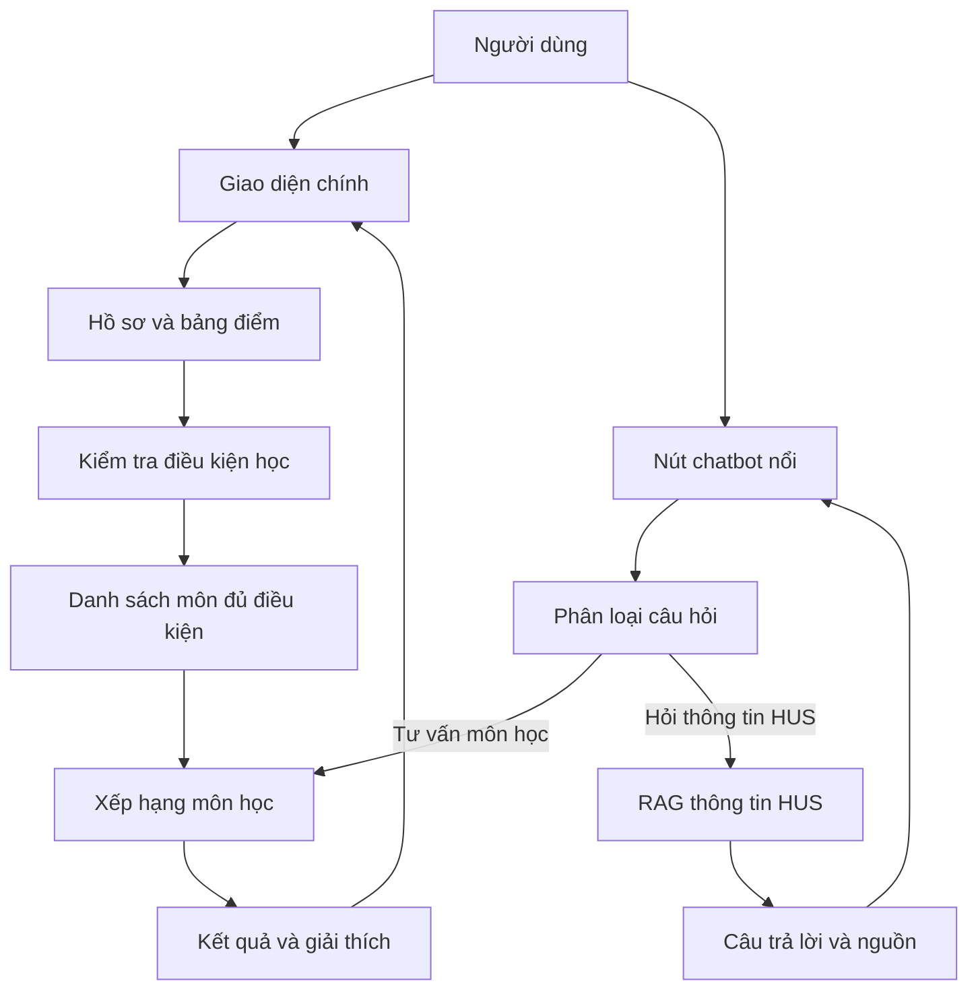
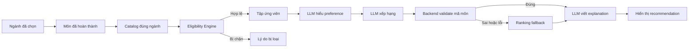
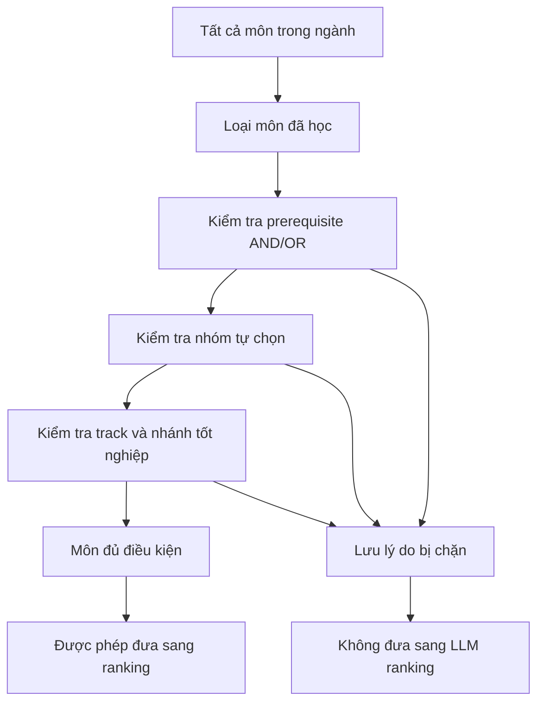
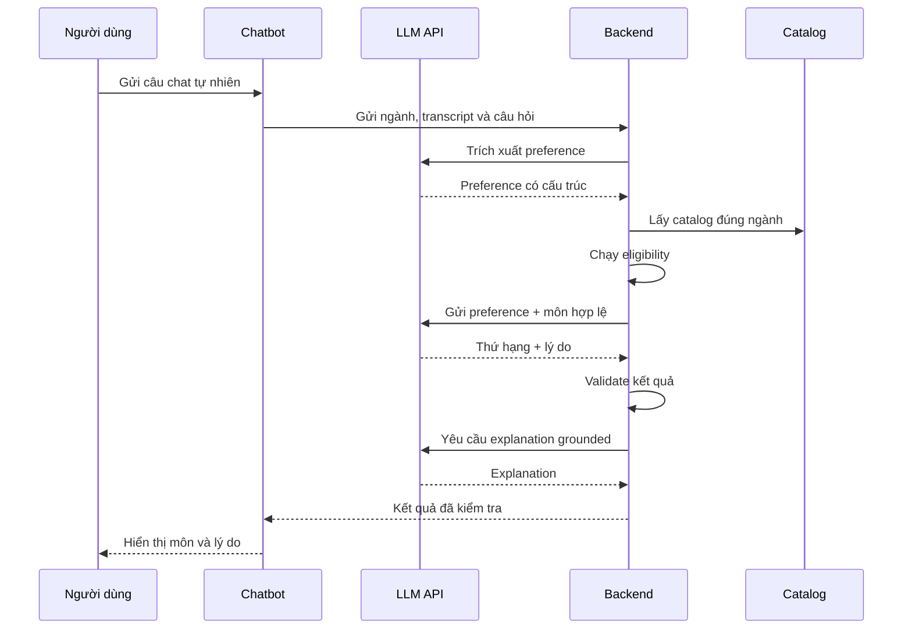
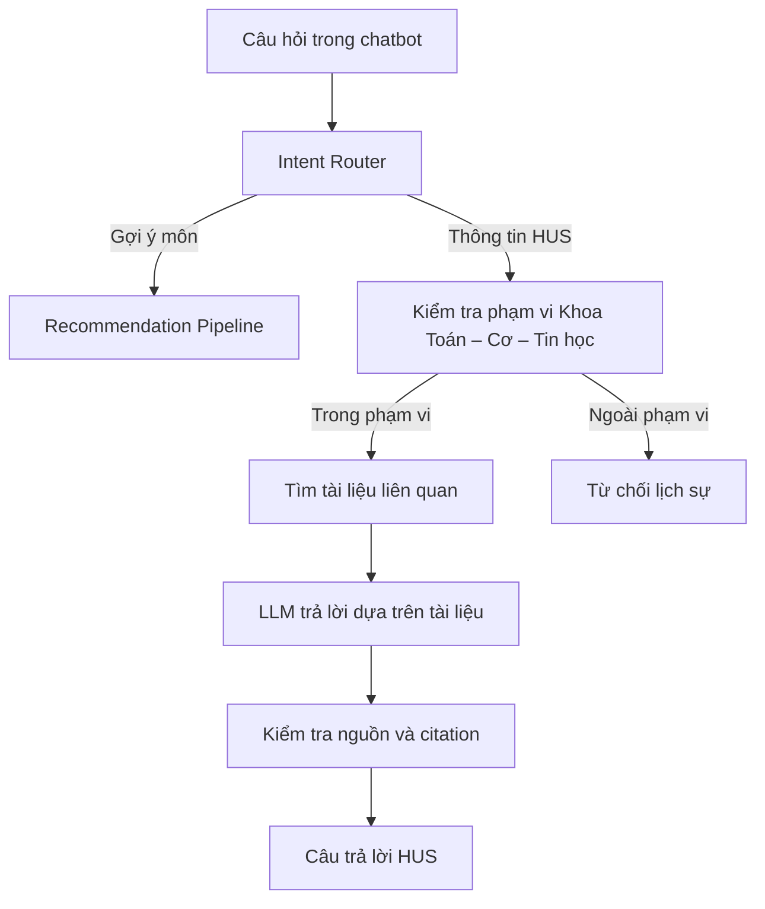
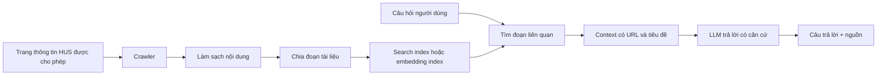

# Đặc tả hệ thống theo pipeline

## 1. Hệ thống này làm gì?

Hệ thống giúp sinh viên:

1. Chọn ngành học.
2. Xem các môn đã hoàn thành và tiến độ học tập.
3. Xem những môn hiện đủ điều kiện để học tiếp.
4. Nói mong muốn của mình bằng câu chat tự nhiên.
5. Nhận danh sách môn được xếp hạng theo mong muốn đó.
6. Xem lý do vì sao từng môn được đề xuất.
7. Hỏi thêm thông tin đào tạo của HUS trong chatbot.

Hệ thống hiện chỉ gợi ý **môn học**. Hệ thống chưa xếp thời khóa biểu, chưa kiểm tra trùng lịch và chưa xác nhận môn có mở trong học kỳ hiện tại.

### Sơ đồ toàn bộ hệ thống

## 2. Người dùng nhìn thấy gì?

Trang chính có ba khu vực chính:

- Khu vực hồ sơ và bảng điểm: chọn ngành, chọn các môn đã hoàn thành, xem tín chỉ và GPA.
- Khu vực kiểm tra điều kiện: xem môn nào đủ điều kiện và môn nào bị chặn, kèm lý do.
- Khu vực gợi ý môn: nhập mong muốn, xem các môn được xếp hạng và lý do.

Ngoài ra, ở mọi trang có một **nút chatbot nổi**. Người dùng bấm nút này để hỏi về môn học hoặc hỏi thông tin HUS.

## 3. Quy tắc quan trọng nhất

Hệ thống luôn làm theo thứ tự:

**Chọn ngành → kiểm tra điều kiện → tạo danh sách môn hợp lệ → hiểu mong muốn → xếp hạng → giải thích → hiển thị.**

LLM không được bỏ qua bước kiểm tra điều kiện. Nếu người dùng thích một môn nhưng chưa đủ prerequisite, LLM cũng không được đề xuất môn đó.

Mọi kết quả chỉ có nghĩa là:

> “Môn này đủ điều kiện theo dữ liệu chương trình đang có và phù hợp tương đối với nhu cầu đã nhập.”

Kết quả không có nghĩa là môn chắc chắn mở lớp hoặc là quyết định học vụ chính thức.

### Sơ đồ pipeline recommendation

## 4. Dữ liệu đầu vào của hệ thống

### 4.1. Dữ liệu chương trình đào tạo

Hệ thống có bốn catalog độc lập:

- Toán học;
- Toán tin;
- Khoa học máy tính và thông tin;
- Khoa học dữ liệu.

Mỗi môn trong catalog có các thông tin chính:

- mã môn;
- tên môn;
- số tín chỉ;
- nhóm hoặc loại môn;
- môn tiên quyết;
- nhóm tự chọn hoặc hướng học;
- nhánh tốt nghiệp nếu có;
- trang nguồn trong tài liệu;
- trạng thái đã xác minh hay chưa.

Để hiểu những câu như “tôi muốn học về thị giác máy tính”, môn học cần có thêm chủ đề, ví dụ `computer_vision`, `image_processing`, `machine_learning` hoặc `deep_learning`.

Nếu catalog chưa có thông tin về độ khó hoặc khối lượng học, hệ thống phải ghi là “chưa có dữ liệu”. Không được tự đoán rằng một môn là dễ hoặc nhẹ.

### 4.2. Dữ liệu người dùng

Người dùng demo có:

- ngành đang chọn;
- danh sách môn đã hoàn thành;
- điểm số nếu có;
- tín chỉ đã tích lũy;
- mục tiêu hoặc định hướng;
- câu chat mô tả mong muốn học kỳ tới.

Dự án dùng 12 hồ sơ tổng hợp, ba hồ sơ cho mỗi ngành. Không dùng dữ liệu sinh viên thật.

## 5. Pipeline tổng thể của trang chính

### Bước 1: Người dùng chọn ngành

Người dùng chọn một trong bốn ngành.

Backend kiểm tra ngành có tồn tại không và nạp đúng catalog của ngành đó.

Đầu ra:

- tên ngành;
- tổng tín chỉ;
- danh sách môn thuộc ngành;
- trạng thái catalog.

Từ thời điểm này, mọi xử lý đều chỉ dùng catalog của ngành đã chọn.

### Bước 2: Người dùng nhập các môn đã hoàn thành

Người dùng tích chọn môn hoặc nhập điểm.

Backend kiểm tra:

- mã môn có thuộc ngành đang chọn không;
- điểm có nằm trong phạm vi hợp lệ không;
- môn đã đạt hay chưa đạt;
- môn có được tính vào tín chỉ tích lũy không.

Nếu người dùng đổi ngành, hệ thống xóa danh sách môn đã chọn của ngành cũ để không trộn dữ liệu giữa hai ngành.

### Bước 3: Backend tính tiến độ

Backend tính:

- số môn đã đạt;
- số tín chỉ đã tích lũy;
- GPA nếu đủ dữ liệu;
- danh sách môn chưa đạt;
- các nhóm hoặc phần chương trình còn thiếu nếu dữ liệu hỗ trợ.

Kết quả này chỉ dùng để hiển thị và làm đầu vào cho bước kiểm tra điều kiện.

## 6. Pipeline kiểm tra điều kiện học

Đây là pipeline quan trọng nhất vì nó quyết định môn nào **được phép** đi tiếp.

### Bước 1: Lấy toàn bộ môn của ngành

Backend lấy danh sách môn từ catalog ngành đang chọn. Không lấy môn của ba ngành còn lại.

### Bước 2: Loại môn đã hoàn thành

Các môn đã đạt bị loại khỏi danh sách đề xuất. Hệ thống không đề xuất học lại những môn này.

### Bước 3: Kiểm tra prerequisite

Mỗi môn có thể có nhiều điều kiện.

- Nhiều nhóm điều kiện khác nhau thường mang nghĩa AND: phải thỏa tất cả nhóm.
- Nhiều mã trong cùng một nhóm mang nghĩa OR: chỉ cần hoàn thành một mã.

Ví dụ, điều kiện “A hoặc B, và C” nghĩa là người dùng phải có A hoặc B, đồng thời phải có C.

Nếu thiếu một nhóm điều kiện, môn bị đưa vào danh sách bị chặn và backend ghi rõ môn nào còn thiếu.

Mã prerequisite nằm ngoài catalog hoặc chưa được xác minh không được tự động công nhận để mở khóa môn.

### Bước 4: Kiểm tra nhóm tự chọn

Backend kiểm tra sinh viên đã đủ tín chỉ trong nhóm tự chọn hay chưa. Nếu nhóm đã đủ quota, các môn chỉ thuộc nhóm đó có thể bị loại.

Khi một môn thuộc nhiều nhóm, tín chỉ của môn chỉ được tính một lần trong tiến độ, nhưng quan hệ thành viên nhóm vẫn được giữ lại để tính điều kiện chính xác.

### Bước 5: Kiểm tra track và nhánh tốt nghiệp

Nếu chương trình yêu cầu chọn hướng hoặc nhánh tốt nghiệp, backend dùng các rule của catalog để kiểm tra. Không được viết cứng các con số hoặc tên hướng trong code nếu chúng có thể thay đổi theo catalog.

### Bước 6: Tạo hai danh sách

Kết quả của eligibility gồm:

- **Môn đủ điều kiện:** được phép chuyển sang bước xếp hạng.
- **Môn bị chặn:** không được chuyển sang LLM để xếp hạng, kèm lý do cụ thể.

Từ đây trở đi, LLM chỉ được nhìn thấy danh sách môn đủ điều kiện khi thực hiện recommendation.

### Tóm tắt kết quả của eligibility

## 7. Pipeline chatbot gợi ý môn học

Người dùng có thể nói:

> “Kỳ này tôi muốn học nhẹ, dễ một chút, hơi thiên về học thuật và muốn biết thêm về thị giác máy tính.”

Chatbot xử lý câu này qua các bước sau.

### Bước 1: Nhận câu chat

Frontend gửi câu chat cùng với:

- ngành đang chọn;
- các môn đã hoàn thành;
- lịch sử chat trong phiên hiện tại nếu có.

Frontend không gửi API key cho model.

### Bước 2: LLM hiểu mong muốn

LLM đọc câu chat và chuyển thành các preference có cấu trúc. Ví dụ:

- workload: nhẹ;
- difficulty: thấp;
- orientation: thiên lý thuyết;
- interest topics: computer vision;
- target credits: chưa nói;
- target course count: chưa nói.

Nếu câu chat quá mơ hồ, LLM không tự đoán mà tạo câu hỏi làm rõ. Ví dụ “học ổn ổn thôi” có thể khiến chatbot hỏi người dùng muốn ít tín chỉ, ít môn hay môn ít prerequisite.

### Bước 3: Chạy eligibility

Backend chạy lại hoặc sử dụng kết quả eligibility mới nhất. Đây là bước bắt buộc trước khi gọi LLM để xếp hạng.

### Bước 4: Gắn metadata cho các môn hợp lệ

Backend chuẩn bị thông tin của từng môn hợp lệ:

- mã và tên môn;
- tín chỉ;
- nhóm môn;
- chủ đề;
- định hướng;
- workload/difficulty nếu có;
- lý do môn đủ điều kiện;
- trạng thái nguồn.

### Bước 5: LLM xếp hạng

Backend gửi cho LLM:

- preference đã hiểu;
- chỉ danh sách môn hợp lệ;
- metadata của các môn đó;
- yêu cầu chỉ được trả về mã môn trong danh sách.

LLM ưu tiên những môn khớp với mong muốn. Ví dụ:

- môn có topic `computer_vision` được ưu tiên hơn môn chỉ có `machine_learning`;
- môn có workload nhẹ được ưu tiên nếu catalog có dữ liệu;
- môn lý thuyết được ưu tiên nếu người dùng muốn học thuật.

Nếu một trường dữ liệu bị thiếu, LLM không được coi giá trị thiếu là phù hợp hoặc không phù hợp một cách chắc chắn.

### Bước 6: Backend kiểm tra output của LLM

Backend kiểm tra:

- mã môn có tồn tại trong danh sách hợp lệ không;
- môn có bị trùng không;
- môn có phải môn người dùng đã học không;
- số lượng kết quả có đúng giới hạn không;
- lý do có mâu thuẫn với catalog không.

Nếu có lỗi, backend loại kết quả sai và dùng ranking fallback deterministic.

### Bước 7: LLM viết explanation

LLM nhận các facts đã được backend kiểm tra và viết lời giải thích dễ hiểu. Một explanation tốt phải tách hai ý:

1. Vì sao môn được phép học: đã hoàn thành prerequisite nào, thuộc nhóm nào.
2. Vì sao môn phù hợp: khớp chủ đề, định hướng hoặc workload nào.

LLM không được nói “môn chắc chắn dễ”, “môn chắc chắn mở lớp” hoặc “môn phù hợp tuyệt đối” nếu dữ liệu không chứng minh điều đó.

### Bước 8: Hiển thị kết quả

Frontend hiển thị khoảng 3–5 môn nổi bật, mỗi môn gồm:

- mã môn;
- tên môn;
- số tín chỉ;
- thứ hạng hoặc mức độ phù hợp;
- lý do đủ điều kiện;
- lý do được ưu tiên;
- nguồn dữ liệu nếu có;
- cảnh báo chưa xác nhận môn có mở lớp.

Người dùng có thể nhắn tiếp “ưu tiên nhẹ hơn” hoặc “muốn thực hành hơn”. Khi đó hệ thống cập nhật preference và xếp hạng lại trên cùng tập môn hợp lệ.

## 8. Ba việc LLM làm và những việc backend làm

### LLM làm

1. Hiểu câu chat và trích xuất preference.
2. Xếp hạng các môn đã hợp lệ.
3. Viết lời giải thích bằng ngôn ngữ tự nhiên.

### Backend làm

1. Nạp đúng catalog.
2. Kiểm tra dữ liệu đầu vào.
3. Kiểm tra eligibility.
4. Chặn môn sai hoặc chưa xác minh.
5. Kiểm tra output của LLM.
6. Chạy fallback khi LLM lỗi.
7. Gửi kết quả cho frontend.

API key chỉ dùng để xác thực với nhà cung cấp LLM và cho phép gọi model. API key không tự lọc môn và không được đưa xuống trình duyệt.

## 9. Pipeline chatbot hỏi đáp thông tin HUS

### Sơ đồ phân nhánh chatbot

Luồng này chỉ chạy trong khung chatbot, không tạo thêm trang FAQ bên ngoài.

### Giai đoạn A: Chuẩn bị dữ liệu HUS

1. Xác định danh sách URL được phép crawl.
2. Chỉ lấy các trang thuộc phạm vi thông tin đào tạo của Khoa Toán – Cơ – Tin học.
3. Làm sạch nội dung, bỏ menu và phần không liên quan.
4. Chia nội dung thành các đoạn nhỏ.
5. Lưu nội dung cùng URL, tiêu đề và ngày cập nhật.
6. Tạo chỉ mục tìm kiếm hoặc embedding.

Crawler và script migration dùng chung quy tắc gắn nhãn ngành cho tệp đính kèm.
Khi nội dung ghi rõ áp dụng cho sinh viên toàn trường, toàn khoa hoặc tất cả ngành,
tài liệu giữ nhãn `general`, kể cả khi được liên kết từ một trang ngành cụ thể.
Chỉ tệp chưa xác định được phạm vi mới kế thừa ngành của trang cha. Trạng thái
chưa xác định được phân biệt trong logic suy luận; định dạng trường `major` trong
catalog vẫn giữ nguyên. Script migration có thể sửa nhãn đã kế thừa sai trong
catalog cũ; chế độ `--dry-run` chỉ tính thống kê và không ghi dữ liệu.
Tiêu đề nhắc từ hai ngành khác nhau trở lên cũng được giữ ở `general` trước khi
xét URL hoặc phần đầu nội dung, tránh thu hẹp thông báo dành cho nhiều ngành.
Tên ngành ghép “Toán học và Tin học” được tính là một ngành Toán–Tin.

### Chuẩn bị corpus ứng viên có thể tái lập — 2026-10-25

`tools.prepare_hus_corpus` là pipeline offline riêng sau crawl. Đầu vào gồm snapshot được ghim
theo commit/checksum, cấu hình versioned và quyết định review đủ document ID; lưu trong
`data/hus/corpus/`. Công cụ kiểm tra hash/catalog/Markdown trước khi tạo inventory, bản chuẩn hóa,
quyết định review và documents/chunks/source map ứng viên. Mỗi build có manifest hash mã công cụ,
contract và output; `verify` dựng lại và so từng byte. Không ghi đè nguồn hoặc build cũ.

Baseline mới có 106 ID, 100 `needs_review`, 6 `pending_ocr`, 0 `include`; không nhập quyết định
build07 chưa có hồ sơ trong checkout. `active` của crawler không chứng nhận review. Chỉ quyết định
`include` có raw hash-bound và bằng chứng review mới xuất corpus. Metadata thời gian/ngành vẫn
cần thẩm định; locator chunk chỉ về bản chuẩn hóa, chưa xác nhận trang/ô bảng gốc. Không tự gộp
text trùng, chạy OCR, chứng nhận hiệu lực hoặc kích hoạt RAG. Xem
[quy trình và nghiệm thu](HUS_CORPUS_PREPARATION.md) để tái tạo trên cùng snapshot.

### Giai đoạn B: Trả lời câu hỏi

P1 chất lượng nguồn (2026-10-26, corpus 1.4): báo cáo và hàng đợi OCR theo từng trang PDF,
không lấy trung bình toàn file. SourceTable giữ raw_rows riêng với display, định danh hàng/
cột/ô, header/spans và locator PDF bbox, DOCX block, HTML DOM hoặc XLSX sheet/address.
ReviewDecision.source_quality gắn hash report và hồ sơ đối chiếu từng trang/bảng/ô với reviewer,
timestamp, locator và giá trị đã đọc. Gate trích xuất lại từ raw; thiếu hoặc sai một unit,
grid chưa giải quyết hay nội dung hiển thị khác nguồn đều chặn toàn document khỏi corpus/index.
Chunks dẫn report/unit ở phạm vi toàn tài liệu; chưa có ánh xạ chính xác từng chunk tới ô.
Không tự chạy OCR, duyệt số liệu hoặc phát hành RAG; xem [HUS_SOURCE_QUALITY.md](HUS_SOURCE_QUALITY.md).

P1 applicability (2026-10-26, corpus 1.3): unknown, general và out_of_scope là ba trạng thái
khác nhau. Bộ suy luận bỏ tín hiệu link/menu/bảng và query URL; nhận diện hai chương trình
Địa chất/Địa lý ngoài phạm vi trước tín hiệu Toán trong nội dung phụ. HUSDocument.major là
proposal crawler; ApplicabilityMetadata tách proposed/verified cho ngành, bậc học, chương trình,
biến thể, khóa/năm và hiệu lực. Verified khác unknown cần reviewer, thời gian có múi giờ và
locator/quote khớp source có hash/URL đúng; không kế thừa xác minh từ trang cha.

Lớp applicability.json versioned áp dụng lên snapshot bất biến theo đủ 106 ID; không viết lại
source để sửa nhãn cũ. Corpus/index xuất major từ verified, giữ proposal/legacy riêng, chặn
nguồn out_of_scope ngay tại cổng duyệt. Chưa có verified major trong baseline; unknown không
được coi là general hoặc mở khóa học phần. Hướng dẫn tại
[HUS_APPLICABILITY_METADATA.md](HUS_APPLICABILITY_METADATA.md).

P1 provenance (2026-10-26): RawStorage lưu byte bất biến theo SHA-256, append-only acquisition
ledger có URL/document ID/thời điểm/loại file và kết quả từng lần lấy. HUSDocument.raw_source
trỏ capture cụ thể; attachment của trang cha trỏ raw_path. Thiếu raw hợp lệ thì không gửi
validator; 304 không có cache/body phải tải lại không validator hoặc ghi blocker, không bỏ qua.
Corpus 1.2 xuất raw_capture, kiểm tra reference với manifest và giữ nguyên cổng duyệt 1.1.
Hai PDF local khớp text catalog đã được lưu như candidate chưa xác minh phiên bản byte gốc;
49 URL còn queued. Không thay catalog, snapshot bất biến hoặc review vì tìm được file.
Chi tiết phạm vi/bằng chứng tại [HUS_RAW_PROVENANCE.md](HUS_RAW_PROVENANCE.md).

Cổng duyệt P0 (pipeline 1.1, 2026-10-26) dùng chung `ReviewDecision` và `require_review()` cho
corpus, chunking và index Python. `include` cần URL/hash nguồn và nội dung khớp, reviewer,
timestamp có múi giờ và locator. Review toàn tài liệu; chưa hỗ trợ xuất từng phần đã duyệt.
Metadata hiệu lực giữ unknown khi chưa có căn cứ. Scope hiện hành cần current_verified,
bằng chứng, ngày bắt đầu hiệu lực và as_of tường minh, nằm trong khoảng hiệu lực nếu có.
Chunk/output lưu review và review_as_of. Không suy hiệu lực từ fetched_at hoặc ngày hệ thống.

Index cần quyết định hiện tại do caller cung cấp, không tin approval lưu trong cache; kiểm tra
lại khi nạp/lưu, bỏ chunk bị rút duyệt hoặc nguồn thay đổi, kể cả content_hash không đổi khi
trạng thái crawler chuyển sang pending_ocr. Lệnh index cũ chỉ cho empty/dry-run, chặn xuất từ
crawl chưa duyệt trước HTTP. Crawler vẫn giữ mọi bằng chứng; corpus/index chỉ nhận phần đã
qua cổng. Đây là kiểm tra contract và bằng chứng review, không tự chứng nhận học vụ.

1. Người dùng hỏi trong chatbot.
2. Router xác định đây là câu hỏi HUS hay câu hỏi gợi ý môn.
3. Nếu là câu hỏi HUS, hệ thống tìm các đoạn tài liệu liên quan.
4. LLM trả lời dựa trên các đoạn đã tìm được.
5. Backend kiểm tra câu trả lời có nguồn hay không.
6. Chatbot hiển thị câu trả lời cùng URL và tiêu đề nguồn.

Nếu không tìm thấy thông tin, chatbot nói rõ chưa tìm thấy và không tự đoán. Nếu câu hỏi ngoài phạm vi khoa, chatbot từ chối lịch sự. Nếu tài liệu mâu thuẫn, chatbot nói rõ có mâu thuẫn và hướng dẫn người dùng xác nhận với đơn vị phụ trách.

### Sơ đồ dữ liệu của HUS RAG

## 10. What-if hoạt động thế nào?

What-if cho phép người dùng thử một mong muốn khác mà không sửa hồ sơ thật.

Ví dụ:

- thử muốn học ít tín chỉ hơn;
- thử ưu tiên thực hành thay vì lý thuyết;
- thử quan tâm đến computer vision;
- thử thay đổi trọng số mục tiêu.

Pipeline What-if là:

1. Sao chép trạng thái hiện tại.
2. Thay preference hoặc dữ liệu giả lập trong bản sao.
3. Giữ nguyên catalog và rule gốc.
4. Chạy lại ranking.
5. So sánh thứ hạng trước và sau.

What-if không được mở khóa môn mới nếu môn đó vốn bị chặn.

## 11. Xử lý lỗi và fallback

Hệ thống phải vẫn hoạt động khi:

- không có API key;
- LLM timeout;
- LLM trả dữ liệu sai định dạng;
- LLM trả mã môn lạ;
- không có môn đủ điều kiện;
- câu chat không rõ;
- catalog chưa được xác minh;
- HUS không có tài liệu phù hợp.

Khi LLM lỗi, backend dùng ranking từ khóa hoặc rule-based baseline. Khi không có dữ liệu để kết luận, chatbot nói rõ thiếu dữ liệu thay vì tự bịa.

## 12. Những thứ hệ thống chưa làm

- Không xây thời khóa biểu.
- Không kiểm tra trùng ca học.
- Không xác nhận môn có mở trong kỳ hiện tại.
- Không đăng ký môn thay cho sinh viên.
- Không kết nối SIS/LMS.
- Không dùng dữ liệu sinh viên thật.
- Không tự động nhận diện ngành từ danh sách môn.
- Runtime dùng PostgreSQL cho catalog và hồ sơ demo tổng hợp; Docker Compose chỉ chạy database local, backend vẫn chạy trực tiếp bằng Python.

## 13. Thứ tự xây dựng codebase

Nên xây theo thứ tự này:

1. Kiểm tra và hoàn thiện dữ liệu bốn catalog.
2. Hoàn thiện transcript và major isolation.
3. Hoàn thiện eligibility cho prerequisite, nhóm, track và nhánh tốt nghiệp.
4. Tạo 12 hồ sơ tổng hợp.
5. Hoàn thiện ranking fallback.
6. Thêm preference extraction bằng LLM.
7. Thêm LLM ranking và validation.
8. Thêm explanation grounded.
9. Nối pipeline mới vào chatbot nổi.
10. Xây crawler và RAG cho thông tin HUS.
11. Viết test tích hợp cho toàn bộ luồng.

## 14. Tiêu chí kiểm tra cuối cùng

Hệ thống được coi là chạy đúng khi:

- người dùng không thể trộn dữ liệu giữa hai ngành;
- môn đã học không xuất hiện trong recommendation;
- môn thiếu prerequisite không lọt sang LLM;
- LLM không thể đưa môn ngoài danh sách hợp lệ vào kết quả cuối;
- fallback vẫn chạy khi không có API key;
- explanation không mâu thuẫn với catalog;
- câu hỏi HUS có nguồn hoặc thông báo rõ là không tìm thấy;
- mọi recommendation đều có cảnh báo về trạng thái mở lớp chưa được xác nhận;
- 12 hồ sơ demo cho kết quả có thể tái lập;
- tỷ lệ vi phạm eligibility bằng không.

## 15. Persistence và nền tảng chạy

Quyết định ngày 2026-10-14: PostgreSQL được đưa vào phạm vi theo yêu cầu người dùng. JSON trong `data/curricula/` và `data/synthetic/` là nguồn versioned để validation/seed; runtime mặc định đọc PostgreSQL qua storage adapter. API và các hàm domain dùng catalog/profile entry points chung, vì vậy đổi storage không thay eligibility/ranking.

`app/config.py` đọc `.env` tại một điểm, không nạp key khi import schema advisor. `app/db/schema.py` quy định relational keys; `alembic/` quản lý migration; `tools/seed_database.py` kiểm tra source và import toàn bộ bốn ngành trong một transaction. Content hash của curriculum, courses, source rows và profiles xác định revision. Seed giống nhau không tạo bản ghi mới; nguồn thay đổi tạo revision mới và đổi active revision trong transaction.

Prerequisite groups là AND, options trong mỗi group là OR. Foreign key composite ngăn prerequisite, membership và transcript tham chiếu course của revision/ngành khác. External prerequisites được lưu nullable reference với trạng thái unverified. Provenance và metadata chưa chuẩn hóa được giữ bằng JSONB, không suy diễn lại dữ liệu nguồn.

Chỉ fixture demo được lưu; bảng điểm nhập tay, history chat và What-if của người dùng vẫn ở phiên. Chưa lưu recommendation audit hoặc HUS documents trong database của đợt này. Thiết kế chi tiết và giới hạn nằm trong `docs/DATABASE_DESIGN.md`.

`/health` là liveness; `/ready` kiểm tra storage/seed. Lỗi kết nối trả 503; lỗi dữ liệu server trả 500; không fallback storage âm thầm. Test mặc định cô lập .env, chặn outbound HTTP. Test PostgreSQL chỉ chạy khi đặt `TEST_DATABASE_URL` và dùng schema ngẫu nhiên riêng.

### Cập nhật phần A — 2026-10-15

JSON và PostgreSQL đi qua cùng normalizer/validator cho envelope metadata 1.0. Contract mới kiểm tra kiểu dữ liệu, identity, vocabulary, field evidence/review và quan hệ hai chiều của nhóm/nhánh/khối. Nhánh legacy được nhận diện riêng, không tự tạo evidence. Unknown/conflict không mở khóa môn; external không được coi là completed. Thông tin tư vấn thiếu vẫn là null.

Builder kiểm tra source rows và quota theo định nghĩa chương trình; `--check` không ghi file. Thay đổi mã môn/tiên quyết hoặc trường đã review cần review dữ liệu riêng, không âm thầm giữ bằng chứng cũ. API transcript summary bổ sung progress tổng/khối/nhóm và track/path nếu đã chọn; counted_in_total và loại trừ cấp chương trình dùng chung cho TC/GPA/progress. Transcript trùng mã bị từ chối đến khi có chính sách retake.

Nguồn sản phẩm hiện vẫn chỉ có mẫu KHDL 65 môn, chưa thẩm định PDF. Readiness/seed sản phẩm tiếp tục yêu cầu đủ bốn catalog và 12 profile. Test nghiệp vụ dùng nguồn giả lập nhỏ riêng, kiểm kê nguồn đầy đủ nằm sau marker full_catalog_acceptance; kết quả test không chứng nhận nguồn bốn ngành hoàn chỉnh.
