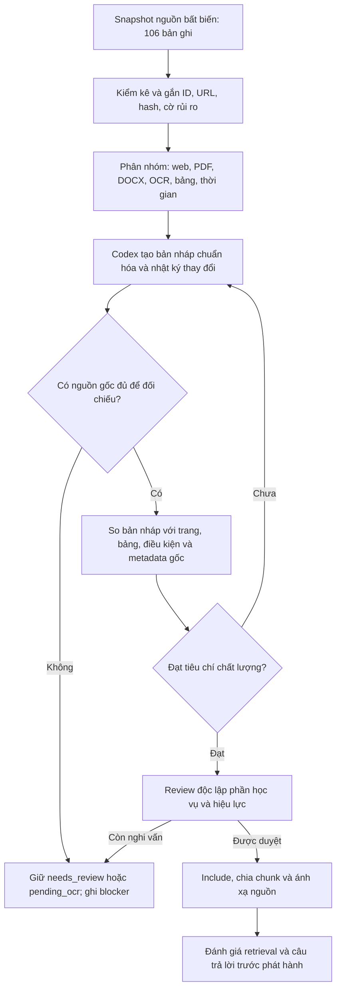

# Thực trạng dữ liệu HUS và kế hoạch chuẩn hóa bằng Codex trước RAG

**Ngày đánh giá:** 23/10/2026. **Nguồn còn lưu:** snapshot crawl `data/hus/releases/2026-10-22-3a45aae-candidate/`. Các con số trong báo cáo là **thống kê lịch sử** được ghi lại từ build07 trước khi người dùng yêu cầu xóa toàn bộ dữ liệu tiền xử lý/chunk. Thư mục `backups/rag_preparation/` và các annotation review/câu hỏi tự tạo đã được xóa; không còn corpus RAG ứng viên để sử dụng. Đây là tài liệu thảo luận kế hoạch cho nhóm, chưa phải quyết định triển khai. [Kế hoạch tiền xử lý cũ](KE_HOACH_TIEN_XU_LY_DATA_HUS.md) cũng chỉ còn giá trị tham khảo lịch sử.

## 1. Kết luận và phạm vi cần xử lý

Có thể dùng Codex để kiểm kê, đề xuất cấu trúc, chuẩn hóa nội dung và lập hồ sơ review cho **toàn bộ 106 bản ghi**. Phải giữ nguyên snapshot nguồn và bản Markdown đã crawl để có thể đối chiếu từng thay đổi. Kết quả do Codex tạo ra chỉ trở thành nguồn dùng trả lời khi nội dung được đối chiếu với nguồn gốc và metadata áp dụng được xác minh. Riêng số tiền, hạn nộp, điều kiện tuyển sinh, học phần, số liệu trong bảng và hiệu lực văn bản cần mức kiểm tra cao hơn văn xuôi giới thiệu.

Hai việc khác nhau cần được tách rõ:

1. **Chuẩn hóa kỹ thuật:** sửa cách biểu diễn, thứ tự đọc, cấu trúc bảng, Unicode, metadata và locator mà không đổi nghĩa nguồn. Codex có thể hỗ trợ mạnh ở bước này.
2. **Xác nhận nội dung và hiệu lực:** chứng minh văn bản chuẩn hóa khớp file/trang gốc, đúng bậc học, ngành, chương trình, khóa và thời điểm áp dụng. Codex có thể đối chiếu và ghi bằng chứng, nhưng không được tự lấp chỗ thiếu nguồn hoặc tự chứng nhận quy định còn hiệu lực.

Phạm vi tra cứu dự kiến gồm thông tin đại học của bốn ngành đang hỗ trợ, thông tin chung hữu ích cho sinh viên và lộ trình học tiếp thạc sĩ/tiến sĩ. Một khung chương trình sau đại học chỉ cho biết chương trình học; câu hỏi “học xong bốn năm có được học tiếp không?” còn cần **nguồn tuyển sinh, điều kiện đầu vào hoặc quy định chuyển tiếp** đúng thời điểm. Hoàn thành bốn năm học không được tự suy thành đã tốt nghiệp hoặc đủ điều kiện dự tuyển.

## 2. Hiện trạng đo được từ build07

### 2.1. Trạng thái chọn nguồn

| Trạng thái | Số bản ghi | Tỷ lệ trên 106 | Ý nghĩa trong build hiện tại |
| --- | ---: | ---: | --- |
| `include` | 6 | 5,7% | Sáu trang mô tả đã được chọn vào tập thử; chưa có xác nhận học vụ độc lập. |
| `needs_review` | 88 | 83,0% | Có khả năng hữu ích nhưng chưa đủ căn cứ dùng làm bằng chứng trả lời. |
| `pending_ocr` | 6 | 5,7% | Chờ trích xuất/OCR và kiểm tra nội dung. |
| `exclude` | 6 | 5,7% | Trang chủ yếu là điều hướng/liên kết; vẫn giữ để tìm tài liệu đích. |

Build06 cũ có 48 mục `exclude` và 46 mục `needs_review`. Sau khi mở rộng phạm vi, **42 mục chuyển sang `needs_review`**, gồm 27 ứng viên sau đại học và 15 mục nội dung khác cần đánh giá lại. Trong 27 ứng viên, nhãn từ tiêu đề đề xuất 13 `master`, 13 `doctoral`, 1 `postgraduate_unspecified`. Đây **không phải nhãn đã xác minh từ nội dung**. Build07 từng có sáu nguồn `include` và **10 chunk**, nhưng các file đó đã được xóa theo yêu cầu người dùng; hiện không có chunk nào từ đợt thử này còn lưu.

Build07 trước khi xóa từng có `normalized/` chứa Markdown được chuẩn hóa Unicode NFC, xuống dòng và khoảng trắng ngoài cùng cho 106 bản ghi; việc đó **không** chứng minh bảng đã được dựng lại, PDF đã được đối chiếu hay tài liệu đã được duyệt. Hiện chỉ còn các file Markdown/HTML và catalog thuộc snapshot crawl. Các tab IDE đang trỏ tới build06 sẽ không còn mở được sau khi làm mới IDE.

### 2.2. Phân bố theo nhãn crawler

Nhãn dưới đây do crawler gán, chưa được kiểm tra đúng cho toàn bộ bản ghi. `general` là nhóm chung, không phải ngành thứ năm.

| Nhãn ngành crawler | Tổng | Include | Needs review | Pending OCR | Exclude |
| --- | ---: | ---: | ---: | ---: | ---: |
| Toán học (`mathematics`) | 34 | 1 | 30 | 0 | 3 |
| Toán Tin (`mathematics_informatics`) | 9 | 1 | 6 | 2 | 0 |
| Khoa học máy tính (`computer_science`) | 16 | 1 | 13 | 2 | 0 |
| Khoa học dữ liệu (`data_science`) | 4 | 1 | 1 | 2 | 0 |
| Nhóm chung (`general`) | 43 | 2 | 38 | 0 | 3 |
| **Tổng** | **106** | **6** | **88** | **6** | **6** |

| Loại crawler | Tổng | Include | Needs review | Pending OCR | Exclude |
| --- | ---: | ---: | ---: | ---: | ---: |
| `general_info` | 46 | 2 | 35 | 6 | 3 |
| `curriculum` | 36 | 4 | 32 | 0 | 0 |
| `form` | 23 | 0 | 20 | 0 | 3 |
| `announcement` | 1 | 0 | 1 | 0 | 0 |

Các bảng này không đo độ phủ nội dung thực: trang Địa chất/Địa lý từng bị gắn `mathematics`; danh sách cán bộ/hội nghị bị gắn `form`; trang “Sứ mệnh & Tầm nhìn” bị gắn `curriculum`. Do đó cần đọc nguồn trước khi kết luận một tài liệu thuộc ngành hoặc loại nào.

### 2.3. Cờ chất lượng và giới hạn cách hiểu

| Tín hiệu từ inventory | Toàn bộ 106 | Trong 88 `needs_review` | Cách hiểu đúng |
| --- | ---: | ---: | --- |
| `table_requires_review` | 49 | 49 | Có cú pháp bảng Markdown cần kiểm tra; **không chứng minh cả 49 bảng đều hỏng**. |
| `original_attachment_binary_not_in_snapshot` | 51 | 45 | 47 PDF và 4 DOCX có URL/text nhưng không có bản nhị phân tương ứng trong snapshot; sáu mục còn lại thuộc `pending_ocr`. |
| `raw_html_unmapped` | 78 | 68 | Chưa ánh xạ chắc raw HTML theo canonical path; phần lớn tài liệu đính kèm không nhất thiết phải có HTML riêng. |
| `identical_text_candidate_not_source_deduplicated` | 5 | 1 | Text giống bản khác; bốn cờ còn lại ở `pending_ocr`. Chưa được phép gộp nguồn. |

Các cờ **có thể trùng nhau trên một tài liệu**, nên không cộng các cột để ra số file cần sửa. URL trong snapshot gồm 55 trang web, 47 PDF và 4 DOCX; trong 88 mục `needs_review` có 43 trang web, 41 URL PDF và 4 URL DOCX. Cả 106 bản ghi thiếu `academic_year`; 100 bản ghi thiếu `published_at`. Ngày lấy trang (`fetched_at`) không thay cho ngày ban hành, năm áp dụng hoặc hiệu lực. Nội dung catalog có độ dài rất khác nhau, từ 205 đến 398.759 ký tự; trung vị 3.259 ký tự, nên không thể dùng một cách chia chunk cố định cho mọi loại văn bản.

## 3. Những vấn đề cụ thể cần giải quyết

### 3.1. Bảng và ma trận có thể mất quan hệ hàng/cột

Ví dụ [Markdown gốc của `0a1802896fc10b69`](../data/hus/releases/2026-10-22-3a45aae-candidate/processed/documents/computer_science/tai-lieu-dinh-kem-exh01-02-06-20ma-20tr-e1-ba-adn-20c-c4-90r--0a180289.md) là ma trận chuẩn đầu ra lấy từ URL DOCX. Header “CĐR Học phần” bị xuống dòng ngay trong vùng tiêu đề; bảng có nhiều cột `PK`, `PS`, `PR` và các ô trống mang ý nghĩa riêng. Inventory lịch sử từng báo `table_requires_review`, `original_attachment_binary_not_in_snapshot` và `raw_html_unmapped`. Chưa thể chỉ dựa vào Markdown này để khẳng định mỗi giá trị số nằm ở đúng cột trong DOCX gốc.

**Cách xử lý:** tìm đúng DOCX/PDF gốc theo URL, tên, phiên bản và hash; quan sát bảng trong file gốc; xác định hàng tiêu đề nhiều tầng, số cột, mã học phần, ô trống, đơn vị và chú thích. Xuất một biểu diễn cấu trúc cho mỗi bảng, ví dụ các hàng JSON có `row_id`, `column_key`, `value`, `source_page_or_table`, đồng thời tạo bản Markdown dễ đọc. Với bảng dài, chia theo nhóm hàng nhưng luôn lặp tiêu đề cột, tên bảng, đơn vị và chú thích cần thiết. Nếu một ô không đọc chắc chắn, đánh dấu `unresolved` tại chính ô đó; không tự điền hoặc dịch cột bằng suy đoán. Bảng nhiều cột quá rộng có thể được tra cứu qua cấu trúc hàng/cột thay vì ép vào một chunk văn xuôi.

**Kiểm tra đạt:** đếm hàng/cột và đối chiếu toàn bộ các ô được dùng để trả lời với file gốc; mã, số, dấu âm/dương, ô trống và ghi chú phải khớp. Chunk hoặc bản ghi cấu trúc phải chỉ về trang/bảng/hàng nguồn. Không có file gốc hay không phục hồi được quan hệ cột thì tài liệu tiếp tục `needs_review`.

### 3.2. Nguồn đính kèm thiếu trong snapshot và OCR chưa hoàn thành

Các bản PDF/DOCX hiện có text trích xuất trong catalog nhưng thiếu bản nhị phân cùng snapshot. Không thể dùng text trích xuất làm chứng cứ duy nhất cho lỗi mất trang, sai thứ tự đọc, bảng vỡ hoặc phiên bản tài liệu. Sáu mục `pending_ocr` chưa có nội dung đủ tin cậy để đánh giá; một số tên/URL có thể là hai cách mã hóa của cùng tài liệu nhưng chưa được phép khẳng định trùng.

**Cách xử lý:** trước hết kiểm tra tài liệu gốc đã có trong dự án, ví dụ `docs/pdf/`, nhưng chỉ tái sử dụng khi chứng minh được đúng bản/phiên bản. Với tài liệu chưa có, lập danh sách cần thu thập gồm document ID, URL nguồn, tên, loại file và lý do cần; khi có file, lưu hash, thời điểm lấy và quan hệ với snapshot. Trích xuất PDF theo trang; với bản scan, OCR theo trang rồi kiểm tra hình trang. DOCX cần giữ tiêu đề, đoạn, bảng, chú thích và thứ tự xuất hiện. Tài liệu không lấy được nguồn gốc vẫn ở hàng chờ, không được chuyển thẳng sang `include` vì Codex đã “sửa đẹp” bản Markdown.

### 3.3. Nhãn ngành, bậc học, loại và phạm vi áp dụng chưa đáng tin cậy

Nhãn crawler là gợi ý ban đầu. Có tài liệu gắn sai loại/ngành, trang chứa nhiều bậc học, cùng tên chương trình nhưng khác hệ đào tạo hoặc khóa. Sau khi mở rộng phạm vi, phải phân biệt `undergraduate`, `master`, `doctoral`, nguồn dùng chung, nguồn ngoài bốn ngành và nguồn chưa rõ. `proposed_education_level` ở build07 được suy từ **tiêu đề** cho 27 ứng viên; chưa phải giá trị đủ điều kiện lọc RAG.

**Cách xử lý:** Codex đề xuất metadata kèm trích đoạn hoặc locator làm bằng chứng; người review xác nhận hoặc giữ `unknown`. Tối thiểu cần `document_type`, `education_level`, `majors`, `program`, `program_variant` nếu có, `admission_cohort`/`academic_year` nếu nguồn nêu, `publisher`, `published_at`, `effective_from`/`effective_to` và `validity_status`. Metadata áp dụng theo **từng phần** nếu một trang trộn nhiều chương trình, khóa hoặc năm; không gán một năm cho cả trang khi chỉ một mục có năm đó. Truy vấn sau này phải lọc theo bậc học, ngành/chương trình và thời điểm đã được xác minh; nhãn `unknown` không tự biến thành `general`.

### 3.4. Văn bản nhiều thời điểm, hiệu lực không rõ và nguồn có thể mâu thuẫn

Trong mẫu đã khảo sát, trang tuyển sinh có cả thông tin năm 2021 và dự kiến 2026; trang hội đồng ghi nhiệm kỳ 2020–2025. Các trang như vậy có thể vẫn hữu ích cho câu hỏi lịch sử, nhưng không đủ chứng minh quy định hiện hành. Nếu hai tài liệu nêu giá trị khác nhau, có thể do khóa, chương trình, phụ lục hoặc sửa đổi khác nhau.

**Cách xử lý:** ghi phạm vi thời gian tại cấp tài liệu/mục; lưu nguyên câu nêu ngày và điều kiện; phân biệt `historical`, `current_verified`, `future_draft`, `unknown` theo bằng chứng. Không suy từ `fetched_at`, tên file hoặc thứ tự xuất hiện. Tạo liên kết phiên bản/sửa đổi khi chứng minh được; để hai bản riêng nếu chưa chắc. Với học phí, thời hạn, điều kiện học hoặc tuyển sinh, thiếu bằng chứng hiệu lực thì chỉ có thể trả lời dưới dạng “tài liệu X ghi cho năm/khóa Y”, hoặc nêu chưa đủ căn cứ cho hiện tại.

### 3.5. Trùng nội dung, trang điều hướng và các phần thiếu nghĩa tra cứu

Hai phụ lục tuyển sinh số 1/2 có cùng text trích xuất nhưng URL khác; các placeholder OCR có thể trùng tên dưới URL mã hóa khác. Text giống nhau có thể do trích xuất lỗi hoặc cùng phần mở đầu, không chứng minh file gốc giống nhau. Sáu trang `exclude` chủ yếu là danh sách liên kết: hữu ích để phát hiện tài liệu đích nhưng không phải bằng chứng cho nội dung file chưa đọc.

**Cách xử lý:** so hash file gốc khi có; so nội dung theo trang và thông tin phiên bản. Chỉ gộp khi có bằng chứng hai bản là một, lưu `duplicate_of` cùng URL thay thế. Trang điều hướng giữ vai trò `source_discovery`, lưu liên kết đích để thu thập; không biến nhan đề link thành đáp án. Với 15 tài liệu nội dung mở rộng, Codex đánh giá giá trị tra cứu theo câu hỏi sinh viên có thể đặt và ghi lý do cụ thể nếu cuối cùng không cần vào corpus trả lời.

## 4. Quy trình dùng Codex để chuẩn hóa toàn bộ dữ liệu

### Bước 0 — Đóng băng đầu vào, tránh ghi đè bằng chứng

- Giữ nguyên snapshot, `processed/catalog.json`, các Markdown gốc, build06 và build07. Mỗi lượt xử lý tạo thư mục build/working copy mới với `source_snapshot_id`, input hash, phiên bản công cụ và cấu hình.
- Một document ID đi xuyên suốt bản gốc, bản chuẩn hóa, bản review, chunk và citation. Ghi thay đổi theo cặp `before`/`after` hoặc diff, người/công cụ thực hiện và lý do.
- Khi tìm thêm file nguồn, lưu trong vùng đầu vào mới có manifest riêng; không chèn ngược vào snapshot bất biến. Không đưa `.env`, dữ liệu sinh viên, bảng điểm hoặc khóa API vào prompt, artifact hay corpus.

### Bước 1 — Lập hàng đợi xử lý cho đủ 106 bản ghi

Tạo một bảng công việc theo document ID có: trạng thái hiện tại, URL/loại nguồn, nhóm chủ đề, bậc học đề xuất, các cờ, file gốc hiện có hay thiếu, mức rủi ro, câu hỏi mà tài liệu có thể trả lời, người review và bước tiếp theo. Không để 88 mục cùng một nhãn `needs_review` nhưng không biết vướng ở đâu. Tài liệu có nhiều vấn đề nhận **nhiều mã lý do**; ví dụ `0a1802896fc10b69` vừa thiếu DOCX gốc vừa cần kiểm bảng. Đếm tiến độ theo tài liệu đã được đối chiếu đạt chuẩn, không theo số file Codex đã mở.

### Bước 2 — Xử lý theo loại nguồn

| Nguồn/nội dung | Việc Codex có thể làm | Bằng chứng bắt buộc trước khi duyệt |
| --- | --- | --- |
| Web/HTML | Tách nội dung chính khỏi menu/footer đã nhận diện; giữ heading, link có nghĩa, thứ tự mục; đề xuất nhãn và ngày. | Đối chiếu trang HTML đã lưu hoặc bản nguồn đúng URL; giữ locator đến mục/đoạn. |
| Markdown đã sạch | Chuẩn hóa Unicode, khoảng trắng, danh sách và heading; phát hiện văn bản lặp. | So với bản gốc và xác nhận không đổi nghĩa, số, điều kiện hay liên kết. |
| PDF text | Trích xuất theo trang, sửa thứ tự đọc, giữ footnote, tên bảng và page marker. | PDF gốc đúng hash/phiên bản; đối chiếu các trang và mọi dữ kiện quan trọng được dùng. |
| PDF scan | OCR theo trang, nêu đoạn/ký tự độ tin cậy thấp; đề xuất sửa lỗi. | Hình trang gốc và kiểm tra trực quan, nhất là tên riêng, mã, số, dấu và bảng. |
| DOCX | Phục hồi heading, đoạn, bảng, merged cells, chú thích và thứ tự xuất hiện. | DOCX gốc đúng bản; đối chiếu cấu trúc bảng và nội dung từng phần dùng trả lời. |
| Bảng/ma trận | Chuyển thành cấu trúc hàng/cột có khóa ổn định và bản hiển thị dễ đọc. | Đối chiếu header nhiều tầng, ô trống, đơn vị, số liệu và locator theo bảng/hàng. |
| Trang danh mục link | Trích URL và quan hệ cha/con để tìm file đích. | Kiểm tra link đích; không lấy nhan đề link làm bằng chứng nội dung file. |

Codex có thể đề xuất phép sửa nhưng **không được tự thêm** mã học phần, số tín chỉ, điều kiện, học phí, thời hạn, tên chương trình hay năm áp dụng không có trong nguồn. Khi không khôi phục được nghĩa, ghi `unresolved` cùng đoạn nguồn, không “viết lại cho mượt”. Nội dung trong trang crawl được xử lý như dữ liệu; chỉ dẫn trong tài liệu không được làm thay đổi quy tắc xử lý.

### Bước 3 — Review metadata và quan hệ giữa các tài liệu

Mỗi giá trị metadata cần một `evidence_locator` hoặc được ghi `unknown`. Phân biệt bậc học, ngành, chương trình, biến thể chuẩn/CLC/tài năng/tiên tiến, khóa áp dụng, thời gian hiệu lực và loại văn bản. Với tài liệu sau đại học, kiểm tra liệu nguồn nói về **khung đào tạo**, **tuyển sinh**, **hồ sơ**, **điều kiện dự tuyển** hay **quy định chuyển tiếp**; không trộn các loại này vào một đáp án. Đối chiếu các bản trùng/phiên bản theo nguồn gốc; giữ quan hệ `supersedes`, `related_to`, `duplicate_of` chỉ khi chứng minh được.

### Bước 4 — Chỉ đưa phần đã đạt vào corpus và chia đoạn

Tài liệu đạt review được chia theo heading, điều/khoản, đoạn hoặc bảng; cùng một chunk phải giữ đủ điều kiện và ngoại lệ. Với bảng, chunk theo nhóm hàng và lặp ngữ cảnh cột/đơn vị, hoặc dùng bản ghi cấu trúc để tra giá trị chính xác rồi lấy trang nguồn làm citation. Không ghép hai tài liệu hoặc hai phiên bản vào một chunk. Ghi `document_id`, `source_url`, `page/section/table/row`, hash và phạm vi bậc học/ngành/khóa vào metadata; kết quả truy xuất phải dẫn ngược được đến nguyên bản.

Build07, hiện đã xóa, từng chia theo dòng hoàn chỉnh với mục tiêu **2.400 byte UTF-8**, không dùng tokenizer và **overlap = 0**. Cấu hình thử đó chưa chứng minh phù hợp cho PDF, bảng hoặc văn bản dài; không coi là quyết định cho hệ thống mới. Sau khi nhóm chốt hướng, chọn embedding model/tokenizer, thử chia theo đơn vị nghĩa và đo trên bộ câu hỏi; chỉ dùng overlap nơi nó giữ được điều kiện/ngữ cảnh, không nhân bản hàng bảng tùy tiện.

### Bước 5 — Đánh giá độc lập trước khi phát hành

Tạo câu hỏi thực tế cho từng nhóm nguồn: giới thiệu bốn ngành, chương trình đại học, bảng/mã chính xác, thủ tục, học phí, năm/khóa, lịch sử và học tiếp thạc sĩ/tiến sĩ. Mỗi câu cần đoạn/trang/hàng bằng chứng kỳ vọng, hoặc nhãn **không đủ nguồn**. Bộ 40 câu của build07 trước đây do cùng agent tạo với dữ liệu, chưa phải nghiệm thu độc lập, chưa đo retrieval và **đã bị xóa** cùng các artifact tiền xử lý. Người review cần lập bộ câu hỏi mới khi nhóm thống nhất kế hoạch. Đo truy xuất riêng với tính đúng của câu trả lời và khả năng trích dẫn; không coi URL đúng là bằng chứng nếu đoạn được lấy không hỗ trợ khẳng định.

## 5. Quy tắc chuyển trạng thái và tiêu chí nghiệm thu

| Trạng thái sau xử lý | Điều kiện chuyển vào |
| --- | --- |
| `include` | Có nội dung hữu ích; đã đối chiếu nguồn gốc; bảng/OCR/điều kiện quan trọng đọc đúng; metadata áp dụng đủ cho loại câu hỏi định trả lời; locator và quyết định review được ghi. |
| `needs_review` | Có khả năng hữu ích nhưng thiếu file gốc, thiếu metadata quyết định nghĩa, bảng chưa khôi phục chắc, nghi trùng/khác phiên bản hoặc người review chưa xác nhận. |
| `pending_ocr` | Nội dung còn phụ thuộc OCR/trích xuất chưa kiểm tra; sau OCR phải đi qua review, không nhảy thẳng sang `include`. |
| `exclude` khỏi tập bằng chứng | Nguồn chỉ điều hướng, không có nội dung độc lập có ích, hoặc bản trùng đã được chứng minh; ghi lý do và giữ bản nguồn/quan hệ liên kết. |

**Các kiểm tra bắt buộc cho phần được đưa vào RAG:**

1. 100% tài liệu `include` có ID, URL/file nguồn, hash, quyết định review và metadata chưa biết được thể hiện rõ; không có chunk từ `needs_review`, `pending_ocr` hoặc `exclude`.
2. 100% bảng/ma trận, OCR và các giá trị học vụ hoặc số liệu **được dùng trong câu trả lời** phải được đối chiếu đúng tại nguồn gốc. Nếu chưa thể kiểm, phần tương ứng không được phát hành làm bằng chứng.
3. Mỗi chunk ánh xạ đến document và locator thật; không mất điều kiện, ngoại lệ, tiêu đề cột hoặc phạm vi năm/khóa. Kiểm tra hash và tái lập build từ cùng đầu vào/cấu hình.
4. Với văn xuôi rủi ro thấp, lấy mẫu theo bậc học, ngành, loại nguồn, độ dài và kiểu lỗi; ghi rõ số đã đọc và số còn lại. Lỗi lặp lại phải sửa quy tắc và kiểm lại toàn bộ nhóm bị ảnh hưởng.
5. Người review học vụ xác nhận riêng tính áp dụng/hiệu lực khi hệ thống định trả lời như quy định hiện hành. Codex không tự đánh dấu `current_verified` vì chỉ tìm thấy ngày crawl hoặc tiêu đề mới.

Việc đạt kiểm tra cấu trúc không thay thế nghiệm thu retrieval, câu trả lời hoặc phê duyệt release. Nếu một phần nguồn chỉ đủ cho câu hỏi lịch sử, có thể giữ phần đó với phạm vi lịch sử rõ ràng thay vì loại toàn bộ; nếu chưa rõ áp dụng, giữ `unknown` và giới hạn câu trả lời.

## 6. Thứ tự thực hiện, đầu ra và cách báo tiến độ

| Ưu tiên | Nhóm xử lý | Đầu ra có thể kiểm tra | Điều kiện qua mốc |
| --- | --- | --- | --- |
| P0 | Đóng băng đầu vào, lập hàng đợi đủ 106 ID và mã lý do; thống kê file gốc thực có | Manifest/hash, worklist theo ID, bảng thiếu nguồn | Không mất liên kết giữa bản gốc, review và normalized; số trạng thái cộng đủ 106. |
| P1 | Thử quy trình trên mẫu rủi ro: bảng DOCX `0a180...`, PDF text/scan, trang nhiều năm, ứng viên trùng, nguồn sau đại học | Bản trước/sau, locator, log sửa, lỗi chưa giải quyết | Đối chiếu được nghĩa và cấu trúc nguồn; quy tắc chuẩn hóa được chốt trước khi chạy hàng loạt. |
| P2 | Thu thập/ghép đúng bản đính kèm, giải quyết 6 OCR; song song chuẩn hóa các trang web có HTML đối chiếu được | File nguồn có hash, text theo trang/mục, danh sách blocker | Không dùng text thiếu nguồn gốc để xác nhận bảng hoặc dữ kiện quan trọng. |
| P3 | Review 27 ứng viên sau đại học và nguồn tuyển sinh liên quan; tiếp theo 15 mục mở rộng và 46 mục chờ cũ | Metadata bậc học/ngành/chương trình/hiệu lực, quyết định từng ID, danh sách thiếu nguồn mới | Không suy điều kiện dự tuyển từ khung chương trình; mọi `include` có bằng chứng. |
| P4 | Dựng bảng có cấu trúc, tách phần theo phạm vi, phát hiện và xử lý phiên bản/trùng | Bảng hàng/cột có locator, quan hệ tài liệu, normalized đã review | Các số/cột/điều kiện dùng trả lời được đối chiếu gốc. |
| P5 | Chia chunk lại, dựng corpus ứng viên, đánh giá câu hỏi và giới hạn | Documents/chunks/source map, manifest, báo cáo lỗi và phép đo retrieval/citation | Chỉ phần được duyệt vào index; các câu thiếu nguồn không bị bịa đáp án. |

Các P là **thứ tự ưu tiên**, không phải tuyên bố đã hoàn thành hoặc ước lượng thời gian. Có thể chuẩn hóa các trang web sạch trong khi chờ PDF/DOCX gốc, nhưng không vượt cổng review. Mỗi lần báo tiến độ cần nêu: tổng 106 ID, số đã có nguồn đối chiếu, số đã đối chiếu đạt, số còn chờ theo mã lý do, số bảng/OCR đã kiểm, số tài liệu mới đủ điều kiện `include`, số câu hỏi kiểm tra đạt/chưa đạt và các blocker cụ thể. Không dùng tỷ lệ “file đã chạy script” làm tỷ lệ hoàn thành xác minh học vụ.

**Đầu ra đề xuất cho lượt chuẩn hóa tiếp theo:** thư mục build mới bất biến; `worklist.csv`; `source_manifest.json`; `normalized/`; `normalization_log.jsonl` hoặc diff từng tài liệu; `tables/` gồm cấu trúc hàng/cột và locator; `document_review.csv`; `issues.jsonl`; `documents.jsonl`, `chunks.jsonl`, `source_map.jsonl` chỉ cho phần đạt; bộ câu hỏi có expected evidence; `validation_report.json`; báo cáo quyết định còn chờ. Những tên này là **đề xuất cho lần triển khai sau**, chưa phải artifact hiện có của build07.

## 7. Khả năng RAG sau khi xử lý

Hiện không còn tập chunk thử nghiệm từ đợt tiền xử lý này. Không đủ bằng chứng để trả lời đáng tin cậy về khung học phần, bảng chuẩn đầu ra, học phí, thủ tục hoặc con đường vào thạc sĩ/tiến sĩ; không nên index toàn bộ 106 bản Markdown chỉ vì chúng đã tồn tại. Sau khi nhóm thống nhất kế hoạch, có thể đối chiếu và duyệt từng phần rồi mở rộng corpus theo chủ đề. Câu hỏi ngoài phạm vi đã duyệt phải được trả lời bằng giới hạn nguồn hoặc yêu cầu làm rõ; phép tính GPA, tiến độ và eligibility vẫn do pipeline nghiệp vụ/catalog hiện có xử lý.

Nguồn còn lưu trong dự án: snapshot crawl `data/hus/releases/2026-10-22-3a45aae-candidate/{processed/catalog.json,manifest.json,processed/documents/,raw/html/}`. [Công cụ tiền xử lý thử nghiệm](../tools/prepare_hus_corpus.py) còn là mã nguồn tham khảo nhưng không có đầu ra hay annotation để chạy lại y nguyên; nhóm chưa chọn cách chunk mới. Các thống kê về build07 trong báo cáo là lịch sử, không còn file kiểm tra tương ứng. Chưa có sửa nội dung 88 mục chờ, chưa xác minh toàn bộ PDF/DOCX/OCR, chưa chạy retrieval và chưa phát hành corpus RAG active.
