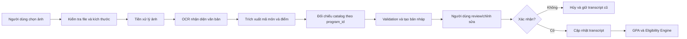

# Module 09 — Nhập bảng điểm từ ảnh bằng OCR

## Trạng thái

**Planned** — đây là đặc tả để phân việc, chưa có code implementation và chưa có endpoint chạy thật.

## 1. Mục tiêu

Cho phép sinh viên tải ảnh bảng điểm lên để hệ thống nhận diện các dòng môn học, mã môn và điểm hệ 10. Kết quả OCR chỉ là bản nháp để người dùng kiểm tra; hệ thống chỉ cập nhật bảng điểm sau khi người dùng xác nhận.

Module phải giữ các nguyên tắc hiện có:

- Luôn gắn kết quả với đúng `program_id` đang chọn.
- Không để OCR tự quyết định điều kiện học phần.
- Không để OCR tự mở khóa môn học.
- Không ghi dữ liệu sinh viên thật vào database trong phạm vi demo.
- Không làm thay đổi bảng điểm hiện tại nếu nhận diện lỗi hoặc người dùng hủy.

## 2. Trải nghiệm người dùng

### 2.1. Điểm bắt đầu

Trong khu vực nhập bảng điểm, người dùng chọn chức năng **Nhập từ ảnh** và chọn một hoặc nhiều ảnh bảng điểm theo phạm vi được chốt ở giai đoạn triển khai.

Trước khi tải ảnh, giao diện cần hiển thị hướng dẫn ngắn:

- Ảnh phải rõ, đủ sáng, không bị cắt mất mã môn hoặc điểm.
- Không tải ảnh chứa thông tin không cần thiết.
- Kết quả nhận diện phải được kiểm tra trước khi áp dụng.

### 2.2. Màn hình xem kết quả

Sau khi xử lý, giao diện hiển thị:

- Ảnh gốc hoặc bản xem trước.
- Số dòng đã nhận diện.
- Danh sách từng dòng nhận diện.
- Mã môn dự đoán.
- Tên môn đối chiếu từ catalog ngành đang chọn.
- Điểm hệ 10 nếu nhận diện được.
- Mức độ tin cậy nếu engine OCR cung cấp.
- Cảnh báo đối với dòng thiếu mã, thiếu điểm hoặc không khớp catalog.

Người dùng có thể sửa mã môn, sửa điểm, chọn hoặc bỏ chọn từng dòng và loại bỏ dòng sai.

### 2.3. Xác nhận

Nút **Áp dụng dòng đã chọn** chỉ hoạt động khi các dòng được chọn đã qua validation tối thiểu. Khi xác nhận:

1. Đối chiếu lại ngành học hiện tại.
2. Đối chiếu lại mã môn với catalog hiện tại.
3. Chuẩn hóa điểm hệ 10.
4. Ghi vào transcript trong bộ nhớ trình duyệt hoặc session hiện tại.
5. Chạy lại GPA, transcript summary và Eligibility Engine.
6. Xóa kết quả recommendation cũ vì đầu vào đã thay đổi.

## 3. Pipeline OCR dự kiến

### 3.1. Kiểm tra đầu vào

- Chỉ nhận định dạng ảnh được hỗ trợ.
- Giới hạn dung lượng và số pixel để tránh quá tải tài nguyên.
- Từ chối file rỗng, file sai MIME hoặc file không phải ảnh thật.
- Có thể giới hạn số ảnh trong một lần xử lý.
- Không lưu file ảnh lâu hơn thời gian cần thiết cho phiên xử lý.

### 3.2. Tiền xử lý

Pipeline có thể gồm các bước sau, tùy engine được chọn:

- Xoay ảnh theo hướng đọc được.
- Cắt vùng bảng điểm nếu xác định được.
- Chuyển grayscale.
- Tăng tương phản và giảm nhiễu.
- Phóng to ảnh có độ phân giải thấp.
- Giữ bản gốc để người dùng đối chiếu khi review.

Tiền xử lý không được làm mất mã môn hoặc điểm trong ảnh gốc.

### 3.3. Nhận diện và chuẩn hóa

OCR trả văn bản và tọa độ dòng nếu engine hỗ trợ. Bộ trích xuất tìm các mẫu mã môn trong catalog ngành đang chọn, sau đó tìm điểm gần mã môn trong cùng dòng hoặc vùng tương ứng.

Các giá trị cần chuẩn hóa:

- Khoảng trắng thừa trong mã môn.
- Ký tự dễ nhầm giữa chữ và số.
- Dấu phẩy hoặc dấu chấm trong điểm.
- Điểm hệ 10 trong khoảng từ 0 đến 10.

Khi không đủ bằng chứng, trường dữ liệu phải để trống và tạo cảnh báo. Không được tự đoán điểm hoặc tự coi môn là đã đạt.

## 4. Schema dự kiến

### 4.1. Request

| Trường | Kiểu dự kiến | Bắt buộc | Mô tả |
|---|---|---:|---|
| `program_id` | `string` | Có | Ngành đang được chọn |
| `image` | file ảnh | Có | Ảnh bảng điểm |
| `session_id` | `string` | Không | Mã phiên nếu hệ thống cần liên kết session |

### 4.2. Một dòng nhận diện

| Trường | Kiểu dự kiến | Mô tả |
|---|---|---|
| `course_code` | `string \| null` | Mã môn sau chuẩn hóa |
| `recognized_name` | `string \| null` | Tên môn đọc được từ ảnh |
| `catalog_name` | `string \| null` | Tên môn lấy từ catalog nếu mã hợp lệ |
| `grade_10` | `number \| null` | Điểm hệ 10 |
| `passed` | `boolean \| null` | Chỉ xác định sau khi có điểm hợp lệ |
| `confidence` | `number \| null` | Độ tin cậy do OCR cung cấp |
| `source_bbox` | object/null | Vùng tọa độ trong ảnh nếu cần hiển thị |
| `warnings` | danh sách chuỗi | Cảnh báo của dòng |
| `selected` | `boolean` | Người dùng có chọn áp dụng dòng này không |

### 4.3. Response bản nháp

Response dự kiến gồm:

- `program_id`.
- `records`.
- `warnings` tổng quát.
- `processing_status`.
- `engine_name` và `engine_version` nếu cần audit.
- `expires_at` nếu bản nháp được lưu tạm phía server.

Response không được trả dữ liệu của catalog ngành khác và không được coi là transcript đã xác nhận.

## 5. Validation

### 5.1. Validation file

- Kiểm tra extension, MIME và nội dung thật của file.
- Giới hạn dung lượng, kích thước ảnh và số lượng ảnh.
- Từ chối ảnh không đọc được.
- Không xử lý file vượt giới hạn tài nguyên.

### 5.2. Validation mã môn

- Mã môn phải thuộc catalog của `program_id` đang chọn.
- Chuẩn hóa mã môn trước khi đối chiếu.
- Mã không khớp phải bị đánh dấu cảnh báo và không được tự động áp dụng.
- Không chấp nhận mã môn trùng trong cùng một lần nhập nếu chưa có quy tắc gộp rõ ràng.

### 5.3. Validation điểm

- Điểm hệ 10 phải là số từ 0 đến 10.
- Điểm thiếu hoặc mơ hồ phải yêu cầu người dùng nhập lại.
- Chỉ điểm từ 5.0 trở lên mới được coi là đạt theo quy tắc hiện tại.
- Quy đổi GPA hệ 4 dùng chung bảng quy đổi của module transcript hiện tại.

### 5.4. Validation trước khi cập nhật

- `program_id` của bản nháp phải trùng ngành hiện tại.
- Không áp dụng bản nháp đã hết hạn hoặc được tạo cho catalog khác.
- Không ghi đè các môn hiện có nếu chưa có quy tắc xử lý trùng được người dùng xác nhận.
- Sau khi cập nhật phải chạy lại transcript summary và eligibility.

## 6. Review trước khi apply

Review là bước bắt buộc, không được bỏ qua kể cả khi OCR có độ tin cậy cao.

Giao diện cần cho người dùng thấy rõ:

- Dòng nào hợp lệ.
- Dòng nào có cảnh báo.
- Trường nào được OCR nhận diện.
- Trường nào người dùng đã sửa.
- Số dòng sẽ được áp dụng.
- Ngành học đang dùng để đối chiếu.

Nếu còn dòng được chọn nhưng thiếu mã môn hoặc điểm không hợp lệ, nút áp dụng phải bị khóa hoặc yêu cầu bỏ chọn/sửa dòng đó.

## 7. Lỗi và trạng thái

Các lỗi cần có thông báo dễ hiểu:

- File không phải ảnh.
- File quá lớn hoặc ảnh không đọc được.
- Engine OCR chưa được cài hoặc không sẵn sàng.
- Không nhận diện được văn bản.
- Có văn bản nhưng không tìm thấy mã môn thuộc catalog.
- Kết quả không còn thuộc ngành đang chọn.
- Dòng có điểm ngoài khoảng hợp lệ.
- Bản nháp hết hạn.
- Lỗi tạm thời khi xử lý.

Khi xảy ra lỗi, transcript hiện tại phải được giữ nguyên. Người dùng có thể đóng kết quả và thử lại bằng ảnh khác.

## 8. Bảo mật và quyền riêng tư

- Chỉ dùng dữ liệu tổng hợp trong demo; không đưa ảnh sinh viên thật vào repository.
- Không ghi ảnh hoặc văn bản OCR vào log ứng dụng.
- Xóa file tạm ngay sau khi xử lý hoặc khi session hết hạn.
- Không gửi ảnh lên dịch vụ bên ngoài nếu chưa có phê duyệt rõ ràng và thông báo cho người dùng.
- Nếu dùng OCR cloud, API key phải ở backend và không xuất hiện ở frontend.
- Giới hạn kích thước, thời gian xử lý và số request để chống lạm dụng tài nguyên.
- Escape dữ liệu OCR trước khi hiển thị để tránh chèn HTML hoặc script.
- Không dùng OCR để suy luận ngành học tự động.

## 9. Acceptance criteria

- Người dùng chọn đúng ngành rồi tải được ảnh định dạng được hỗ trợ.
- Ảnh lỗi hoặc vượt giới hạn bị từ chối với thông báo rõ ràng.
- Kết quả OCR luôn được hiển thị ở dạng bản nháp.
- Người dùng sửa được mã môn và điểm trước khi áp dụng.
- Chỉ mã môn thuộc catalog ngành hiện tại mới có thể được chọn áp dụng.
- Dòng thiếu điểm không tự động được coi là đã đạt.
- Hủy hoặc OCR lỗi không làm thay đổi transcript hiện tại.
- Áp dụng thành công làm cập nhật GPA, số tín chỉ và Eligibility Engine.
- Recommendation cũ bị xóa sau khi transcript thay đổi.
- Đổi ngành trong lúc review không cho phép áp dụng bản nháp của ngành cũ.
- Không có ảnh, điểm hoặc mã môn thật nào được ghi vào repository.
- Có thể thay engine OCR mà không thay đổi contract review và validation của hệ thống.

## 10. Phạm vi chưa làm

- Chưa chọn engine OCR cuối cùng.
- Chưa quyết định xử lý một ảnh hay nhiều ảnh trong một lần.
- Chưa triển khai nhận diện bảng nhiều trang hoặc PDF.
- Chưa tích hợp OCR cloud.
- Chưa có benchmark độ chính xác trên các mẫu bảng điểm được cho phép sử dụng.
- Chưa có code, endpoint, dependency hoặc test implementation trong module này.
