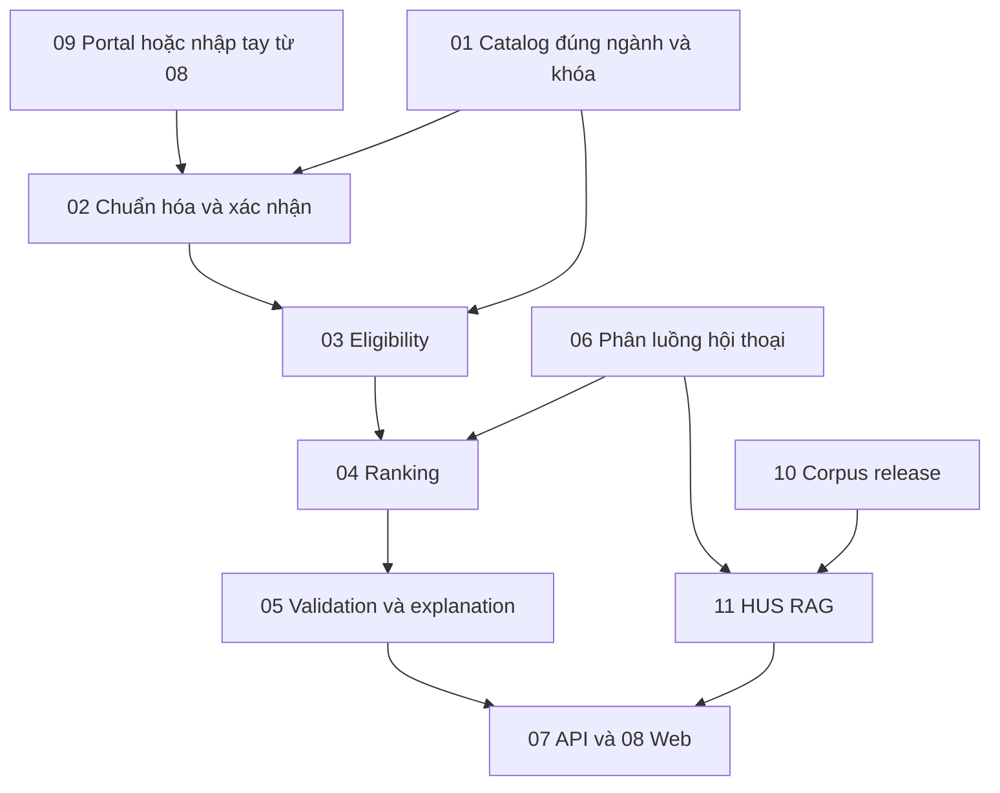

# Đặc tả và kế hoạch các module AI-07

**Tài khoản hệ thống (25/10/2026, đã triển khai local):** thêm tài khoản Sổ học tập
riêng với đăng ký/xác thực email/login/logout, admin/student và hai account mẫu
trong DB local. VNU là kết nối dữ liệu sau đăng nhập hệ thống.
Xem [Module 12](12-system-authentication.md) và
[kế hoạch chi tiết](../docs/KE_HOACH_TAI_KHOAN_HE_THONG_2026_10_25.md).
Quyết định mới này thay các giới hạn lịch sử không tạo account hệ thống riêng;
Bản local có migration, hai seed và Mailpit; xem [hướng dẫn vận hành](../docs/HUONG_DAN_TAI_KHOAN_HE_THONG.md).
SMTP thật và triển khai công khai vẫn cần nghiệm thu riêng.

**Hướng chuyển đổi mới nhất (23/10/2026):** người dùng đồng ý dùng bảng điểm
VNU làm nguồn duy nhất cho học vụ và bỏ hoàn toàn nhập tay sau khi thay thế
được backend/UI. Xem [kế hoạch chuyển đổi](../docs/KE_HOACH_CHUYEN_SANG_BANG_DIEM_VNU_2026_10_23.md).
Kế hoạch mới này thay mô tả “giữ nhập tay dự phòng” bên dưới; chưa triển khai
việc loại bỏ. Các trạng thái “chưa tích hợp portal” trong lịch sử tài liệu
cần đọc cùng [bàn giao portal local](../docs/PORTAL_INTEGRATION_STATUS_2026_10_23.md).

Cập nhật: **23/10/2026**. Phạm vi người dùng xác nhận: chỉ viết tài liệu Markdown cho từng module, chưa triển khai chức năng.

## Kiến trúc mục tiêu

Sinh viên chủ động kết nối cổng đào tạo để lấy bảng điểm; module kết nối do bạn của người dùng phụ trách. Hệ thống chính chuẩn hóa dữ liệu, cho xem trước/xác nhận, tính tiến độ, kiểm tra điều kiện rồi xếp hạng môn. Nhập tay được giữ làm phương án dự phòng.

Phạm vi mới được chốt 23/10/2026: tích hợp localhost với tài khoản/profile và lưu bảng điểm nguồn theo chủ tài khoản vào database. Chưa áp dụng dữ liệu portal vào progress/gợi ý trong đợt đầu. [Kế hoạch chi tiết](../docs/KE_HOACH_TICH_HOP_PORTAL_BANG_DIEM_2026_10_23.md) ghi migration, phiên, UI và các mốc nghiệm thu; tính năng này chưa triển khai trên main.

OCR bảng điểm được bỏ khỏi kế hoạch. OCR PDF tài liệu HUS khi cần vẫn thuộc chuẩn bị corpus tra cứu. Không đưa bảng điểm, credentials hoặc hội thoại vào corpus.

## Danh mục

| Module | Trách nhiệm | Trạng thái local |
| --- | --- | --- |
| [01 Catalog](01-curriculum-catalog.md) | Chương trình, provenance, revision/publication | Có HUS runtime; nguồn draft_unverified |
| [02 Transcript/progress](02-transcript-profile.md) | Chuẩn hóa bảng điểm và tính tiến độ | Có nhập tay; import/attempt policy chưa có |
| [03 Eligibility](03-eligibility-engine.md) | Cổng kiểm tra điều kiện tất định | Có; cần regression với dữ liệu import |
| [04 Ranking/what-if](04-preference-ranking-whatif.md) | Preference, xếp hạng và gói môn | Có; còn lỗi input và thiếu baseline revision |
| [05 Explanation/validation](05-explanation-llm-validation.md) | Kiểm tra ranker và giải thích từ facts | Có template và validation |
| [06 Advisor](06-advisor-chat.md) | Tư vấn môn và phân luồng câu hỏi | Có course advisor; chưa nối RAG |
| [07 API](07-recommendation-api.md) | Điều phối và hợp đồng tích hợp | Có API hiện hành; import/RAG chưa có |
| [08 Web](08-web-ui.md) | Workspace, review import, kết quả và chat | Có giao diện mới; import/citations chưa có |
| [09 Portal](09-portal-transcript-import.md) | Kết nối cổng và lấy bảng điểm | Connector trên feat/login đã đọc thật; chưa tích hợp main |
| [10 Corpus](10-hus-corpus-release.md) | Chuẩn bị/index/phát hành dữ liệu HUS | Có candidate 106 tài liệu; chưa active |
| [11 RAG](11-hus-rag-qa.md) | Tra cứu và trả lời có nguồn | Chưa có service runtime |
| [12 System auth](12-system-authentication.md) | Tài khoản hệ thống, email verification, admin/student, liên kết VNU | Đã triển khai local; SMTP Mailpit; production còn gate riêng |

## Luồng nghiệp vụ

Sơ đồ biểu diễn phụ thuộc nghiệp vụ; API điều phối, không yêu cầu service gọi HTTP vòng qua chính ứng dụng. Progress nằm trong module 02, không cần tạo module trùng.

## Bất biến

- Mọi context gắn đúng một ngành/khóa/catalog revision. Đổi ngành xóa transcript, draft import, recommendation/chat context; loại phản hồi cũ.
- Eligibility chạy trước ranking. LLM, importer và RAG không được tự mở khóa môn hoặc gán tương đương mã môn.
- Dữ liệu chưa biết giữ nguyên; không xác nhận offering, thời khóa biểu hoặc quyết định học vụ.
- Bảng điểm nhập tay/hội thoại dùng trong phiên. Profile và bảng điểm nguồn portal được phép lưu database theo tài khoản theo yêu cầu mới; chưa tự áp dụng vào gợi ý. Credentials portal không vào database/log/prompt/index.
- Catalog và corpus có phiên bản riêng. Runtime không crawl theo request/startup/lịch tuần.
- HUS dùng công cụ migration/publication riêng; giữ legacy database để rollback.

## Thứ tự thực hiện sau khi được yêu cầu triển khai

Sửa lỗi PDF acceptance, preference/fallback và mẫu năm học; thống nhất contract portal; triển khai chuẩn hóa/review/import; đồng bộ advisor/what-if; triển khai corpus/RAG và kiểm tra đầu cuối.

Bộ tài liệu này thay thế phạm vi OCR bảng điểm, nguồn JSON-only và demo profile bắt buộc của các đặc tả module cũ. Việc viết lại tài liệu không sửa các lỗi code hoặc chứng nhận tính năng đã hoạt động.

Tham chiếu: [audit và kế hoạch sửa](../docs/RA_SOAT_MODULE_VA_KE_HOACH_CHINH_SUA_2026_10_23.md), [kế hoạch RAG](../docs/KE_HOACH_XU_LY_DATA_RAG_HUS.md), [vận hành HUS](../database/HUS_RUNTIME.md).
